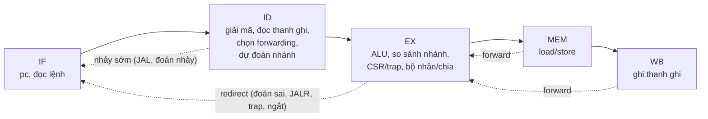

# rv32i-single-cycle

[](https://github.com/trandangduy777-cloud/rv32i-single-cycle/actions/workflows/verify.yml)

Ba lõi RISC-V tự viết bằng Verilog, dùng chung bộ kiểm chứng, đưa qua flow RTL-to-GDS (LibreLane, PDK mở IHP SG13G2 130 nm):

| Lõi | Tập lệnh | Chu kỳ tối thiểu (góc chậm) | CPI bench (RV32I / nặng M) | Số cell |
|---|---|---|---|---|
| `rv32i_core.v`: single-cycle | RV32IM + CSR + trap | ≈ 23,0 ns (ngoại suy) * | 1,00 / 7,95 | 28.775 * |
| `rv32i_pipeline.v`: 5 tầng | RV32I | ≈ 11,98 ns, ≈ 83 MHz | 1,29 / - | 36.466 |
| `rv32im_pipeline.v`: 5 tầng | RV32IM(C) + CSR + trap + ngắt + WFI, BTB + RAS | ≈ 13,67 ns, ≈ 73 MHz ** | 1,16 / 3,55 (tắt BTB/RAS, nhân lặp: 1,32 / 5,00) | 51.623 ** |
| như trên + cache 2 × 256 B, bộ đệm ghi 4 mục | RV32IMC, bộ nhớ có độ trễ | ≈ 18,76 ns, ≈ 53 MHz *** | 1,20-1,37 / 4,98-5,18 | 137.359 *** |

**Toàn bộ số liệu flow trong bảng (chu kỳ, số cell) đo trên RTL cũ, ngày 22/11/2026 trở về trước; chưa chạy lại cho RTL hiện tại** (chưa gồm BTB/RAS, bộ nhân song song, bộ đệm ghi, cache set-associative, `mtvec` vectored).  
\* Số liệu flow của single-cycle đo trên bản RV32I thuần, trước khi thêm CSR, trap và M.
\*\* Bản đầy đủ với `ENABLE_C = 1` (lệnh nén, ngắt, WFI, bắt tay bộ nhớ, `FENCE.I`), bộ nhớ tổ hợp; xem mục Flow cho bản RV32IMC. Số liệu flow đo trước khi có BTB/RAS và bộ nhân song song (sẽ chạy lại cùng các flow còn lại).
\*\*\* Mảng nhớ cache là flip-flop (chưa có macro SRAM), không đạt timing ở 15 ns; chu kỳ tối thiểu ngoại suy từ slack. Chỉ để tham khảo. Số liệu flow đo trước khi thêm bộ đệm ghi và BTB/RAS; CPI đo với bộ nhớ trễ tối đa 1 / 4 / 8 chu kỳ, khi còn bộ nhân lặp.

- **Pipeline**: forwarding tính sẵn ở ID, dự đoán nhánh ở ID (bảng đếm 2 bit 64 mục, JAL nhảy ngay ở ID), `redirect` được đăng ký ở RV32IM để cắt đường tới hạn, bộ nhân song song 2 chu kỳ, bộ chia lặp 2 bit mỗi chu kỳ.
- **CoreMark**: 2,75 CoreMark/MHz (pipeline RV32IMC, `-O2`, mô phỏng, CRC đúng chuẩn, so từng lệnh với Spike), tăng 44 % so với 1,91 khi còn bộ nhân lặp.
- **Bộ nhân song song**: Booth radix-4 + cây CSA, 1 hoặc 2 chu kỳ (tham số), chứng minh hình thức đúng với mọi cặp toán hạng 33 bit (tách bổ đề, yosys + z3), 18 đột biến đều bị bắt.
- **Ngắt so với Spike**: Spike làm thư viện, đi từng lệnh theo vết RTL; 18,9 triệu lệnh, 386.235 ngắt trên 6 cấu hình lõi khớp hoàn toàn, 23 đột biến phần ngắt đều bị bắt; `mtvec` vectored; tìm ra lỗi `mepc` mất bit 1 với lệnh nén.
- **Cache và bộ nhớ có độ trễ**: pipeline RV32IM có bắt tay bộ nhớ (`imem_ready`, `dmem_ready`), cache lệnh và cache dữ liệu set-associative tham số hoá (1 / 2 / 4 đường, pseudo-LRU), bộ đệm ghi có forward vào lần nạp dòng, bộ phân xử bus chung; chạy đúng từng lệnh so với Spike với bộ nhớ trễ ngẫu nhiên 1-8 chu kỳ mỗi từ.
- **Lệnh nén C** (tham số `ENABLE_C` của pipeline RV32IM): giải nén ở IF nên ID/EX/MEM/WB không đổi; mã của benchmark nhỏ đi khoảng 29 % mà số chu kỳ giữ nguyên. Bộ giải nén được so với GNU objdump trên toàn bộ 49.152 mã lệnh 16 bit.
- **Ngắt**: ngắt timer, ngắt phần mềm (khối `mtime`/`mtimecmp`/`msip` kiểu CLINT) và ngắt ngoài cho pipeline RV32IM, nhận chính xác ở tầng EX, cùng lệnh `WFI`; testbench riêng cho ngắt xen vào giữa vòng lặp nhân/chia/load/store hơn 300 lần, kèm 16 đột biến phần ngắt và WFI đều bị bắt.
- **Kiểm chứng**: so từng lệnh với ISS Python trên chương trình ngẫu nhiên, so từng lệnh với Spike (trình mô phỏng chuẩn của RISC-V) trên riscv-tests và benchmark, riscv-tests chính thức (rv32ui, rv32um), mutation test (42 / 28 / 66 lỗi chèn cố ý đều bị bắt), benchmark C so checksum giữa các lõi, mô phỏng gate-level trên netlist sau P&R. Kiểm chứng chạy tự động bằng GitHub Actions mỗi lần push (riêng bộ mutation mở rộng chạy khi bấm Run workflow và hàng tuần).
- **Thiết kế vật lý**: mọi run flow trong bảng đều đạt DRC, LVS, antenna; mọi số liệu flow nằm trong `results/` và `metrics.json`.



Chi tiết từng phần nằm ở các mục bên dưới; giới hạn và các điểm chưa làm được ghi ở mục cuối.

## Cấu trúc thư mục
| File | Nội dung |
|---|---|
| `rv32i_core.v` | Lõi single-cycle RV32IM + CSR + trap (chứa module `rv32m` dùng chung và bộ nhân song song `rv32_mul_csa`), bộ nhớ lệnh và dữ liệu nằm ngoài lõi |
| `tb_rv32i_core.v` | Testbench: nạp `prog.hex`, báo PASS/FAIL qua địa chỉ `0x1000` |
| `rv32i_pipeline.v` | Pipeline 5 tầng, RV32I thuần (xem mục Pipeline) |
| `tb_rv32i_pipeline.v` | Testbench tự kiểm tra cho pipeline, nạp `prog_base.hex` |
| `rv32im_pipeline.v` | Pipeline đầy đủ: RV32IM + CSR + trap + ngắt + WFI (dùng module `rv32m` trong `rv32i_core.v`) |
| `rv32c_decompress.v` | Bộ giải nén lệnh RV32C (16 bit → 32 bit), dùng ở IF của pipeline RV32IM khi `ENABLE_C = 1` |
| `rv32_icache.v`, `rv32_dcache.v`, `rv32_bus_arbiter.v` | Cache lệnh, cache dữ liệu (ghi xuyên) và bộ phân xử bus cho pipeline RV32IM |
| `cache/` | Kiểm chứng cache: testbench ngẫu nhiên, mutation test, đo hiệu năng (xem mục Cache) |
| `rvc/` | Kiểm chứng lệnh nén: so bộ giải nén với objdump trên 49.152 mã lệnh, mutation test (xem mục Mở rộng C) |
| `rv32_mtimer.v` | Bộ đếm `mtime`/`mtimecmp` 64 bit và thanh ghi `msip`, ánh xạ bộ nhớ, sinh ngắt timer và ngắt phần mềm |
| `irq/` | Kiểm chứng ngắt và WFI: chương trình `irq_test.S`, testbench `tb_irq.v`, mutation test `mutate_irq.py` (xem mục Ngắt) |
| `config_pipeline.json` | Cấu hình LibreLane cho pipeline RV32I thuần (`CLOCK_PERIOD` = 14 ns, đã chạy đạt timing) |
| `config_pipeline_full.json` | Cấu hình LibreLane cho pipeline đầy đủ (`CLOCK_PERIOD` = 15 ns, đã chạy đạt timing) |
| `config_pipeline_c.json`, `config_cached.json`, `flow/` | Cấu hình LibreLane và module đỉnh cho bản RV32IMC (đạt 15 ns) và bản có cache (không đạt), script `flow/run_flow.sh` |
| `prog_base.hex` | Chương trình test chỉ gồm RV32I thuần (229 lệnh), dùng cho pipeline |
| `asm.py` | Assembler mini sinh `prog.hex` (823 lệnh tự kiểm tra, gồm CSR/trap và M) |
| `verify/` | Mô hình tham chiếu (ISS), bộ sinh chương trình ngẫu nhiên, so vết từng lệnh, mutation test (xem `verify/README.md`) |
| `prog.hex` | Chương trình test đã sinh sẵn |
| `config.json` | Cấu hình LibreLane (`CLOCK_PERIOD` = 24 ns) |
| `metrics.json` | Số liệu flow của single-cycle RV32I (24 ns) |
| `results/` | Số liệu flow của các lõi pipeline (`metrics_*.json`), mỗi file ứng với một dòng trong bảng so sánh |
| `bench/` | Benchmark C: `bench.c` (RV32I thuần), `bench_m.c` (nặng nhân/chia) và `bench_call.c` (gọi hàm, nhảy gián tiếp), `run_bench.sh` in số chu kỳ và CPI |
| `mul/` | Bộ nhân song song: chứng minh hình thức `formal/`, testbench thử hết / biên / ngẫu nhiên `tb_mul.v`, mutation test `mutate_mul.py` (xem mục Bộ nhân song song) |
| `bpred/` | Bộ dự đoán nhánh: đo theo cấu hình BTB / RAS / gshare, kiểm hiệu năng đúng từng chu kỳ, mutation test (xem mục BTB, RAS và gshare) |
| `coremark/` | Port CoreMark (`port/`) và script build + chạy + kiểm CRC trên các lõi (xem mục CoreMark) |
| `riscv-tests/` | Môi trường tối giản và script chạy bộ test ISA chính thức riscv-tests trên cả 3 lõi |
| `cosim/` | So từng lệnh của 3 lõi với Spike: testbench `tb_cosim.v`, script `run_cosim.py` (xem mục So vết với Spike) |
| `formal/` | riscv-formal (RVFI) cho pipeline RV32IMC và chứng minh bộ chia (`formal/div`): `checks.cfg`, `wrapper.sv`, `rvfi_csrw_check.sv`, `run.sh` (chạy check), `mutate.sh` (đột biến cố ý), `setup_ci.sh` (dựng yosys + SymbiYosys + Boolector); xem mục Chứng minh hình thức bằng riscv-formal |
| `gls/` | Mô phỏng gate-level netlist sau P&R (`run_gls.sh`, `make_func_lib.py`); netlist không được commit |
| `synth/` | Tổng hợp với thư viện IHP SG13G2 và STA trước P&R bằng OpenSTA, so sánh nhanh các cấu hình không cần chạy cả flow |
| `cosim/irq/` | So vết với Spike khi có ngắt: harness C++ dùng Spike làm thư viện, chương trình bão ngắt, mutation test |
| `tools/` | `setup_env.sh` dựng môi trường kiểm chứng như CI (iverilog, GCC RISC-V, Spike ghim phiên bản, riscv-tests, yosys + z3); `regress.sh` chạy regression theo bước (`nhanh`, `dot-bien`, `tat-ca` hoặc số bước), in một dòng kết quả mỗi bước |
| `soc/` | SoC nhỏ quanh pipeline RV32IMC: bus, ROM/RAM, UART, GPIO, CLINT, PLIC, SYSCON, phần mềm C (crt0, linker script), FreeRTOS V11.1.0 chạy trên RTL, testbench, mutation test và STA trước P&R (xem mục SoC nhỏ) |
| `docs/` | Ảnh layout (KLayout) và đường tới hạn (OpenROAD) |

## Tập lệnh hỗ trợ
`LUI AUIPC JAL JALR`, `BEQ BNE BLT BGE BLTU BGEU`, `LB LH LW LBU LHU SB SH SW`, `ADDI SLTI SLTIU XORI ORI ANDI SLLI SRLI SRAI`, `ADD SUB SLL SLT SLTU XOR SRL SRA OR AND`.
Thêm: `FENCE` (coi như NOP), `FENCE.I` (Zifencei: pipeline RV32IM xoá cache lệnh và nạp lại; single-cycle và pipeline RV32I coi như NOP), `ECALL`, `EBREAK`, `MRET`, `CSRRW CSRRS CSRRC CSRRWI CSRRSI CSRRCI`.
Phần mở rộng M: `MUL MULH MULHSU MULHU DIV DIVU REM REMU`.
Phần mở rộng C (chỉ pipeline RV32IM, `ENABLE_C = 1`): mọi lệnh nén RV32C không dùng số thực.

## Phần mở rộng M
- Bộ nhân/chia lặp, mỗi chu kỳ xử lý 1 bit, một lệnh M mất 34 chu kỳ (1 nhận toán hạng, 32 lặp, 1 hoàn tất). Trong lúc đó lõi giữ nguyên PC (stall).
- Tham số `STEPS` (1, 2 hoặc 4) cho số bit xử lý mỗi chu kỳ: bước nhân/chia 1 bit được lặp `STEPS` lần nối tiếp trong một chu kỳ, nên chỉ cần 32/`STEPS` chu kỳ lặp. Single-cycle giữ `STEPS = 1` (34 chu kỳ). Bản RV32IM pipeline dùng `STEPS = 2` (19 chu kỳ mỗi lệnh M thay vì 35); flow 15 ns vẫn đạt (slack +0,60 ns). `STEPS = 4` cho 11 chu kỳ nhưng nối 4 bộ cộng/trừ 33 bit trong một chu kỳ, chưa thử flow.
- Bản pipeline dùng tham số `PREP = 1` của module `rv32m`: chu kỳ đầu chỉ chép toán hạng thô vào thanh ghi, chu kỳ sau mới đảo dấu từ chính các flop đó (thêm 1 chu kỳ mỗi lệnh M). Lý do: toán hạng của lệnh M đã đi qua mux forwarding, nếu đảo dấu (bộ cộng 32 bit) ngay trước khi ghi thì đường `idex_fb_wb` → đảo dấu → thanh ghi nhân/chia trở thành đường tới hạn của RV32IM. Bản single-cycle giữ `PREP = 0`.
- Pipeline RV32IM có thêm bộ nhân song song (tham số `MUL_LAT`, xem mục Bộ nhân song song); phép chia vẫn dùng bộ lặp.
- Chia cho 0: thương toàn bit 1, dư bằng số bị chia. `INT_MIN / -1`: thương `INT_MIN`, dư 0, không trap (đúng đặc tả).
- Tín hiệu `retire` báo lệnh đã hoàn tất, testbench in vết theo tín hiệu này.

### Bộ nhân song song (pipeline RV32IM, `MUL_LAT`)
CoreMark cho thấy 32 % số chu kỳ là chờ bộ nhân/chia lặp, phần lớn do lệnh nhân. Module `rv32_mul_csa` (trong `rv32i_core.v`) nhân hai số 33 bit có dấu (bit thứ 33 là bit dấu mở rộng, nên một bộ dùng chung cho cả `MUL`, `MULH`, `MULHSU`, `MULHU`):
- **Booth radix-4**: mỗi nhóm 3 bit `{b[2i+1], b[2i], b[2i-1]}` chọn 0, ±a hoặc ±2a, nên 33 bit chỉ cần 17 hàng tích riêng thay vì 33. Hàng âm lấy bù 1 (`~pp`), phần +1 của tất cả các hàng âm gom vào một hàng hiệu chỉnh riêng (bit `neg` của nhóm i đặt ở vị trí 2i), nên tạo hàng chỉ là mux, không có bộ cộng.
- **Cây CSA (bộ cộng 3:2)**: 18 hàng rút gọn còn 2 hàng (sum, carry) qua 6 tầng (18 → 12 → 8 → 6 → 4 → 3 → 2), mỗi tầng chỉ có XOR/majority, không có chuỗi nhớ. Cây được sinh bằng `generate` từ số hàng, nên cùng một module dùng cho mọi độ rộng W (testbench dùng W nhỏ).
- **Bộ cộng cuối** 66 bit cộng sum + carry rồi chọn nửa thấp (`MUL`) hoặc nửa cao.
- `MUL_LAT = 0`: chỉ bộ lặp như trước (19 chu kỳ mỗi lệnh M). `MUL_LAT = 1`: cả cây và bộ cộng cuối trong 1 chu kỳ, lệnh nhân không đóng băng pipeline. `MUL_LAT = 2` (mặc định): chốt sum/carry vào thanh ghi, bộ cộng cuối ở chu kỳ sau, lệnh nhân đóng băng EX 1 chu kỳ. Phép chia vẫn đi bộ lặp.
- Toán hạng vào cây được ép về 0 khi không có lệnh nhân mới (operand isolation): giảm chuyển mạch vô ích của khoảng 6.000 cổng, và mô phỏng nhanh lại gần bằng bản lặp (5,9 giây thay vì 42 giây cho một lượt `run_verify`).

Kiểm chứng:
- `mul/tb_mul.v`: **thử hết mọi cặp** (a, b) ở W = 3, 4, 5, 8, 9, 10 (tới 1.048.576 cặp ở W = 10; W chẵn và lẻ đi hai nhánh khác nhau của cách mở rộng dấu), và ở W = 33 thử 302.704 cặp: mọi cặp trong 52 giá trị biên (0, ±1, lớn nhất, nhỏ nhất, một bit 1, một bit 0, xen kẽ bit; 2.704 cặp) cộng 300.000 cặp ngẫu nhiên. CI chạy hết W ≤ 10 và 20.000 cặp ngẫu nhiên ở W = 33.
- **Chứng minh hình thức ở đúng 33 bit** (`mul/formal/run_formal.py`, yosys + z3, khoảng 1,5 phút). Chứng minh nguyên khối "cây = phép nhân" không xong từ W = 12 (bài toán nhân vốn khó cho SAT), nên bộ nhân được tách thành 3 module con (`rv32_booth_pp`, `rv32_csa_tree`, `rv32_csa32`) và chứng minh theo từng bổ đề, không bổ đề nào phải giải phép nhân bit-vector:
  - L1: bộ cộng 3:2 giữ tổng, `s + c = x + y + z (mod 2^66)`.
  - L2: cây 18 hàng giữ tổng, `sum + carry = tổng các hàng`, với bộ cộng 3:2 thay bằng mô hình trừu tượng (mọi cặp s, c có tổng đúng, gồm cả bộ cộng thật theo L1); bổ đề này kiểm phần nối dây của cây.
  - L3: với từng nhóm i = 0..16, hàng Booth i cộng bit hiệu chỉnh của nó bằng `d_i · A · 4^i (mod 2^66)`, trong đó `d_i = −2·b[2i+1] + b[2i] + b[2i−1]` được tính lại bằng số học chứ không chép bảng chọn của RTL; hàng hiệu chỉnh không có bit lạ.
  - Đại số (`algebra.py`, z3 trên số nguyên): cộng các đẳng thức trên được `Σ d_i · A · 4^i`; đẳng thức Booth `Σ d_i · 4^i = B` cho `Σ d_i · A · 4^i = A · B`; và `|A · B| < 2^65` nên tích vừa 66 bit có dấu. Kết luận: `sum + carry = a × b` chính xác với **mọi** cặp 33 bit có dấu.
  - L4: phần nối vào `rv32m` (chọn dấu cho `MULH`/`MULHSU`/`MULHU`, chọn nửa kết quả, operand isolation, thời điểm `done`) đúng đặc tả RISC-V với cả `MUL_LAT = 1` và `2`: từ trạng thái rảnh, mọi lệnh nhân với mọi toán hạng cho đúng kết quả ở đúng chu kỳ. Bộ nhân thay bằng định lý ở trên, phép nhân trong cả mô hình và đặc tả thay bằng một hàm không diễn giải (đúng với mọi hàm thì đúng với phép nhân thật), nên solver không phải giải phép nhân.
  - **Đối chứng âm**: 16 bản RTL cố ý sai (lấy từ danh sách đột biến) và 4 mệnh đề đại số sai gần giống đều bị báo sai, để chắc các bổ đề không đạt "suông".
  - Phạm vi: chứng minh không phủ phép chia (vẫn là bộ lặp cũ, kiểm bằng so vết và đột biến) và không phủ ghép `rv32m` vào pipeline (forwarding, đóng băng), phần đó vẫn dựa vào so vết với ISS và Spike.
- Trong lõi: so vết với ISS (`run_verify.py --pipem --mul-lat 0/1/2`, có và không có cache), riscv-tests, và so vết với Spike thêm 2 cấu hình (`MUL_LAT = 0`, `MUL_LAT = 1` + cache 2 đường với bộ nhớ trễ 1-8).
- `mul/mutate_mul.py`: 18 đột biến, đều bị bắt. 9 đột biến ở cây (chọn sai ±2a trong Booth, quên dấu âm, mất hoặc đặt lệch hàng hiệu chỉnh, bộ cộng 3:2 sai tổng hoặc nhớ không dịch, không mở rộng dấu, mất hàng thừa giữa các tầng) bị `tb_mul` bắt ngay ở W = 8; 9 đột biến ở phần nối vào `rv32m` (dấu của `MULH`/`MULHSU`, chọn nửa kết quả của `MULHU`, không chốt loại lệnh ở tầng 2, báo xong sớm, sai trạng thái của operand isolation, đưa nhầm lệnh chia vào bộ nhân, đường 1 chu kỳ) bị so vết với ISS bắt. Các đột biến cũ của bộ nhân/chia lặp trong `run_verify.py --pipem --mutate` nay chạy với `MUL_LAT = 0`, vì với bộ nhân song song lệnh nhân không còn đi qua bộ lặp (lần đầu chạy lại, đột biến "MUL sai dấu kết quả" lọt chính vì lý do này).

Tổng hợp với thư viện cell thật và STA trước P&R (`synth/run_synth_sta.sh`): pipeline RV32IMC (`flow/rv32imc_top.v`), yosys 0.71 + ABC (chèn buffer, chỉnh cỡ cell), thư viện IHP SG13G2 góc chậm 1,08 V 125 °C, OpenSTA 3.2.0, chu kỳ 15 ns, trễ vào/ra 20 % như mặc định của LibreLane, bỏ đường reset (flow dựng cây buffer riêng):

| Pipeline RV32IMC | Số cell | Diện tích cell | Slack ở 15 ns | Đường tới hạn |
|---|---|---|---|---|
| `MUL_LAT = 0` (nhân lặp) | 21.772 | 315.357 µm² | −1,135 ns | `ifid_instr` → `pc` (nhảy sớm ở ID) |
| `MUL_LAT = 1` | 27.584 | 368.819 µm² (+17,0 %) | −1,985 ns | `redirect_q` → bộ nhân → `exmem_result` |
| `MUL_LAT = 2` (mặc định) | 28.021 | 377.265 µm² (+19,6 %) | +0,023 ns | `ifid_instr` → `pc` |

- `MUL_LAT = 1` đưa bộ nhân lên đường tới hạn: đường từ EX tới `exmem_result` dài 10,0 ns ở bản lặp, lên 16,8 ns khi cây CSA + bộ cộng 66 bit nằm trong một chu kỳ.
- `MUL_LAT = 2` thì bộ nhân không còn là đường tới hạn: tầng 1 (forwarding → Booth → cây CSA → thanh ghi) 8,3 ns, dư 6,5 ns; tầng 2 (bộ cộng 66 bit → chọn kết quả → `exmem_result`) 12,9 ns, dư 1,9 ns. Đây là lý do chọn `MUL_LAT = 2` làm mặc định (chỉ kém bản 1 chu kỳ 2,6 % CoreMark).
- Bộ nhân làm diện tích cell tăng khoảng 20 % (123 flop chốt sum/carry, phần còn lại là cây Booth + CSA và bộ cộng).
- Cách đọc: bản lặp và bản 2 chu kỳ có **cùng** đường tới hạn nhưng chênh nhau 1,16 ns, tức sai số của tổng hợp trước P&R cỡ 1 ns; không nên hiểu là bản 2 chu kỳ nhanh hơn. ABC chèn buffer thô hơn resizer của OpenROAD (bi quan), còn không có ký sinh dây (lạc quan). Lần flow trước của bản RV32IMC (chưa có BTB/RAS) đạt slack +1,33 ns ở 15 ns sau P&R. Vì vậy bảng này chỉ dùng để so tương đối giữa các cấu hình; số liệu timing và diện tích thật vẫn chờ flow LibreLane.

Hiệu năng (pipeline RV32IM(C), BTB 16 + RAS 4, bộ nhớ tổ hợp):

| `MUL_LAT` | CoreMark/MHz (RV32IMC, `-O2`) | Chu kỳ chờ lệnh M trong CoreMark | `bench_m` (RV32IMC, 14.657 lệnh): chu kỳ |
|---|---|---|---|
| 0 (lặp) | 1,910 | 845.640 (32,3 %) | 71.238 |
| 1 | 2,822 (+47,7 %) | 0 | 50.862 (−28,6 %) |
| 2 (mặc định) | 2,750 (+44,0 %) | 46.980 (2,6 %) | 51.994 (−27,0 %) |

- `bench_m` giảm ít hơn CoreMark vì phần lớn số chu kỳ còn lại của nó là lệnh chia/lấy dư (lũy thừa mô-đun, tổng chữ số thập phân, UCLN), vẫn đi bộ chia lặp 19 chu kỳ. Bộ chia nhanh hơn (radix-4 SRT hoặc chia sớm khi số bị chia nhỏ) là việc có thể làm sau.

## Pipeline 5 tầng
Có hai bản, cùng cổng với `rv32i_core`:
- `rv32i_pipeline.v`: RV32I thuần. Dùng làm mốc so sánh công bằng với bản single-cycle RV32I thuần đã chạy flow.
- `rv32im_pipeline.v`: RV32IM + CSR + trap. CSR, trap và MRET xử lý ở tầng EX theo đúng thứ tự chương trình và gửi redirect như nhánh. Ở bản này `redirect` được đăng ký và áp ở chu kỳ sau (huỷ 3 lệnh phía sau, mất 3 chu kỳ), và các CSR của trap (`mepc`, `mcause`, `mtval`, `mstatus`) cũng ghi trễ 1 chu kỳ; xem mục "Đăng ký redirect ở RV32IM". Lệnh M đứng ở EX, đóng băng IF/ID/EX đến khi bộ nhân/chia xong, tầng MEM/WB vẫn chạy tiếp.

Chung cho cả hai:
- Forwarding từ EX/MEM và MEM/WB vào tầng EX, ưu tiên lệnh mới hơn. Thanh ghi đọc ở ID được bypass từ WB.
- Các tín hiệu chọn forwarding được so sánh sẵn ở tầng ID và đăng ký vào ID/EX, nên tầng EX chỉ còn mux 3 đường (cắt phần so sánh số thanh ghi khỏi đường tới hạn).
- Các trường dữ liệu của ID/EX (giá trị rs1, rs2, imm, pc, lệnh...) nạp lại mỗi chu kỳ, không bị `redirect` hay `stall` điều khiển enable, vì bong bóng đã được đánh dấu bằng `idex_valid` và các cờ điều khiển. Việc này giảm tải (fanout) của tín hiệu `redirect`, vốn nằm trên đường tới hạn.
- Các trường dữ liệu của IF/ID (`ifid_pc`, `ifid_instr`) cũng không bị `redirect` điều khiển enable, chỉ bị giữ khi stall. Lệnh bị huỷ được đánh dấu bằng `ifid_valid = 0`. Việc này sinh ra từ phân tích đường tới hạn của RV32IM có dự đoán nhánh: đường `idex_fa_wb` → so sánh nhánh → `redirect` → enable của IF/ID trượt −1,64 ns ở 15 ns.
- Load-use: dừng 1 chu kỳ rồi forward từ WB.
- Dự đoán nhánh ở tầng ID (xem mục "Dự đoán nhánh và CPI" bên dưới): JAL nhảy ngay ở ID (mất 1 chu kỳ), nhánh có điều kiện dùng bảng đếm 2 bit 64 mục, đoán sai thì phát hiện ở EX và huỷ 2 lệnh. JALR vẫn quyết định ở EX (mất 2 chu kỳ).
- Bộ nhớ lệnh và dữ liệu vẫn đọc tổ hợp ở ngoài lõi như bản single-cycle.

| Chỉ số | Single-cycle | Pipeline |
|---|---|---|
| Chu kỳ chạy `prog_base.hex` (229 lệnh, có vòng lặp) | 261 | 294 |

Pipeline chỉ đáng giá khi tần số tối đa tăng nhiều hơn tỷ lệ CPI tăng so với single-cycle. Số CPI đo trên benchmark nằm ở mục dưới, Fmax nằm ở bảng so sánh flow.

```
python3 asm.py prog_base.hex --base
iverilog -g2012 -o sim_pipe.vvp rv32i_pipeline.v tb_rv32i_pipeline.v
vvp sim_pipe.vvp
```
Kết quả đúng: `[TB] PASS sau 294 chu ky`.
Bản đầy đủ:
```
iverilog -g2012 -DPIPE_FULL -o sim_pipem.vvp rv32im_pipeline.v rv32i_core.v tb_rv32i_pipeline.v
vvp sim_pipem.vvp +prog=prog.hex
```
Kết quả đúng: `[TB] PASS sau 2423 chu ky`.

## CSR và trap (chế độ Machine)
- CSR: `mstatus` (MIE, MPIE; MPP cố định 11), `misa` (chỉ đọc giá trị RV32I), `mtvec` (chế độ trực tiếp), `mscratch`, `mepc`, `mcause`, `mtval`, `mhartid`.
- Trap: lệnh bất hợp lệ (cause 2), `EBREAK` (3), `ECALL` (11), nhảy tới địa chỉ không chia hết cho 4 (0), load lệch địa chỉ (4), store lệch địa chỉ (6; `mtval` = địa chỉ vi phạm; pipeline RV32IM với `MISALIGNED = 1` thì không trap mà làm bằng phần cứng, xem mục Load/store lệch địa chỉ). Lệnh gây trap không ghi thanh ghi hay bộ nhớ.
- Truy cập CSR không tồn tại, hoặc ghi vào CSR chỉ đọc, là lệnh bất hợp lệ.
- Giải mã chặt: các trường `funct7`/`funct3`/`rd`/`rs1` sai giá trị quy định đều gây trap.
- Ngắt chỉ có ở `rv32im_pipeline.v` (xem mục Ngắt). `FENCE` giữ vai trò NOP (đúng với lõi in-order, bộ nhớ đồng bộ một cổng). `FENCE.I` trên pipeline RV32I là NOP nên pipeline này không hỗ trợ mã tự sửa (lệnh sau `FENCE.I` có thể đã được nạp). Bản `rv32i_pipeline.v` là RV32I thuần, không có trap nên không kiểm tra căn chỉnh; chương trình test của nó chỉ truy cập đúng căn chỉnh.

## Cache và bộ nhớ có độ trễ (pipeline RV32IM)
Mặc định pipeline nối với bộ nhớ tổ hợp (`imem_ready = dmem_ready = 1`, giống hệt bản cũ). Để nối với bộ nhớ thật có độ trễ, lõi có giao tiếp bắt tay và repo có sẵn 3 khối:

- **Bắt tay ở lõi** (`rv32im_pipeline.v`):
  - `imem_ready = 0`: IF giữ pc và đưa bong bóng vào ID; redirect vẫn đổi pc được trong lúc chờ.
  - `dmem_ready = 0` khi lệnh ở MEM đang load (`dmem_re`), store (`dmem_we`) hoặc `FENCE`/`FENCE.I` (`dmem_fence`, chờ bộ đệm ghi rỗng): **toàn bộ pipeline đóng băng** (`frz`): pc, IF/ID, ID/EX, EX/MEM và MEM/WB giữ nguyên. Một tín hiệu đóng băng chung cho mọi tầng, thay vì chỉ dừng các tầng trước MEM, nên forwarding, bypass và các tín hiệu chọn tính sẵn ở ID không phải xử lý trường hợp mới.
  - Trong lúc đóng băng, mọi tác dụng của lệnh ở EX bị chặn: redirect, trap, ghi CSR, `MRET`, nhận ngắt, cập nhật bảng đếm nhánh. Redirect đã đăng ký mà IF chưa dùng tới cũng được giữ. Lệnh ở EX được xét lại khi pipeline chạy tiếp.
  - WB ghi lại cùng giá trị mỗi chu kỳ đóng băng (vô hại); `wb_commit` đánh dấu đúng 1 chu kỳ cho mỗi lệnh hoàn tất, testbench in vết theo tín hiệu này.
- **Set-associative, cả 2 cache** (tham số `WAYS`, mặc định 1 = ánh xạ trực tiếp; `LINES` là tổng số dòng nên dung lượng giữ nguyên khi đổi số đường, số tập = `LINES / WAYS`):
  - Tra cứu so tag mọi đường trong tập cùng lúc. Thay thế: đường còn trống có chỉ số nhỏ nhất, nếu tập đầy thì theo cây pseudo-LRU (`WAYS - 1` bit mỗi tập; với 2 đường là LRU đúng). Đường bị thay được xoá valid ngay khi bắt đầu nạp.
  - Cập nhật LRU: cache lệnh đánh dấu đường trúng của từ thứ nhất rồi từ thứ hai (cửa sổ lệnh nén vắt qua 2 dòng) và dòng vừa nạp; nạn nhân được chọn trên trạng thái LRU đã gồm các lần trúng của chính chu kỳ đó, nên khi chỉ có 1 tập, nạp nửa sau của cửa sổ không bao giờ đẩy nửa đầu ra. Cache dữ liệu đánh dấu khi load trúng và store trúng (không cần đánh dấu lúc nạp xong: load đang chờ trúng ngay chu kỳ sau; đột biến bỏ phần đó là đột biến tương đương nên phần đó đã bị bỏ khỏi RTL).
- **`rv32_icache.v`**: `LINES` dòng × `WORDS` từ. Trả 32 bit tại địa chỉ chia hết cho 2 trong cùng chu kỳ khi trúng; với lệnh nén, cửa sổ 32 bit có thể nằm vắt qua 2 dòng nên cả 2 dòng phải có mặt. Có cổng `flush` (dòng đang nạp khi bị flush sẽ không được đánh dấu valid).
- **`rv32_dcache.v`**: ghi xuyên (write-through), không cấp phát khi ghi. Load trúng: không tốn chu kỳ. Vùng không cacheable (`CMASK`/`CBASE`, vd. thiết bị ngoại vi, TOHOST) đọc thẳng qua bus.
  - **Bộ đệm ghi** (`WBUF` mục, mặc định 4, FIFO địa chỉ + dữ liệu + `wstrb`): store xong ngay trong chu kỳ ở MEM nếu bộ đệm còn chỗ (cập nhật dòng nếu đang có), bộ đệm tự ghi ra bus theo thứ tự mỗi khi bus của cache rảnh. Load trúng cache vẫn được phục vụ trong lúc bộ đệm đang ghi.
  - **Load trượt không chờ bộ đệm**: nạp dòng ngay, mỗi từ đọc về được trộn (forward) với mọi store còn trong bộ đệm cùng địa chỉ từ, theo thứ tự cũ tới mới, nên dòng nạp vào luôn có giá trị mới nhất dù bộ nhớ chưa nhận các store đó.
  - **Thứ tự**: load ngoài vùng cacheable (thiết bị) ghi hết bộ đệm trước; `FENCE`/`FENCE.I` đóng băng ở MEM tới khi bộ đệm rỗng. Với cache lệnh: bộ phân xử ưu tiên phía dữ liệu và cache dữ liệu giữ `m_req` liên tục khi bộ đệm còn dữ liệu (kể cả chuyển thẳng FILL → DRN, DRN → FILL), nên mọi store vào bộ đệm trước một lần nạp lệnh đều tới bộ nhớ trước lần nạp đó; mã tự sửa + `FENCE.I` vẫn đúng.
- **`rv32_bus_arbiter.v`**: 2 cache dùng chung 1 bus tới bộ nhớ; ưu tiên cache dữ liệu (lệnh ở MEM đang đóng băng cả pipeline, và để giữ thứ tự với bộ đệm ghi như trên), giữ quyền bus tới khi bộ nhớ trả lời.

Hiệu năng (`cache/perf_cache.py`, bản biên dịch có lệnh nén, cache lệnh và dữ liệu cùng kích thước, mỗi từ trên bus mất ngẫu nhiên 1..N chu kỳ). **Hai bảng dưới đây đo với bộ dự đoán cũ** (trước khi có BTB/RAS, commit `75761f3`) để so riêng tác dụng của bộ đệm ghi và số đường; số liệu với bộ dự đoán hiện tại ở bảng thứ ba. Cột "trước" là bản không có bộ đệm ghi (commit `39d6a38`, mỗi store chờ bộ nhớ trả lời), đo bằng cùng script:

| Cấu hình | `bench` CPI (N = 1 / 4 / 8), trước → sau | `bench_m` CPI (N = 1 / 4 / 8), trước → sau | Trượt I / D (`bench`) |
|---|---|---|---|
| Bộ nhớ lý tưởng, không cache | 1,32 | 5,00 | - |
| Cache 4 dòng × 4 từ (64 B mỗi cache) | 1,94 / 2,37 / 2,95 → 1,76 / 2,06 / 2,52 | 5,62 / 6,04 / 6,59 → 5,60 / 6,02 / 6,57 | 853 / 802 |
| Cache 16 × 4 (256 B) | 1,55 / 1,71 / 1,94 → **1,37 / 1,40 / 1,49** | 5,14 / 5,24 / 5,37 → 5,13 / 5,21 / 5,32 | 40 / 136 |
| Cache 64 × 4 (1 KB) | 1,54 / 1,70 / 1,91 → 1,36 / 1,39 / 1,46 | 5,06 / 5,10 / 5,15 → 5,04 / 5,07 / 5,10 | 34 / 106 |

- Bộ đệm ghi 4 mục, cache 16 × 4: số chu kỳ `bench` giảm 11,5 % / 18,2 % / 23,1 % (N = 1 / 4 / 8); với N ≤ 4, CPI chỉ còn cách bộ nhớ lý tưởng 4-6 %. `bench_m` gần như không đổi vì bị chi phối bởi lệnh chia/nhân lặp, ít store.
- Theo số mục (cache 16 × 4, `bench`, N = 1 / 4 / 8): 1 mục 1,41 / 1,49 / 1,65; 2 mục 1,37 / 1,40 / 1,52; 4 mục 1,37 / 1,40 / 1,49; 8 mục 1,37 / 1,40 / 1,48. Số chu kỳ store phải chờ vì bộ đệm đầy ở N = 8: 6.620 / 2.330 / 1.339 / 951. Chọn 4 mục làm mặc định.
- Forward khi nạp dòng không xảy ra trên 2 benchmark này (0 từ: không có load trượt vào dòng vừa store); nó được kiểm bởi testbench ngẫu nhiên bên dưới (khoảng 1.150 từ được forward mỗi lần chạy) và bởi đột biến.
- Từ 64 B lên 256 B mỗi cache, số lần trượt của `bench` giảm khoảng 10 lần; lên 1 KB gần như chỉ còn trượt bắt buộc (lần đầu chạm vào dòng). Phần còn lại so với bộ nhớ lý tưởng chủ yếu do mỗi lần nạp dòng tốn `WORDS` lần truy cập bus.

Theo số đường, cùng dung lượng (bộ đệm ghi 4 mục; thêm `cosim/tests/conflict.S`: hai mảng 128 B đặt cách nhau đúng 256 B nên `A[i]` và `B[i]` luôn rơi vào cùng chỉ số/tập, vòng lặp 8 lần `C[i] = A[i] + B[i] + k`, tự kiểm kết quả, khớp Spike trên mọi lõi):

| Cấu hình | `bench` CPI (N = 1 / 4 / 8) | `bench_m` CPI | `conflict` CPI | Trượt I / D: `bench`, `bench_m`, `conflict` |
|---|---|---|---|---|
| Bộ nhớ lý tưởng | 1,32 | 5,00 | 1,18 | - |
| 4 × 4, 1 đường | 1,76 / 2,06 / 2,52 | 5,60 / 6,02 / 6,57 | 2,89 / 4,04 / 5,62 | 853 / 802, 298 / 689, 172 / 520 |
| 4 × 4, 2 đường | 1,72 / 2,00 / 2,42 | 5,61 / 6,04 / 6,61 | 2,13 / 2,78 / 3,66 | 917 / 628, 418 / 593, 242 / 136 |
| 4 × 4, 4 đường (1 tập) | 1,70 / 1,98 / 2,38 | 5,70 / 6,18 / 6,83 | 2,14 / 2,79 / 3,69 | 983 / 506, 624 / 529, 244 / 136 |
| 16 × 4, 1 đường | 1,37 / 1,40 / 1,49 | 5,13 / 5,21 / 5,32 | 2,48 / 3,34 / 4,54 | 40 / 136, 34 / 172, 17 / 520 |
| 16 × 4, 2 đường | 1,37 / 1,40 / 1,49 | 5,14 / 5,23 / 5,36 | **1,28 / 1,34 / 1,43** | 37 / 136, 34 / 198, 17 / 24 |
| 16 × 4, 4 đường | 1,37 / 1,40 / 1,49 | 5,19 / 5,31 / 5,48 | 1,28 / 1,34 / 1,43 | 37 / 136, 34 / 274, 17 / 24 |
| 64 × 4, 1 đường | 1,36 / 1,39 / 1,46 | 5,04 / 5,07 / 5,10 | 1,28 / 1,34 / 1,43 | 34 / 106, 32 / 33, 17 / 24 |
| 64 × 4, 2 đường | 1,36 / 1,39 / 1,46 | 5,04 / 5,07 / 5,10 | 1,28 / 1,34 / 1,43 | 34 / 106, 32 / 33, 17 / 24 |

- **Trượt xung đột (`conflict`)**: cache 256 B ánh xạ trực tiếp trượt 520 lần ở phía dữ liệu (`A[i]` và `B[i]` đẩy nhau ra liên tục); 2 đường chỉ còn 24 lần trượt bắt buộc, số chu kỳ giảm 48 % / 60 % / 69 % (N = 1 / 4 / 8), bằng đúng cache ánh xạ trực tiếp lớn gấp 4 lần.
- **`bench` và `bench_m` gần như không được lợi**, có chỗ còn kém hơn: trượt của 2 benchmark này chủ yếu là trượt dung lượng (tập dữ liệu lớn hơn cache, duyệt vòng), không phải xung đột. Với kiểu duyệt vòng lớn hơn số đường, LRU luôn đẩy ra đúng dòng sắp dùng lại, còn ánh xạ trực tiếp giữ lại được một phần: `bench_m` 16 × 4 có trượt dữ liệu 172 → 198 → 274 khi tăng số đường. Ở 4 × 4, phía dữ liệu giảm trượt (802 → 506) nhưng phía lệnh tăng (853 → 983), CPI chỉ tốt hơn khoảng 3-4 %.
- Vì vậy mặc định vẫn là ánh xạ trực tiếp; 2 đường đáng dùng khi phần mềm có mảng đặt trùng chỉ số (như `conflict`). Chi phí phần cứng và timing của bản nhiều đường chưa đo bằng flow (sẽ chạy cùng các flow còn lại).

Với bộ dự đoán hiện tại (BTB 16 mục + RAS 4 mục, xem mục BTB, RAS và gshare), bộ đệm ghi 4 mục, CPI ở N = 1 / 4 / 8:

| Cấu hình | `bench` | `bench_m` | `conflict` | Trượt I / D `bench` |
|---|---|---|---|---|
| Bộ nhớ lý tưởng | 1,16 | 4,86 | 1,09 | - |
| 4 × 4, 1 đường | 1,60 / 1,92 / 2,43 | 5,39 / 5,74 / 6,21 | 2,78 / 3,91 / 5,48 | 914 / 802 |
| 4 × 4, 2 đường | 1,45 / 1,65 / 2,00 | 5,36 / 5,70 / 6,15 | 2,02 / 2,65 / 3,51 | 456 / 628 |
| 4 × 4, 4 đường | 1,41 / 1,59 / 1,91 | 5,37 / 5,72 / 6,18 | 2,01 / 2,63 / 3,51 | 457 / 506 |
| 16 × 4, 1 đường | 1,20 / 1,24 / 1,37 | 4,98 / 5,07 / 5,18 | 2,40 / 3,26 / 4,48 | 39 / 136 |
| 16 × 4, 2 đường | 1,20 / 1,24 / 1,37 | 5,00 / 5,09 / 5,22 | 1,19 / 1,26 / 1,34 | 37 / 136 |
| 64 × 4, 1 đường | 1,19 / 1,22 / 1,34 | 4,90 / 4,92 / 4,95 | 1,19 / 1,26 / 1,34 | 34 / 106 |

- BTB làm IF nạp ít lệnh nhầm đường hơn, nên số lần trượt cache lệnh cũng đổi: với cache lệnh rất nhỏ (4 × 4) 2 đường, trượt lệnh của `bench` giảm từ 917 (bộ dự đoán cũ) xuống 456, và lần này 2 đường giúp rõ cho `bench` (CPI 1,92 → 1,65 ở N = 4). Với 4 × 4 ánh xạ trực tiếp thì trượt lệnh tăng nhẹ (853 → 914).

Kiểm chứng (`cache/`, `cosim/`):
- **So vết với ISS trên chương trình ngẫu nhiên qua cache** (`verify/run_verify.py --pipem --cache`): bộ nhớ lệnh và dữ liệu đi qua cache 2 dòng × 2 từ với độ trễ 1-6, nên lệnh CSR, trap, `MRET`, lệnh M... của chương trình ngẫu nhiên rơi vào đúng lúc pipeline đang đóng băng. Đây là chỗ Spike cosim không phủ được: riscv-tests và benchmark gần như không có CSR hay trap ngay sau một load trượt cache. Bộ sinh chương trình đặt thêm 1 lệnh `lw` ngay trước mỗi `MRET` để có tình huống này.
- **So vết với Spike**: 4 cấu hình lõi RV32IMC có cache: 16 × 4 với độ trễ 1-4; cache rất nhỏ 2 dòng × 2 từ với độ trễ 1-8 (xung đột dòng liên tục, lệnh nén vắt qua dòng); 16 × 4 2 đường với độ trễ 1-4; 4 dòng × 2 từ 4 đường (1 tập duy nhất, thay thế liên tục) với độ trễ 1-8. Mọi chương trình khớp Spike từng lệnh trên cả 4 cấu hình. Bộ so nay còn đòi giá trị ghi vào TOHOST phải là 1 (mọi chương trình đều ghi 1 khi tự kiểm đạt), để chương trình tự báo lỗi không bị coi là PASS chỉ vì Spike và RTL sai giống nhau; đã thử làm hỏng phần tự kiểm của `conflict.S` và bộ so báo FAIL.
- **Chương trình ngẫu nhiên qua cache 2 đường**: `verify/run_verify.py --pipem --cache --ways 2` (cache 2 dòng thành 1 tập 2 đường).
- **`cache/tb_cache_random.v`**: kiểm tra riêng 2 cache và bộ phân xử, không cần CPU. **Mô hình thay thế độc lập**: testbench giữ bản sao tag / valid / LRU của từng tập cho cả 2 cache, viết lại chính sách bằng công thức tường minh (LRU 1 bit cho 2 đường, 3 bit `b0 b1 b2` cho 4 đường), và ở mỗi lần tra cứu so trúng/trượt và đường trúng, ở mỗi lần bắt đầu nạp so đường bị thay (khoảng 15-125 nghìn lần tra cứu và 3-23 nghìn lần thay thế mỗi lần chạy). Sai chính sách thay thế không làm sai dữ liệu, nên chỉ có cách này bắt được. Khi viết mô hình, nó lộ ra một lỗi của chính testbench: vòng lặp chính hạ `d_we` đúng tại cạnh lên, nên khối lấy mẫu ở cạnh đó thấy hay không thấy store tuỳ thứ tự mô phỏng; nay hạ sau cạnh 1 ns. Load/store ngẫu nhiên (byte, half, word) vào vùng cacheable, vùng không cacheable và vùng thiết bị (giá trị tự tăng mỗi chu kỳ, load phải đi qua bus và trả đúng giá trị bus đọc về); ghi vào vùng mã rồi flush cache lệnh như `FENCE.I`; địa chỉ lệnh đổi ngẫu nhiên cả khi cache đang nạp. So với mô hình tham chiếu (giá trị kiến trúc, không phải bộ nhớ, vì store có thể còn nằm trong bộ đệm ghi) ở mỗi load và mỗi lần cache lệnh trả lệnh. Thỉnh thoảng có `FENCE`: sau khi fence xong, bộ nhớ phải khớp mô hình ở mọi địa chỉ. Kiểm thêm bất biến: bộ đệm ghi còn dữ liệu thì cache dữ liệu phải đang giữ yêu cầu bus. Chuỗi dồn dập cho bộ đệm ghi: đẩy dòng chứa một từ "nóng" ra khỏi cache, 2-4 store chồng byte liên tiếp vào từ đó rồi load ngay (load trượt lúc bộ đệm còn nhiều store cùng từ, khoảng 1.150 từ được forward mỗi lần chạy); và 2-4 store vào cùng một từ không cacheable rồi load. Chạy 9 cấu hình (kích thước cache, 1 / 2 / 4 đường, bộ đệm 1 / 3 / 4 mục) × 3 seed × 20.000 thao tác trong GitHub Actions.
- **`cache/mutate_cache.py`**: 58 đột biến, đều bị bắt (10 trong số đó cho load/store lệch địa chỉ, xem mục đó). Phần set-associative (13 đột biến mới, đều bị `tb_cache_random.v` bắt): so tag của đường 0 cho mọi đường, nạp vào đường 0 thay vì đường bị thay, store trúng ghi vào đường 0, xoá valid nhầm đường khi bắt đầu nạp (sai dữ liệu hoặc lệch mô hình); luôn thay đường 0, không ưu tiên đường trống, trúng không cập nhật LRU (cache lệnh; load trúng và store trúng ở cache dữ liệu), nạn nhân không tính lần trúng của chính chu kỳ, cây LRU đánh dấu sai phía hoặc chọn nạn nhân ngược chiều (dữ liệu vẫn đúng, chỉ mô hình thay thế bắt được). Lần chạy đầu có 1 đột biến không bị bắt: bỏ đánh dấu LRU khi cache dữ liệu nạp xong; đây là đột biến tương đương (load đang chờ luôn trúng ngay chu kỳ sau và đánh dấu cùng đường), nên phần logic thừa đó bị bỏ khỏi RTL và đột biến được thay. Phần bộ đệm ghi (13 đột biến mới): nạp dòng không forward, forward sai thứ tự (mới → cũ), so địa chỉ theo dòng thay vì theo từ, forward cả mục đã ghi ra bộ nhớ, load thiết bị không chờ ghi hết, fence không chờ, ghi ra bus mục cuối thay vì mục đầu, nhận store khi đầy, nạp xong về IDLE dù bộ đệm còn dữ liệu, không đếm lùi, bộ phân xử ưu tiên cache lệnh (bị `tb_cache_random.v` bắt); `FENCE` không đóng băng ở MEM và `FENCE` không được đưa xuống MEM (bị chương trình ngẫu nhiên qua cache bắt, nhờ testbench so bộ nhớ với mô hình kiến trúc mỗi khi một `FENCE` hoàn tất). Lần chạy đầu có 3 đột biến bộ đệm ghi không bị bắt: 2 cái do testbench hiếm khi có nhiều store cùng từ trong bộ đệm lúc nạp dòng (nên thêm chuỗi dồn dập ở trên), 1 cái là đột biến tương đương (nhờ bất biến, cache không bao giờ ở IDLE khi bộ đệm còn dữ liệu) nên được thay bằng đột biến ở trạng thái DRN. Phần còn lại (22 đột biến có từ trước): 11 đột biến trong 2 cache và bộ phân xử (không so tag, cửa sổ lệnh nén sai, flush lúc đang nạp vẫn đánh dấu valid, store không cập nhật dòng hoặc bỏ qua `wstrb`, cache cả vùng thiết bị, bus ghi sai byte, không giữ quyền bus...) bị `tb_cache_random.v` bắt; 4 đột biến bắt tay ở lõi bị so vết Spike bắt; 5 đột biến cơ chế đóng băng (IF/ID hoặc ID/EX vẫn đổi, ghi CSR, trap, `MRET` lúc đóng băng) bị chương trình ngẫu nhiên qua cache bắt. Lúc đầu có 2 đột biến không bị bắt: một cái là đột biến tương đương (trường hợp không thể xảy ra) nên được thay; cái kia lộ ra là chương trình ngẫu nhiên chưa bao giờ có `MRET` lúc đóng băng, nên bộ sinh chương trình được sửa như trên.

- **`FENCE.I` (Zifencei)**: ở EX, `FENCE.I` phát `icache_flush` (xoá mọi dòng của cache lệnh, kể cả dòng đang nạp dở) và redirect tới lệnh kế tiếp, nên các lệnh sau nó đã nằm trong IF/ID bị huỷ và nạp lại. Store cũ hơn có thể còn trong bộ đệm ghi, nhưng bộ phân xử ưu tiên phía dữ liệu và bộ đệm giữ yêu cầu bus liên tục, nên chúng tới bộ nhớ trước mọi lần nạp lệnh sau đó; khi xuống MEM, `FENCE.I` còn chờ bộ đệm rỗng. Chi phí: 3 chu kỳ redirect cộng các lần nạp lại cache.
  - Kiểm chứng bằng `cosim/tests/fencei.S` (tự viết, so từng lệnh với Spike): 24 vòng, mỗi vòng sửa lệnh **ngay sau** `FENCE.I` (đã bị pipeline nạp trước) và sửa một hàm đang nằm trong cache lệnh rồi gọi. Chạy trên single-cycle và 4 cấu hình pipeline RV32IM (có/không lệnh C, có/không cache); pipeline RV32I không được chạy vì không hỗ trợ Zifencei.
  - Bỏ xoá cache trong `FENCE.I` thì 2 cấu hình có cache lệch Spike ở lệnh thứ 16; bỏ redirect thì 2 cấu hình không cache lệch ngay lệnh đó. Cả 2 đột biến có trong `cache/mutate_cache.py`.
  - Test chính thức `rv32ui/fence_i` của riscv-tests cũng chạy trong so vết Spike (bản thường và bản biên dịch có C), khớp trên mọi lõi có Zifencei. Trước đây test này bị bỏ qua vì môi trường rút gọn `riscv-tests/riscv_test.h` dùng nhãn `2:` trong `RVTEST_FAIL`, làm `2f` của test trỏ nhầm vào đó (Spike cũng chạy sai); nay các nhãn của môi trường đổi sang số lớn.
  - Test chính thức chỉ bắt được đột biến "không xoá cache": nó có vòng lặp chờ và `.align` trước khi nhảy tới mã vừa sửa, nên không bao giờ chạy lệnh đã bị nạp trước. Đột biến "không nạp lại" chỉ bị `cosim/tests/fencei.S` bắt.

```
python3 cosim/run_cosim.py <thư mục riscv-tests> --core=cache
iverilog -g2012 -DL=4 -DW=2 -o cr.vvp cache/tb_cache_random.v rv32_icache.v rv32_dcache.v rv32_bus_arbiter.v && vvp cr.vvp +seed=1
python3 cache/perf_cache.py
python3 cache/mutate_cache.py <thư mục riscv-tests>
```

## Load/store lệch địa chỉ bằng phần cứng (pipeline RV32IM, `MISALIGNED = 1`)

Mặc định (`MISALIGNED = 0`) load/store lệch địa chỉ gây trap cause 4/6 như trước. Với `MISALIGNED = 1` lõi tự làm, không trap (như mở rộng Zicclsm):

- **Tầng MEM làm việc theo byte**: dữ liệu store dịch trái `addr[1:0]` byte trên 64 bit, `wstrb` 8 bit (4 bit thấp cho từ chứa địa chỉ, 4 bit cao cho từ kế tiếp). Truy cập lệch nhưng nằm gọn trong 1 từ (vd. `lh` ở byte 1) đi 1 lần với `wstrb` đã dịch, không tốn thêm chu kỳ.
- **Truy cập vắt qua ranh giới từ** (`lw`/`sw` ở byte 1-3, `lh`/`sh` ở byte 3) tách thành 2 pha ở MEM: pha 0 truy cập từ thấp, pha 1 từ cao. Pipeline đóng băng (cùng tín hiệu `frz` với lúc chờ bộ nhớ) từ pha 0 tới khi pha 1 xong, nên EX không có tác dụng phụ giữa 2 pha. Load giữ 32 bit của pha 0 trong `ma_lo` rồi ghép với từ cao.
- Không cần sửa cache: mỗi pha là một truy cập căn chỉnh bình thường, có thể trượt cache riêng, đi qua bộ đệm ghi riêng (2 mục), vắt qua 2 dòng cache.
- **Chi phí đo được** (vòng lặp 2 load + 2 store mỗi lần lặp, cùng mã ở offset 0 và offset 1/2/3): thêm đúng 1 chu kỳ mỗi truy cập vắt qua từ với bộ nhớ tổ hợp; khoảng 1,7 chu kỳ qua cache 16 × 4 với bộ nhớ trễ 1-4 (store vắt qua từ chiếm 2 mục bộ đệm ghi). Diện tích và timing chưa đo bằng flow.
- **Vết store**: store vắt qua từ được in như 1 store với dữ liệu 64 bit và `wstrb` 8 bit, giống nhau ở ISS Python, 2 testbench RTL và bộ đọc vết của so vết Spike, nên vẫn so được 1 dòng cho mỗi lệnh.

Kiểm chứng:
- **So vết với Spike** (`--isa=..._zicclsm`; Spike chỉ cho truy cập lệch khi có mở rộng này, không thì bẫy) trên 2 cấu hình mới: RV32IMC lệch phần cứng với bộ nhớ tổ hợp, và qua cache 2 × 2 với bộ nhớ trễ 1-8 (mỗi pha có thể trượt cache, truy cập vắt qua cả dòng cache). Chạy được test chính thức `rv32ui-ma_data` (bản thường và bản có C) trước đây phải bỏ qua, và test tự viết `cosim/tests/misaligned.S`: với mỗi vị trí byte 0..63 trong vùng đệm, `lw/lh/lhu/lb/lbu` so với giá trị ghép từ các `lbu`, rồi `sw/sh/sb` một giá trị mới, đọc lại ngay (load ngay sau store, store có thể còn trong bộ đệm ghi) và kiểm từng byte cùng 2 byte lân cận; tự kiểm, 23.131 lệnh, khớp Spike.
- **Chương trình ngẫu nhiên** `verify/run_verify.py --pipem --ma [--cache]`: ISS Python cũng làm truy cập lệch (`misaligned_hw`), bộ sinh chương trình sinh truy cập lệch nhiều gấp 4 lần.
- **10 đột biến** trong `cache/mutate_cache.py` (nhóm `ma`, bắt bằng chương trình ngẫu nhiên `--ma` qua cache), đều bị bắt: pha 1 không sang từ kế tiếp, không giữ từ thấp, ghép 2 từ ngược, store pha 1 dùng `wstrb` hoặc dữ liệu của pha 0, không đóng băng ở pha 0, `lh`/`sh` ở byte 3 không tách, pha không về 0, load/store lệch vẫn trap.
- Đột biến "pha 0 không căn chỉnh địa chỉ" là đột biến tương đương ở mọi bộ nhớ trong repo (cache và testbench đều bỏ 2 bit thấp của địa chỉ), nên không đưa vào; RTL vẫn căn chỉnh để không phụ thuộc vào điều đó.
- Sửa kèm: bộ đọc vết RTL của so vết Spike chỉ nhận `wstrb` 1 chữ số hex; 2 đột biến chung của tầng MEM (`LB` không mở rộng dấu, `SH` sai byte-enable) được viết lại cho tầng MEM mới.

## Mở rộng C: lệnh nén 16 bit (pipeline RV32IM)
Bật bằng tham số `ENABLE_C = 1` của `rv32im_pipeline`; mặc định 0 nên phần cứng và mọi số liệu flow cũ không đổi.

- **Giải nén ở IF**: `rv32c_decompress.v` (mạch tổ hợp) đổi lệnh 16 bit thành lệnh 32 bit tương đương trước thanh ghi IF/ID, nên bộ giải mã, forwarding, dự đoán nhánh, CSR, trap và ngắt ở các tầng sau dùng lại nguyên vẹn. Mỗi lệnh chỉ cần 1 bit `c` đi theo pipeline.
- **pc tăng 2 hoặc 4**. Địa chỉ liên kết của `JAL`/`JALR` và đích "chạy tiếp" khi đoán sai nhánh là pc + 2 với lệnh nén. Bảng đếm dự đoán nhánh lấy chỉ số từ bit 1 vì hai nhánh nén có thể nằm chung một từ.
- **Đích nhảy chỉ cần chia hết cho 2**: với C không còn trap lệch địa chỉ lệnh (imm luôn chẵn, `JALR` xoá bit 0).
- **Lệnh không hợp lệ**: mã dành riêng (vd. `c.addi4spn` với imm 0, `c.lwsp` với rd = 0, shamt[5] = 1, lệnh RV64, lệnh số thực `c.flw`...) được giải nén thành 0 và bộ giải mã 32 bit báo illegal; `mtval` là 16 bit gốc như Spike. `misa` có thêm bit C.
- **Bộ nhớ lệnh** phải trả về 32 bit bắt đầu từ một địa chỉ chia hết cho 2, vì lệnh 32 bit có thể nằm vắt qua ranh giới từ (vd. 2 bank 16 bit xen kẽ chẵn / lẻ). Testbench `cosim/tb_cosim.v` làm như vậy.

Lợi ích đo trên pipeline RV32IM (bộ nhớ lý tưởng, `cosim/tb_cosim.v`):

| Chương trình | Mã `.text` không C | Có C | Số lệnh | Chu kỳ không C / có C |
|---|---|---|---|---|
| `bench` | 756 B | 532 B (−29,6 %) | 33.119 | 43.738 / 43.738 |
| `bench_m` | 688 B | 492 B (−28,5 %) | 14.657 | 73.314 / 73.314 |

Số lệnh không đổi vì mỗi lệnh nén tương ứng đúng 1 lệnh 32 bit, và giải nén không thêm chu kỳ nào. Lợi ích là mã nhỏ hơn (bộ nhớ lệnh nhỏ hơn, ít băng thông nạp lệnh hơn). Cái giá là bộ giải nén nằm trên đường IF → IF/ID; flow với `ENABLE_C = 1` vẫn đạt 15 ns với slack góc chậm +1,33 ns (xem mục Flow cho bản RV32IMC).

Kiểm chứng (`rvc/`, `cosim/`):
- `rvc/check_decompress.py`: duyệt **toàn bộ 49.152 mã lệnh 16 bit**. GNU objdump giải mã lệnh nén, rồi giải mã lệnh 32 bit mà RTL sinh ra đặt ở cùng địa chỉ (nên đích nhánh trùng nhau); hai chuỗi phải giống hệt. Khác biệt chỉ do alias (`mv` / `addi rd,rs,0`) được biên dịch lại bằng GNU as để so mã máy. Kết quả: 28.823 mã giải nén đúng, 20.329 mã illegal đúng, 0 lệch. Có 1.537 mã dành riêng theo đặc tả RV32C (shamt[5] = 1, `c.addi16sp` imm 0) mà objdump vẫn giải mã; RTL báo illegal, khớp Spike.
- So vết với Spike: mọi riscv-tests (rv32ui, rv32um) và 2 benchmark được biên dịch lần thứ hai với `-march=...c` (trình hợp dịch tự nén mọi lệnh nén được), cộng test `rv32uc/rvc`, chạy trên cấu hình `ENABLE_C = 1` (xem mục So vết với Spike).
- `rvc/mutate_rvc.py`: 17 đột biến, đều bị bắt. 6 đột biến trong pipeline (địa chỉ liên kết pc + 4, chạy tiếp ở pc + 4 khi đoán sai, IF luôn tăng 4, vẫn trap lệch địa chỉ, mất 16 bit gốc, nhận dạng lệnh nén sai) bị so vết với Spike bắt; 11 đột biến trong bộ giải nén (sai vị trí bit imm của `c.j`, `c.beqz`, `c.addi4spn`, `c.addi16sp`, `c.lwsp`; `c.srai` → `srli`; `c.sub` → `add`; `c.jalr` không ghi `ra`; bỏ kiểm tra illegal của `c.lui` imm 0, shamt[5] = 1, `c.fsw`) bị `check_decompress.py` bắt. Chạy trong GitHub Actions khi bấm Run workflow.

```
python3 rvc/check_decompress.py
python3 rvc/mutate_rvc.py <thư mục riscv-tests> [--spike <đường dẫn spike>]
```

## Ngắt và WFI (pipeline RV32IM)
- Ba chân ngắt mức cao: `irq_ext` (MEIP), `irq_soft` (MSIP), `irq_timer` (MTIP), đồng bộ qua 1 flip-flop. Thêm CSR `mie` (MEIE, MSIE, MTIE) và `mip` (chỉ đọc, phản ánh ba chân ngắt).
- Ngắt được nhận ở tầng EX khi `mstatus.MIE = 1`, bit tương ứng trong `mie` bật và EX đang có lệnh hợp lệ. Lệnh ở EX không thực thi (không ghi thanh ghi, không ghi bộ nhớ, không ghi CSR); `mepc` = pc của lệnh đó, nên ngắt chính xác: mọi lệnh cũ hơn đã ở MEM/WB và hoàn tất, lệnh bị ngắt chạy lại sau `MRET`.
- `mcause` = `0x8000000B` (ngoài), `0x80000003` (phần mềm) hoặc `0x80000007` (timer), ưu tiên theo đúng thứ tự này như đặc tả. Đi chung đường với trap: redirect tới `mtvec`, `mepc`/`mcause`/`mstatus` ghi trễ 1 chu kỳ.
- Điều kiện nhận ngắt chỉ dùng thanh ghi (`mstatus`, `mie`, `mip`, `idex_valid`), không dùng kết quả so sánh nhánh, nên không kéo dài đường tới hạn.
- Lệnh nhân/chia đang chạy không bị ngắt: ngắt chờ tới lệnh kế tiếp. Độ trễ ngắt ngoài đo được tối đa 36 chu kỳ, khi ngắt tới lúc lõi đang chạy lệnh M hoặc đang ở trong trình xử lý của ngắt khác (MIE = 0).
- `WFI` dừng ở EX (đóng băng IF/ID/EX giống lệnh M đang chạy) cho tới khi có ngắt đang chờ và được bật trong `mie`, bất kể `mstatus.MIE`. Ngắt không được nhận trên chính `WFI` mà trên lệnh sau nó, nên `mepc` = địa chỉ `WFI` + 4 và sau `MRET` chương trình không quay lại chờ tiếp. Nếu `mstatus.MIE = 0` thì lõi chỉ thức dậy và chạy tiếp.
- `rv32_mtimer.v`: `mtime` tăng mỗi `PRESCALE` chu kỳ, `irq = mtime >= mtimecmp`, `mtimecmp` khởi động bằng toàn bit 1; `msip` (bit 0) ghi 1 để phát ngắt phần mềm. Ánh xạ: `+0x0`/`+0x4` mtime, `+0x8`/`+0xC` mtimecmp, `+0x10` msip. Khối này nằm ngoài lõi (như CLINT), testbench đặt ở `0x0200_0000`.

Kiểm chứng (`irq/`, chạy trong GitHub Actions):
- `irq_test.S`: vòng lặp 300 lần tính checksum bằng `mul`/`remu`/load/store/nhánh, trong khi ngắt timer (khoảng cách thay đổi 40-103 chu kỳ), ngắt phần mềm (cứ 4 ngắt timer thì trình xử lý timer bật `msip` một lần) và 3 ngắt ngoài xen vào. Checksum phải bằng giá trị tính trước bằng Python (`checksum.py`): lệnh bị ngắt phải chạy lại đúng một lần. Trình xử lý kiểm tra `mcause`, `mstatus` (MIE = 0, MPIE = 1) và `mepc`.
- Sau vòng lặp: ngắt đang chờ nhưng bị che bởi `mstatus.MIE` hoặc `mie` thì không được nhận, `mip` phải báo đủ MTIP, MSIP, MEIP; bật cả ba cùng lúc thì thứ tự nhận phải là ngoài, phần mềm, timer.
- `WFI` với `MIE = 0`: lõi phải chờ tới khi `mtime` chạm `mtimecmp` (đọc lại `mtime` để kiểm), không thức dậy vì MSIP đang chờ nhưng bị che trong `mie`, và không vào trình xử lý. `WFI` với `MIE = 1`: `mepc` phải bằng địa chỉ `WFI` + 4.
- `tb_irq.v` tự đếm số lần lõi nhận từng loại ngắt và so với bộ đếm của phần mềm, đếm số lần ghi bộ nhớ của vòng lặp (phải đúng 300), số vị trí lệnh bị ngắt và số chu kỳ dừng ở `WFI`. Kết quả: 264 ngắt timer, 67 ngắt phần mềm, 4 ngắt ngoài, ngắt rơi vào 11 lệnh khác nhau, dừng ở `WFI` 493 chu kỳ, PASS sau 30.501 chu kỳ.
- `mutate_irq.py`: 16 đột biến (mepc lệch, lệnh bị ngắt vẫn ghi thanh ghi hoặc bộ nhớ, không xoá MIE, bỏ qua MIE/MTIE/MEIE/MSIE, mcause thiếu bit ngắt, đảo ưu tiên ngoài/phần mềm và phần mềm/timer, nhận ngắt khi EX trống, MRET không khôi phục MIE, WFI chạy như NOP, WFI thức dậy vì ngắt bị che, ngắt nhận trên chính WFI) đều bị bắt.
- Bộ so vết với ISS ngẫu nhiên cũng sinh lệnh đọc/ghi `mie`, `mip` cho pipeline RV32IM (chân ngắt nối 0).

```
iverilog -g2012 -o irq.vvp irq/tb_irq.v rv32im_pipeline.v rv32i_core.v rv32_mtimer.v && vvp irq.vvp
python3 irq/mutate_irq.py
sh irq/build.sh        # biên dịch lại irq_test.hex, cần riscv64-unknown-elf-gcc
```

### So vết với Spike khi có ngắt (`cosim/irq/`)
Thời điểm nhận ngắt phụ thuộc chu kỳ nên Spike chạy độc lập không so được. Cách làm giống cosim của Ibex: Spike được dùng như thư viện C++ (`spike_irq.cc`, liên kết `libriscv`) và đi từng lệnh theo vết RTL (`tb_cosim.v -DIRQ`):
- RTL quyết định thời điểm ngắt. Tại điểm RTL nhận ngắt, harness gán `mip` của Spike bằng `mip` của RTL rồi cho Spike bước một lần, và kiểm: pc của Spike lúc đó = `mepc` của RTL (điểm ngắt chính xác), Spike thực sự nhận ngắt theo trạng thái kiến trúc của chính nó (`mstatus.MIE`, `mie`), `mcause` trùng (đúng thứ tự ưu tiên), pc mới = `mtvec`.
- Ở các lệnh thường `mip` của Spike = 0 nên Spike không tự nhận ngắt; đọc CSR `mip` và đọc ngoại vi (`mtime` phụ thuộc chu kỳ) lấy giá trị của RTL, store vào ngoại vi vẫn được so.
- Kiểm thêm những gì so vết không thấy: lệnh bị ngắt chặn lại (chạy lại sau `mret`) không được ghi gì; `WFI` chỉ được hoàn tất khi có ngắt đang chờ và được bật (Spike chạy `WFI` như NOP); RTL không được để ngắt đã được phép chờ quá 8 lệnh (chống "bỏ đói").
- Chương trình: `irq_storm.S` (ngắt timer 15-142 chu kỳ, ngắt phần mềm, ngắt ngoài testbench phát ngẫu nhiên, xen mọi loại lệnh, ECALL, đoạn khoá ngắt, che từng bit `mie` đúng lúc ngắt đó đang chờ, `WFI` khi ngắt đang chờ nhưng bị che; checksum phải bằng lần chạy không ngắt), và bench, bench_m, bench_call, CoreMark chạy dưới "bão" ngắt qua `crt0_irq.S`.
- 6 cấu hình lõi (RV32IMC; + cache 2 × 2 trễ 1-8; nhân lặp; RV32IM + cache 2 đường; truy cập lệch phần cứng + cache; bộ dự đoán ép lỗi + cache) × 2 seed: **86 lần chạy, 18.934.512 lệnh khớp Spike, 386.235 ngắt** (ngoài 133.345, phần mềm 49.469, timer 203.421), 2.584 exception, độ trễ nhận ngắt lớn nhất 4 lệnh. Ngắt rơi vào lệnh nén 182.586 lần, nhánh 50.094, load 37.395, store 6.977, CSR 3.321, nhảy 753; không rơi vào lệnh M vì lõi chỉ nhận ngắt khi không có lệnh nhân/chia đang chạy ở EX.
- `mutate_irq_cosim.py`: 23 đột biến ở phần ngắt / trap (16 của `irq/mutate_irq.py` và 7 đột biến chỉ lộ ra khi so với Spike, gồm 2 của `mtvec` vectored), đều bị bắt. Lần chạy đầu lọt 5 đột biến (bỏ qua `mie.MTIE`, `mie.MEIE`, `WFI` như NOP, `WFI` thức khi ngắt bị che, `MPIE` không lưu), đã bổ sung test và kiểm tra cho cả 5.
- **Lỗi RTL tìm ra**: `mepc` chỉ lưu bit [31:2]. Với lệnh nén, trap hoặc ngắt ở lệnh có địa chỉ lẻ 2 byte làm `mret` quay về sai chỗ (bộ test ngắt cũ dùng mã không nén nên không thấy). Đã sửa (`mepc` lưu bit 1 khi `ENABLE_C = 1`), thêm đột biến tái hiện.
- Hai lỗi của chính môi trường test cũng lộ ra và đã sửa: testbench phát ngắt nhanh hơn tốc độ xử lý ở cấu hình bộ nhớ chậm gây livelock (nay chờ tối thiểu một số lệnh sau mỗi lần ack, khoảng cách ngắt timer cộng thêm theo cấu hình), và bản truy cập lệch không xoá vùng dữ liệu giữa 2 lần chạy.
- `mtvec` hỗ trợ cả chế độ vectored (`MODE = 1`: ngắt nhảy tới `BASE + 4 × mã nguyên nhân`, exception vẫn về `BASE`); `irq_storm` có bản `-DVEC` dùng bảng vector, so với Spike như các bản khác.
- Hạn chế: chỉ có chế độ M; ngoại vi ngắt là mô hình testbench (mô hình đó chưa có PLIC; PLIC có ở SoC, mục SoC nhỏ); CI chạy bản rút gọn (`--quick`, 2 cấu hình lõi), bản đầy đủ mất khoảng 1,5 giờ.

## Mô phỏng
Cần `python3` và Icarus Verilog (`iverilog`, `vvp`).
```
python3 asm.py prog.hex
iverilog -g2012 -o sim.vvp rv32i_core.v tb_rv32i_core.v
vvp sim.vvp
```
Kết quả đúng: `[TB] PASS sau 2260 chu ky`, Fibonacci(10) = 55 được ghi vào địa chỉ `0x300`.
Xem sóng bằng `gtkwave rv32i_core.vcd`.

## Chương trình test gồm
- ALU thanh ghi và immediate
- LUI, AUIPC
- Load/store byte, halfword, word (có dấu và không dấu)
- 6 loại nhánh, mỗi loại thử cả taken và not-taken
- JAL, JALR
- Vòng lặp Fibonacci
- MUL/DIV với đáp án tính tay: dấu, làm tròn về 0, chia cho 0, tràn số, lệnh M liên tiếp
- Các thao tác CSR, ECALL/EBREAK, các loại lệnh bất hợp lệ, nhảy không căn chỉnh, MRET và trạng thái `mstatus` qua trap

## Chạy flow
Chạy LibreLane với `config.json` trong môi trường có sẵn PDK IHP SG13G2 (ví dụ image `isaiassh/unic-cass-tools`). Kết quả nằm trong thư mục `runs/` do LibreLane sinh ra.

## CoreMark

CoreMark của EEMBC (mã nguồn lấy từ GitHub ở commit ghim `1f483d5`, không đưa vào repo) chạy trên các lõi bằng mô phỏng RTL. Port cho lõi này ở `coremark/port/` (dựa trên bản barebones, giấy phép Apache-2.0):
- Lõi không có bộ đếm thời gian: `start_time()` / `stop_time()` ghi 1 / 2 vào một ô nhớ, testbench ghi lại số chu kỳ lúc 2 lệnh store đó hoàn tất. CoreMark/MHz = số vòng × 10⁶ / số chu kỳ phần đo.
- `ee_printf` ghi vào một vùng đệm trong RAM, testbench in ra khi kết thúc. Vì chỉ là các store vào RAM nên Spike chạy y hệt: **CoreMark 1 vòng được so từng lệnh với Spike** (337.723 lệnh, khớp trên cả 12 cấu hình lõi có M).
- **Đây không phải kết quả nộp chính thức**: quy định cần chạy ít nhất 10 giây, mô phỏng chỉ chạy 5 vòng, nên CoreMark tự báo lỗi "phải chạy ít nhất 10 giây". Tính đúng đắn được kiểm bằng CRC: `seedcrc` 0xe9f5, `crclist` 0xe714, `crcmatrix` 0x1fd7, `crcstate` 0x8e3a phải đúng giá trị chuẩn của lần chạy hiệu năng, và lỗi 10 giây là lỗi duy nhất được phép (`coremark/run_coremark.py`, có trong CI).

Kết quả (5 vòng, GCC 13.2 `-O2`, bộ nhớ tổ hợp trừ khi ghi khác):

| Lõi | `-march` | CoreMark/MHz | CPI | Chu kỳ mất ở pipeline: lệnh M / chờ bộ nhớ / redirect EX / load-use / nhảy ở ID |
|---|---|---|---|---|
| Single-cycle | rv32im | 1,604 | 1,990 | - (lệnh M mất 34 chu kỳ) |
| Pipeline RV32I (nhân/chia bằng phần mềm libgcc) | rv32i | 0,996 | 1,345 | - |
| Pipeline RV32IM, bộ dự đoán cũ, nhân lặp | rv32im | 1,785 | 1,788 | 845.640 / 0 / 38.846 / 101.639 / 188.021 |
| Pipeline RV32IM, BTB 16 + RAS 4, nhân lặp | rv32im | 1,907 | 1,674 | 845.640 / 0 / 28.756 / 101.639 / 26.369 |
| Pipeline RV32IM, BTB 16 + RAS 4 (nhân 2 chu kỳ, mặc định) | rv32im | **2,743** | 1,164 | 46.980 / 0 / 28.756 / 101.639 / 26.369 |
| Pipeline RV32IMC, BTB 16 + RAS 4, nhân lặp | rv32imc | 1,910 | 1,671 | 845.640 / 0 / 25.322 / 101.639 / 30.672 |
| Pipeline RV32IMC, BTB 16 + RAS 4, nhân 1 chu kỳ | rv32imc | 2,822 | 1,131 | 0 / 0 / 25.322 / 101.639 / 30.672 |
| Pipeline RV32IMC, BTB 16 + RAS 4 (nhân 2 chu kỳ, mặc định) | rv32imc | **2,750** | 1,161 | 46.980 / 0 / 25.322 / 101.639 / 30.672 |
| Như trên + cache 2 × 256 B, bộ nhớ trễ 1-4 | rv32imc | 1,448 | 2,204 | 46.980 / 662.290 / 25.322 / 100.599 / 30.626 |
| Như trên + cache 2 × 4 KB, bộ nhớ trễ 1-4 | rv32imc | 2,715 | 1,175 | 46.980 / 2.264 / 25.322 / 101.636 / 30.672 |
| Pipeline RV32IM, nhân lặp, `-O3 -funroll-loops` (đo trước khi có bộ nhân song song) | rv32im | 2,045 | 1,742 | 845.640 / 0 / 24.713 / 101.347 / 26.436 |

- **Bộ nhân song song tăng CoreMark 44 %** (1,907 → 2,743 ở RV32IM; 1,910 → 2,750 ở RV32IMC). Với bộ nhân lặp, lệnh M chiếm 32 % số chu kỳ (845.640 / 2.621.781, khoảng 17-19 chu kỳ mỗi lệnh nhân, phần ma trận của CoreMark nhân rất nhiều). Bản 2 chu kỳ chỉ còn 46.980 chu kỳ chờ (1 chu kỳ mỗi lệnh nhân, 2,6 % số chu kỳ); bản 1 chu kỳ về 0 và đạt 2,822, đúng bằng giới hạn trên ước tính trước đó (khoảng 2,8). Bản 1 chu kỳ có 0 chu kỳ chờ lệnh M, tức phần đo của CoreMark `-O2` không có lệnh chia.
- Mặc định chọn `MUL_LAT = 2`: chỉ kém bản 1 chu kỳ 2,6 % CoreMark, nhưng bộ cộng 66 bit đứng riêng một chu kỳ thay vì nối sau cây CSA và trước forwarding (xem mục Bộ nhân song song). STA trước P&R xác nhận: bản 1 chu kỳ đưa bộ nhân lên đường tới hạn (slack −1,99 ns ở 15 ns), bản 2 chu kỳ thì không.
- BTB + RAS tăng 6,8 % (1,785 → 1,907), chủ yếu nhờ bỏ được khoảng 160 nghìn lần nhảy ở ID (mỗi lần 1 chu kỳ).
- Cache 256 B quá nhỏ cho CoreMark (mã và dữ liệu lớn hơn nhiều), chờ bộ nhớ chiếm 662 nghìn chu kỳ; cache 4 KB thì chỉ còn 2.264 chu kỳ chờ, kém bộ nhớ lý tưởng 1,3 %.
- So sánh tham khảo với số liệu công bố của lõi khác (khác trình biên dịch, cờ và hệ thống bộ nhớ nên chỉ để định vị, không phải so trực tiếp): Ibex 0,904 (micro, RV32EC), 2,47 (small, RV32IMC, nhân 3 chu kỳ), 3,13 (maxperf, nhân 1 chu kỳ) theo README của Ibex; VexRiscv 2,30 (full, RV32IM) và 2,57 (full max perf) theo README của VexRiscv. Bài báo về Ibex ở CARRV 2021 cho thấy riêng cờ biên dịch đã làm CoreMark/MHz của cùng một lõi thay đổi từ 2,07 (`-O2`) lên 2,35 (`-O3` + unroll). Với bộ nhân song song, lõi này ở mức 2,74-2,82, cao hơn Ibex small (nhân 3 chu kỳ) và thấp hơn Ibex maxperf; khoảng cách còn lại chủ yếu là load-use (101.639 chu kỳ, 5,6 %) và nhánh đoán sai.

```
python3 coremark/run_coremark.py [--iter 5] [--quick] [--opt "-O3 -funroll-loops"] [--only <tên lõi>]
```

## Dự đoán nhánh và CPI

Bản đầu của pipeline quyết định mọi lệnh nhảy ở EX nên mỗi lệnh nhảy thực hiện đều mất 2 chu kỳ. Bản hiện tại thêm bộ dự đoán ở tầng ID:
- JAL nhảy ngay ở ID, huỷ 1 lệnh ở IF (mất 1 chu kỳ thay vì 2).
- Nhánh có điều kiện: bảng đếm bão hoà 2 bit, 64 mục, chỉ số lấy từ `pc[7:2]`, khởi tạo "yếu, không nhảy". Đoán "nhảy" thì nhảy ngay ở ID (mất 1 chu kỳ), đoán "không nhảy" thì chạy tiếp (không mất chu kỳ nào).
- Đoán sai phát hiện ở EX (so kết quả nhánh với dự đoán đã mang theo qua ID/EX), huỷ 2 lệnh. Đích khi đoán sai chọn theo dự đoán chứ không theo kết quả so sánh, nên tín hiệu `redirect_pc` không nằm sau bộ so sánh.
- Đích nhảy sớm là `pc + imm` tính đúng ở ID, không dùng BTB hay tag. Vì vậy đoán sai chỉ làm chậm, không bao giờ làm sai kết quả, và không cần so sánh tag 30 bit.
- Bảng đếm cập nhật trễ 1 chu kỳ qua thanh ghi giữa EX và MEM, để kết quả so sánh nhánh không phải điều khiển enable của 128 flip-flop (cùng bài học với `redirect` trước đây).
- JALR chưa được dự đoán ở bản này (pipeline RV32I). Pipeline RV32IM nay có BTB ở IF và RAS cho lệnh trả về, xem mục BTB, RAS và gshare.

Đo bằng `bench/` (5 bài: sắp xếp nổi bọt 48 phần tử, sàng nguyên tố đến 600, CRC32 theo bit trên 128 byte, cộng ma trận 12x12, tìm nhị phân lặp lại; biên dịch bằng `riscv64-unknown-elf-gcc -O2`, RV32I thuần). Checksum 5 bài khớp giữa cả 3 lõi và khớp số nguyên tố đã biết (109 số dưới 600).

| | Single-cycle | Pipeline, đứng yên (cũ) | Pipeline RV32I, có dự đoán | Pipeline RV32IM, có dự đoán, redirect đăng ký |
|---|---|---|---|---|
| Chu kỳ | 33 118 | 46 917 | 42 744 | 43 737 |
| Lệnh hoàn tất | 33 118 | 33 117 | 33 117 | 33 117 |
| CPI | 1,000 | 1,416 | 1,290 | 1,320 |

Dự đoán giảm 8,9% số chu kỳ so với bản cũ. Pipeline vẫn chậm hơn single-cycle 1,29 lần về chu kỳ, nên chỉ có lợi khi Fmax tăng nhiều hơn 1,29 lần. Chạy lại: `sh bench/run_bench.sh`.

Bộ `bench/` ở trên không có lệnh M. `bench/bench_m.c` (biên dịch với `-march=rv32im`) gồm 5 bài nặng nhân/chia: nhân ma trận 8x8, lũy thừa mô-đun, tổng chữ số thập phân, UCLN bằng chia lấy dư, nhân/chia có dấu và MULH. Checksum khớp giữa các lõi và khớp giá trị tính độc lập bằng Python.

| `bench_m` (14.655 lệnh) | Chu kỳ | CPI |
|---|---|---|
| Single-cycle (`STEPS = 1`) | 116.527 | 7,95 |
| Pipeline RV32IM, `STEPS = 1` | 122.705 | 8,37 |
| Pipeline RV32IM, `STEPS = 2` (hiện tại) | 73.313 | 5,00 |
| Pipeline RV32IM, `STEPS = 4` (chưa dùng) | 48.617 | 3,32 |

Flow 15 ns của RV32IM với `STEPS = 2` (`results/metrics_rv32im_15ns_steps2.json`): slack góc chậm +0,601 ns (Tmin ≈ 14,40 ns), 47.129 instance, 538.550 µm² (+1 % so với `STEPS = 1`). Thời gian chạy `bench_m`: 73.313 × 14,40 ns ≈ 1.056 µs so với 122.705 × 14,21 ns ≈ 1.743 µs, nhanh hơn khoảng 1,65 lần. Bộ `bench/` không có lệnh M chậm đi khoảng 1,3 % (≈ 630 µs so với ≈ 621 µs) vì Tmin tăng 0,19 ns; mức chênh này nhỏ, có thể một phần do biến động của P&R chứ không chỉ do bộ nhân/chia.


Kiểm chứng phần dự đoán: sinh thêm đơn vị vòng lặp có giới hạn vào bộ chương trình ngẫu nhiên (nếu không, mỗi nhánh chỉ chạy một lần và bảng đếm không bao giờ học), thêm 8 mutation riêng cho dự đoán (đích đoán sai, thiếu một chiều đoán sai, nhảy sớm khi đang stall load-use, nhảy sớm đè lên redirect của EX, nhảy sớm khi lệnh M đóng băng EX, ...). Cả 8 đều bị bắt. Riêng mutation chỉ làm giảm hiệu năng (ví dụ không cập nhật bảng đếm) không thể bị bắt bằng so sánh kết quả, vì thiết kế đã bảo đảm đoán sai không đổi kết quả; hiệu năng được kiểm bằng CPI ở trên.

### BTB, RAS và gshare (pipeline RV32IM)

Bộ dự đoán cũ: bảng đếm 2 bit 64 mục đọc ở ID, nên nhánh đoán "nhảy" và JAL mất 1 chu kỳ, còn JALR (kể cả lệnh trả về) luôn quyết định ở EX, mất 3 chu kỳ. Bộ dự đoán mới (tham số `BTB_N`, `RAS_N`, `GHR_BITS`, `BTB_TAG`; đặt `BTB_N = RAS_N = GHR_BITS = 0` thì trùng từng chu kỳ với bản cũ):

- **IF**: BTB `BTB_N` mục (mặc định 16, ánh xạ trực tiếp theo pc, tag 10 bit) cho biết ở pc đang nạp có lệnh điều khiển đã từng nhảy, đích của nó và loại (nhánh, JAL, JALR, trả về). Nếu trúng và (là JAL/JALR, hoặc là nhánh mà bảng đếm đoán nhảy) thì IF sang đích ngay: nhảy đoán đúng **không mất chu kỳ nào**. Lệnh loại trả về lấy đích từ đỉnh RAS. Bảng đếm đọc ở IF; chỉ số là pc hoặc pc XOR lịch sử toàn cục (`GHR_BITS > 0`, gshare).
- **ID kiểm lại dự đoán của IF** (BTB có thể trúng nhầm do tag ngắn, hoặc cũ do mã tự sửa): nhánh/JAL có đích BTB khác `pc + imm` thì sửa sang `pc + imm`; lệnh không phải nhảy mà BTB đoán nhảy thì quay về lệnh kế tiếp và xoá mục BTB đó. Khi IF không nhảy: JAL và nhánh đoán nhảy nhảy ở ID như cũ; lệnh trả về (JALR có `rs1` là `ra`/`t0` theo bảng gợi ý của đặc tả) nhảy tới đỉnh RAS ở ID (1 chu kỳ thay vì 3).
- **EX**: nhánh so hướng như cũ; JALR so đích thật với đích dự đoán (BTB hoặc RAS), khác thì redirect như cũ. Mọi dự đoán sai chỉ làm chậm, không làm sai.
- **Cập nhật không suy đoán**, trễ 1 chu kỳ, chỉ với lệnh thật sự chạy xong ở EX (không đóng băng, không trap): bảng đếm (theo chỉ số lúc đoán, cần cho gshare), lịch sử toàn cục, BTB (nhánh nhảy, JAL, JALR) và RAS "kiến trúc" (đẩy khi gọi hàm `rd` = `ra`/`t0`, lấy ra khi trả về; đầy thì đè mục cũ nhất).
- **RAS suy đoán**: bản thứ hai của RAS cập nhật ngay ở ID khi lệnh gọi / trả về rời ID (giải mã chính xác), nên lệnh trả về của hàm ngắn đã thấy địa chỉ vừa đẩy. (Đã thử cho IF đọc thêm trạng thái *sau* thao tác của lệnh đang ở ID, để cả hàm rỗng cũng đoán đúng: số chu kỳ cả 3 benchmark không đổi, mà lại đặt giải mã ở ID lên đường pc → pc của IF, nên bỏ; đột biến bỏ phần chuyển tiếp đó là đột biến duy nhất không bị bắt ở lần chạy đầu.) Mỗi lần EX redirect (đoán sai, trap, `MRET`, ...) các lệnh trẻ hơn bị huỷ và RAS suy đoán được chép lại từ RAS kiến trúc, gồm cả cập nhật đang chờ của chính lệnh redirect, nên lệnh nhầm đường không làm hỏng RAS.
  - Bản đầu chỉ có RAS cập nhật ở EX. Đột biến "BTB ghi lệnh trả về thành JALR thường" (dùng đích lần trước thay vì RAS) lại làm `bench_call` **nhanh hơn** (JALR đoán sai 1.084 → 898), tức RAS ở IF thường bị cũ. RAS suy đoán giảm xuống 685 (số chu kỳ 72.008 → 70.811).

Benchmark mới `bench/bench_call.c` (vì 2 benchmark cũ gần như không có lời gọi hàm: các hàm `static` bị gộp vào `main` khi `-O2`): fibonacci đệ quy, duyệt cây đệ quy 2 nhánh, gọi qua con trỏ hàm với đích đổi theo dữ liệu, máy trạng thái `switch` dày (bảng nhảy), chuỗi gọi lồng 3 tầng. Chạy trên cả 3 lõi với checksum khớp nhau và khớp Spike.

Kết quả (`bpred/perf_bpred.py`, bản biên dịch có lệnh nén, bộ nhớ tổ hợp; đo khi còn bộ nhân lặp, tức `MUL_LAT = 0`. Với bộ nhân song song mặc định chỉ cột `bench_m` đổi, số liệu kiểm trong CI đã cập nhật theo):

| Cấu hình BTB / RAS / GHR | `bench` CPI | `bench_m` CPI | `bench_call` CPI | Nhánh đoán sai: `bench`, `bench_m`, `bench_call` | JALR đoán sai (`bench_call`) |
|---|---|---|---|---|---|
| 0 / 0 / 0 (bản cũ) | 1,321 | 5,002 | 1,383 | 13,4 %, 13,4 %, 34,1 % | 4.199 / 4.199 |
| 16 / 0 / 0 | 1,156 | 4,861 | 1,326 | như trên | 4.142 / 4.199 |
| 0 / 4 / 0 | 1,320 | 5,002 | 1,269 | như trên | 742 / 4.199 |
| 8 / 4 / 0 | 1,158 | 4,866 | 1,183 | như trên | 685 / 4.199 |
| **16 / 4 / 0 (mặc định)** | **1,156** | **4,860** | **1,177** | như trên | 685 / 4.199 |
| 32 / 4 / 0 | 1,154 | 4,860 | 1,144 | như trên | 685 / 4.199 |
| 64 / 4 / 0 | 1,154 | 4,860 | 1,133 | như trên | 685 / 4.199 |
| 16 / 2 / 0 | 1,156 | 4,860 | 1,203 | như trên | 1.261 / 4.199 |
| 16 / 8 / 0 | 1,156 | 4,860 | 1,166 | như trên | 471 / 4.199 |
| 16 / 16 / 0 | 1,156 | 4,860 | 1,165 | như trên | 437 / 4.199 |
| 16 / 4 / 4 (gshare) | 1,158 | 4,879 | 1,123 | 13,8 %, 17,0 %, 13,2 % | 685 / 4.199 |
| 16 / 4 / 6 (gshare) | 1,170 | 4,888 | 1,137 | 15,6 %, 18,7 %, 18,6 % | 685 / 4.199 |

- Mặc định 16 / 4 / 0 so với bản cũ: số chu kỳ giảm 12,5 % (`bench`), 2,8 % (`bench_m`), 14,9 % (`bench_call`). `bench` gần như chỉ còn nhánh đoán sai: 6.435 lần IF nhảy theo BTB, chỉ còn 72 lần ID phải sửa / nhảy muộn (bản cũ 6.206 lần nhảy ở ID, mỗi lần 1 chu kỳ).
- RAS một mình (0 / 4 / 0, lệnh trả về nhảy ở ID) đã cứu phần lớn lệnh trả về của `bench_call` (JALR đoán sai 4.199 → 742); BTB một mình gần như không giúp JALR (4.142) vì mỗi lệnh `ret` trả về nhiều nơi khác nhau. Kết hợp còn 685, phần còn lại là gọi qua con trỏ hàm có đích đổi liên tục (BTB chỉ nhớ 1 đích cho mỗi lệnh) và đệ quy sâu hơn RAS (RAS 8 mục: 471, 16 mục: 437).
- **gshare 4 bit** giảm nhánh đoán sai của `bench_call` từ 34,1 % xuống 13,2 % (nhánh phụ thuộc mẫu lặp của máy trạng thái) nhưng làm `bench_m` tệ hơn (13,4 % → 17,0 %): với bảng 64 mục, trộn lịch sử làm các nhánh dẫm lên nhau. Tổng 3 chương trình nhanh hơn 1,6 % (trước khi có RAS suy đoán) nhưng vì đánh đổi này và vì `bench_call` do mình tự viết, mặc định vẫn là bảng đếm theo pc; gshare là tuỳ chọn.
- BTB 32 / 64 mục chỉ giúp `bench_call` (mã lớn hơn); mặc định giữ 16 mục (khoảng 44 bit mỗi mục: 1 valid, 10 tag, 31 đích, 2 loại). Diện tích và timing chưa đo bằng flow; tra BTB nằm ngay trên đường pc → pc ở IF nên đây là chỗ cần xem kỹ khi chạy flow.

Kiểm chứng:
- **Cấu hình "ép lỗi"** (`BTB_N = 4`, `BTB_TAG = 1`, `RAS_N = 2`, `GHR_BITS = 2`): BTB trúng nhầm liên tục nên các đường sửa ở ID và EX thực sự chạy. Trên 20 chương trình ngẫu nhiên: 1.081 lần ID sửa BTB trúng nhầm lệnh không phải nhảy, 344 lần sửa đích sai; cấu hình mặc định thì 0 lần (chương trình nhỏ hơn tầm của tag 10 bit), nên chỉ chạy cấu hình mặc định là không đủ. Chạy trong `verify/run_verify.py --pipem --bpstress [--cache]` và là một cấu hình lõi riêng trong so vết Spike (qua cache 2 × 2, trễ 1-6).
- Bộ sinh chương trình ngẫu nhiên có thêm đơn vị **gọi hàm trong vòng lặp** (`jal t0, F` ... `jalr x0, 0(t0)`), vì trước đây không có cặp gọi / trả về nào (x1 là con trỏ vùng nhớ nên dùng `t0`, cũng là thanh ghi link theo đặc tả).
- **So vết với Spike**: 110 chương trình khớp trên 11 cấu hình lõi (thêm `bench_call` 2 bản và lõi ép lỗi; RAS 2 mục nên tràn liên tục).
- **Kiểm hiệu năng đúng từng chu kỳ** (`bpred/perf_bpred.py --check`, chạy trong CI): 3 cấu hình (cũ, mặc định, gshare 4 bit) trên 3 chương trình phải ra đúng số chu kỳ và số lần đoán sai đã ghi. Đột biến chỉ làm chậm không bị so kết quả bắt (thiết kế bảo đảm đoán sai không đổi kết quả); kiểm này bắt được. Số liệu phụ thuộc mã máy của trình biên dịch nên được gắn với phiên bản GCC của CI; GCC khác thì chỉ kiểm tương đối (bản mới phải nhanh hơn bản cũ).
- **`bpred/mutate_bpred.py`: 19 đột biến, đều bị bắt.** 8 đột biến làm sai kết quả (EX không so đích JALR, ID không sửa đích sai hoặc trúng nhầm, sửa trúng nhầm về đích thay vì lệnh kế tiếp, IF/ID quên cờ đã nhảy, EX coi nhánh IF đã nhảy là đoán không nhảy, JAL không nhảy khi BTB trượt, đích dự đoán ghi xuống EX khác đích đã nhảy theo) bị chương trình ngẫu nhiên ép lỗi bắt; 11 đột biến chỉ làm chậm (BTB không ghi, RAS không đẩy / không lấy ra / đẩy sai địa chỉ, ghi lệnh trả về thành JALR thường, bỏ qua bảng đếm, BTB không so tag, RAS suy đoán không chép lại khi redirect / không lấy ra ở ID, gshare cập nhật sai chỉ số, lịch sử không cập nhật) bị kiểm từng chu kỳ bắt. Đột biến "đích dự đoán khác đích đã nhảy theo" ban đầu được xếp vào loại chỉ làm chậm, nhưng nó làm `bench_call` chạy sai và treo: EX so với một đích không phải đích IF/ID đã thực sự nhảy theo, nên khi trùng hợp bằng đích thật thì lệnh nhầm đường được giữ lại. Thiết kế đúng luôn lấy hai giá trị này từ cùng một tín hiệu; script đo nay báo treo là FAIL thay vì lỗi Python.
- Sửa kèm: 2 đột biến chung của pipeline và 1 đột biến mở rộng C, 1 đột biến `FENCE.I` trỏ vào mã đã viết lại được cập nhật.

### Đăng ký redirect ở RV32IM

Ở RV32IM có dự đoán, flow 15 ns trượt setup vì `redirect` (sau bộ so sánh nhánh, khoảng 10 ns) phải đi qua khoảng 13 tầng buffer mới tới `pc` và các thanh ghi bị huỷ. Lần sửa lần lượt:
- Các cờ điều khiển ID/EX chỉ bị `stall` xoá, `redirect` chỉ xoá `idex_valid`: slack góc chậm từ -2,50 ns lên -2,15 ns.
- `redirect` và `redirect_pc` được lưu vào `redirect_q`/`redirect_pc_q` và áp ở chu kỳ sau; lệnh nằm ở EX trong chu kỳ đó bị vô hiệu qua `idex_valid = idex_valid_r & ~redirect_q`. Slack lên -0,26 ns, chỉ còn 1 endpoint trượt (`mtval_r`).
- Endpoint đó do `trap_ex` (phụ thuộc kết quả so sánh khi đích nhánh lệch) điều khiển enable của các CSR trap, nên các CSR này cũng ghi trễ 1 chu kỳ qua `trap_q`. Lệnh ở EX chu kỳ sau đã bị huỷ và lệnh đầu của trình xử lý trap tới EX sau ít nhất 3 chu kỳ, nên hành vi không đổi. Flow 15 ns sau thay đổi này đạt: slack góc chậm +0,79 ns.

Cái giá: phạt khi đoán sai, JALR, trap và MRET tăng từ 2 lên 3 chu kỳ, CPI bench từ 1,290 lên 1,320 (+2,3 %), thêm khoảng 67 flip-flop. Các thay đổi được kiểm bằng 200 chương trình ngẫu nhiên, riscv-tests (rv32ui, rv32um) và 4 mutation mới. RV32I không đổi.

### Kết quả flow của bản có dự đoán (RV32I, 14 ns)

| Hạng mục | Chưa có dự đoán | Có dự đoán |
|---|---|---|
| Setup slack, góc chậm | +0,216 ns | +2,02 ns |
| Chu kỳ tối thiểu | 13,78 ns | ≈ 11,98 ns (≈ 83,5 MHz) |
| Số instance | 33.372 | 36.466 (+9 %) |
| Diện tích instance | 375.352 µm² | 413.937 µm² (+10 %) |
| Công suất ước tính | 11,11 mW | 13,08 mW |

Số liệu có dự đoán là của bản đã tách dữ liệu IF/ID khỏi `redirect` (xem mục cải tiến bên dưới), nên Fmax tăng đến từ cả hai thay đổi chứ không riêng bộ dự đoán.

### Kết quả flow của bản có dự đoán (RV32IM, 15 ns)

| Hạng mục | Chưa có dự đoán | Có dự đoán, redirect đăng ký |
|---|---|---|
| Setup slack, góc chậm | +0,441 ns | +0,792 ns |
| Chu kỳ tối thiểu | 14,56 ns | ≈ 14,21 ns (≈ 70,4 MHz) |
| Số instance | 42.064 | 46.464 (+10 %) |
| Diện tích instance | 474.858 µm² | 532.973 µm² (+12 %) |
| Công suất ước tính | 21,51 mW | 14,17 mW |
| Vi phạm Max Slew | 7 | 0 |

Thời gian chạy bộ benchmark: 43.737 chu kỳ × 14,21 ns ≈ 621 µs so với 46.917 chu kỳ × 14,56 ns ≈ 683 µs, tức nhanh hơn khoảng 1,10 lần, đổi lại diện tích tăng 12 %. Công suất ước tính giảm nhưng dùng hoạt động chuyển mạch mặc định của công cụ, nên mức giảm này chưa giải thích được và không nên dùng để kết luận. Số liệu: `results/metrics_rv32im_15ns_bp.json`.

## Kết quả flow (clock 24 ns)
Số liệu dưới đây đo trên bản RV32I thuần, trước khi thêm CSR, trap và M. Chưa chạy lại flow cho bản hiện tại (diện tích sẽ tăng, nhất là do bộ nhân/chia).

| Hạng mục | Giá trị |
|---|---|
| Setup slack, góc chậm (1,08 V, 125 °C) | +0,587 ns |
| Setup slack, góc điển hình (1,20 V, 25 °C) | +5,606 ns |
| Setup slack, góc nhanh (1,32 V, -40 °C) | +8,624 ns |
| Hold slack tồi nhất | +0,134 ns |
| Lỗi DRC (route / Magic / KLayout) | 0 / 0 / 0 |
| Lỗi LVS | 0 |
| Lỗi antenna (net / pin) | 0 / 0 |
| Số instance | 28.775 |
| Công suất tổng (ước tính) | 4,21 mW |

Ở clock 20 ns thiết kế không đạt setup ở góc chậm (slack -1,813 ns), nên chu kỳ được nới lên 24 ns.

## Flow cho bản RV32IMC và bản có cache

Chạy bằng `flow/run_flow.sh` (LibreLane, IHP SG13G2, SDC mặc định, clock 15 ns), số liệu trong `results/metrics_rv32imc_15ns.json` và `results/metrics_rv32imc_cached_15ns.json`. Module đỉnh: `flow/rv32imc_top.v` (lõi với `ENABLE_C = 1`, bộ nhớ ngoài như các lần flow trước) và `flow/rv32imc_cached_top.v` (lõi + cache lệnh + cache dữ liệu 16 dòng × 4 từ + bộ phân xử, ra ngoài một bus bộ nhớ).

| Hạng mục | RV32IM, `STEPS = 2` (lần trước) | RV32IMC đầy đủ (hiện tại) | RV32IMC + 2 cache 256 B |
|---|---|---|---|
| Thêm so với cột trước | | lệnh nén C, ngắt, WFI, bắt tay bộ nhớ, `FENCE.I` | cache, bộ phân xử bus |
| Setup slack, góc chậm (1,08 V, 125 °C) | +0,601 ns | +1,334 ns | −3,763 ns (205 điểm cuối vi phạm) |
| Setup slack, góc thường | | +6,322 ns | +3,281 ns |
| Hold slack tồi nhất | +0,108 ns | +0,111 ns | +0,068 ns |
| Chu kỳ tối thiểu (góc chậm) | 14,40 ns, ≈ 69,5 MHz | 13,67 ns, ≈ 73,2 MHz | 18,76 ns, ≈ 53 MHz |
| Số instance (cell chuẩn) | 47.129 (18.130) | 51.623 (19.591) | 137.359 (51.120) |
| Diện tích instance | 538.550 µm² | 562.587 µm² (+4,5 %) | 1.607.690 µm² (×2,9) |
| Công suất ước tính (15 ns) | 14,56 mW | 17,89 mW | 43,82 mW |
| DRC (route / Magic / KLayout), LVS, antenna | đạt | 0 / 0 / 0, 0, 0 | 0 / 0 / 0, 0, 0 |

Cách đọc:
- **Lệnh nén C và các tính năng thêm không làm chậm lõi**: slack góc chậm còn tốt hơn lần trước (+1,33 ns so với +0,60 ns). Bộ giải nén nằm trên đường IF → IF/ID, không phải đường tới hạn. Chênh 0,7 ns một phần là do biến động của P&R giữa hai lần chạy, nên không nên hiểu là "nhanh hơn" mà là "không chậm đi". Diện tích chỉ tăng 4,5 %.
- **Bản có cache không đạt 15 ns ở góc chậm.** Nghi vấn chính (chưa xem báo cáo đường tới hạn): đường từ địa chỉ load ở MEM → so tag và chọn 1 trong 64 từ của cache dữ liệu → `dmem_ready` → `frz` → bật/tắt ghi của mọi thanh ghi pipeline; cộng thêm bộ chọn từ 64 đầu vào của cache lệnh trước IF/ID. Hướng sửa: đăng ký `dmem_ready` (thêm 1 chu kỳ cho load trúng cache), hoặc dùng SRAM thật thay mảng flip-flop.
- **Diện tích gần gấp 3 vì 2 × (64 từ × 32 bit + tag + valid) ≈ 4.900 flip-flop (2 × (2.048 bit dữ liệu + 16 tag × 24 bit + 16 valid))** cộng bộ chọn lớn. Với macro SRAM thật, phần này nhỏ hơn nhiều; con số chỉ để tham khảo.
- Có 7 (bản C) và 2 (bản cache) vi phạm max slew sau flow, không ảnh hưởng DRC/LVS.

## So sánh single-cycle và pipeline (cùng PDK, cùng flow, SDC mặc định)

| Hạng mục | Single-cycle RV32I | Pipeline RV32I | Pipeline RV32IM | Pipeline RV32IM, có dự đoán | RV32IM, có dự đoán, `STEPS = 2` (hiện tại) |
|---|---|---|---|---|---|
| Clock chạy flow | 24 ns | 14 ns | 15 ns | 15 ns | 15 ns |
| Setup slack, góc chậm | +0,587 ns | +0,216 ns | +0,441 ns | +0,792 ns | +0,601 ns |
| Hold slack tồi nhất | +0,134 ns | +0,099 ns | +0,121 ns | +0,106 ns | +0,108 ns |
| Chu kỳ tối thiểu | 23,0 ns (ngoại suy), ≈ 43 MHz | 13,78 ns, ≈ 72,6 MHz | 14,56 ns, ≈ 68,7 MHz | 14,21 ns, ≈ 70,4 MHz | 14,40 ns, ≈ 69,5 MHz |
| Số instance | 28.775 | 33.372 (+16 %) | 42.064 (+46 %) | 46.464 (+61 %) | 47.129 (+64 %) |
| Diện tích instance | không ghi lại | 375.352 µm² | 474.858 µm² | 532.973 µm² | 538.550 µm² |
| Công suất ước tính | 4,21 mW (24 ns) | 11,11 mW (14 ns) | 21,51 mW (15 ns) | 14,17 mW (15 ns) | 14,56 mW (15 ns) |
| DRC (route / Magic / KLayout), LVS, antenna | 0 / 0 / 0 | 0 / 0 / 0 | 0 / 0 / 0 | đạt cả ba | đạt cả ba |

Cách đọc:
- Pipeline RV32I có tần số tối đa cao hơn single-cycle khoảng 1,67 lần (23,0 / 13,78). CPI của pipeline cao hơn khoảng 1,21 lần (1,22 so với 1,01 trên chương trình ngẫu nhiên dày phụ thuộc dữ liệu), nên thời gian chạy thực tế nhanh hơn khoảng 1,4 lần, đổi lại diện tích tăng 16 %.
- Thời gian chạy bộ benchmark trong `bench/`: pipeline RV32I có dự đoán 42.744 chu kỳ × 11,98 ns ≈ 512 µs, single-cycle 33.118 chu kỳ × 23,0 ns ≈ 762 µs, tức nhanh hơn khoảng 1,49 lần. Vế single-cycle dùng Tmin ngoại suy nên con số này chỉ mang tính ước lượng.
- Chu kỳ tối thiểu của pipeline được tính bằng chu kỳ chạy trừ slack góc chậm. Với RV32IM, run 20 ns (slack +5,441 ns) và run 15 ns (slack +0,441 ns) cho cùng một kết quả 14,56 ns, nên phép tính này đáng tin với pipeline. Với single-cycle, đường vào ra chiếm ưu thế (độ dốc khoảng 0,6) nên 23,0 ns chỉ là ngoại suy từ hai lần chạy (20 ns: -1,813 ns; 24 ns: +0,587 ns).
- Không có số liệu flow của single-cycle RV32IM, nên cột RV32IM chỉ so được với pipeline RV32I.
- Công suất ở các chu kỳ khác nhau không so sánh trực tiếp được.
- SDC là SDC mặc định của flow (độ trễ vào ra 20 % chu kỳ). Mô phỏng gate-level mới ở mức chức năng (xem mục bên dưới).
- Run RV32IM và RV32I chưa có dự đoán còn cảnh báo Max Slew ở góc chậm (nom_slow_1p08V_125C). Đây là vi phạm ràng buộc điện, không làm flow dừng nhưng chưa được xử lý. Hai run có dự đoán (RV32I 14 ns, RV32IM 15 ns) không còn vi phạm Max Slew.

### Cải tiến đã giúp giảm chu kỳ
- Tính sẵn các tín hiệu chọn forwarding ở tầng ID rồi đăng ký vào ID/EX (RV32I: từ ≈ 17,6 ns xuống 15,49 ns).
- Các trường dữ liệu của ID/EX không còn bị `redirect` và `stall` điều khiển enable. Tín hiệu `redirect` trước đó phải đi tới khoảng 250 flip-flop. RV32IM giảm từ ≈ 21,4 ns xuống 14,56 ns, RV32I từ 15,49 ns xuống 13,78 ns.
- Các trường dữ liệu của IF/ID (`ifid_pc`, `ifid_instr`) cũng không còn bị `redirect` điều khiển enable, chỉ bị giữ khi stall; lệnh bị huỷ được đánh dấu bằng `ifid_valid`. RV32I có dự đoán đạt ≈ 11,98 ns nhờ thay đổi này. Với RV32IM thì đường tới hạn dời sang chỗ khác và chưa giải quyết xong.

## Hình ảnh kết quả

Layout cuối (KLayout), pipeline RV32I, 14 ns:


Layout cuối (KLayout), pipeline RV32IM, 15 ns:


Đường tới hạn (OpenROAD GUI), pipeline RV32I. Báo cáo trong ảnh dùng góc điển hình (nom_typ_1p20V_25C), nên slack trong ảnh (+5,348 ns) lớn hơn slack góc chậm trong bảng (+0,216 ns). Điểm đáng chú ý: điểm xuất phát có fanout 105, tức là cây buffer cho tín hiệu điều khiển chiếm phần lớn độ trễ.


## Kiểm chứng bằng bộ test ISA chính thức (riscv-tests)

Ngoài ISS Python tự viết, 3 core được chạy trên bộ `riscv-tests` chính thức của RISC-V International (rv32ui và rv32um), để không chỉ tự kiểm bằng mô hình do cùng một người viết.

| Core | PASS | FAIL | Bỏ qua |
|---|---|---|---|
| Single-cycle (RV32IM) chạy rv32ui | 40 | 0 | 10 |
| Pipeline RV32I | 40 | 0 | 10 |
| Pipeline RV32IM (rv32ui + rv32um) | 48 | 0 | 2 |

- Số "bỏ qua" của single-cycle và pipeline RV32I gồm 8 test rv32um (hai core này được chạy với rv32ui) và 2 test dưới đây.
- Bỏ qua `fence_i` (testbench này tách bộ nhớ lệnh và dữ liệu nên store không sửa được mã; test này chạy trong so vết Spike với bộ nhớ chung) và `ma_data` (kiểm tra truy cập lệch được phần cứng xử lý, còn các core ở đây mặc định bẫy cause 4/6; `ma_data` chạy trong so vết Spike trên 2 cấu hình `MISALIGNED = 1`).
- Môi trường test là bản tối giản tự viết (`riscv-tests/riscv_test.h`, `link.ld`): không khởi tạo PMP/satp, kết quả ghi vào địa chỉ `0x00100000`. Không dùng được env gốc vì core chỉ có tập CSR M-mode nhỏ.
- Đã kiểm tra harness bắt được lỗi: cố tình đổi SLT thành so sánh không dấu thì `slt`/`slti` fail, phá forwarding thì 34/40 test fail.

Chạy lại:

```
git clone --recursive https://github.com/riscv-software-src/riscv-tests
python3 riscv-tests/run_riscv_tests.py riscv-tests
```

Cần `gcc-riscv64-unknown-elf` và `iverilog`.

## So vết từng lệnh với Spike

riscv-tests chỉ tự báo PASS/FAIL ở cuối, và ISS Python do chính mình viết nên có thể sai giống RTL. `cosim/run_cosim.py` so **mọi lệnh hoàn tất** của RTL với [Spike](https://github.com/riscv-software-src/riscv-isa-sim), trình mô phỏng ISA chuẩn của RISC-V:

- Chương trình: 48 test riscv-tests (rv32ui, rv32um) và 2 benchmark C (`bench`, `bench_m`); với cấu hình có lệnh C, các chương trình này được biên dịch thêm một lần với `-march=...c`, cộng test `rv32uc/rvc`, biên dịch đặt ở `0x8000_0000` theo bản đồ bộ nhớ mặc định của Spike. Lõi khởi động ở đó nhờ tham số `RESET_PC`; bộ nhớ lệnh và dữ liệu dùng chung như Spike.
- Spike chạy với `--log-commits`. Với từng lệnh, so pc, mã lệnh, thanh ghi đích và giá trị ghi, địa chỉ / độ rộng / giá trị của lệnh store. Dừng ở lệnh lệch đầu tiên và in 3 lệnh trước đó.
- Thanh ghi x1-x31 được đặt 0 trước khi chạy như Spike (register file không có reset, hàm C lưu thanh ghi chưa dùng lên stack).

| Lõi | Chương trình | Số lệnh khớp Spike |
|---|---|---|
| Single-cycle (RV32IM) | 55 (rv32ui, rv32um, bench, bench_m, bench_call, CoreMark 1 vòng, `fencei.S`, `conflict.S`) | 463.855 |
| Pipeline RV32I | 43 (rv32ui, bench, bench_call, `conflict.S`) | 108.852 |
| Pipeline RV32IM | 55 | 463.855 |
| Pipeline RV32IM, `ENABLE_C = 1` | 108 (gồm cả các bản biên dịch có C) | 586.042 |
| Như trên + cache 16 × 4, bộ nhớ trễ 1-4 | 108 | 586.042 |
| Như trên + cache 2 × 2, bộ nhớ trễ 1-8 | 108 | 586.042 |
| Như trên + cache 16 × 4 2 đường, bộ nhớ trễ 1-4 | 108 | 586.042 |
| Như trên + cache 4 × 2 4 đường (1 tập), bộ nhớ trễ 1-8 | 108 | 586.042 |
| Pipeline RV32IMC, `MISALIGNED = 1` (Spike `..._zicclsm`) | 111 (thêm `rv32ui-ma_data` 2 bản và `misaligned.S`) | 609.861 |
| Như trên + cache 2 × 2, bộ nhớ trễ 1-8 | 111 | 609.861 |
| Pipeline RV32IMC, bộ dự đoán ép lỗi (BTB 4 mục tag 1 bit, RAS 2, gshare 2) + cache 2 × 2, trễ 1-6 | 108 | 586.042 |
| Pipeline RV32IMC, nhân lặp (`MUL_LAT = 0`) | 108 | 586.042 |
| Pipeline RV32IMC, nhân 1 chu kỳ (`MUL_LAT = 1`) + cache 2 × 2, trễ 1-8 | 108 | 586.042 |

Các lõi pipeline RV32IM ở trên dùng bộ nhân mặc định (`MUL_LAT = 2`), trừ 2 dòng cuối.

Ngoài ra `rv32ui/fence_i` (bản thường và bản có C) và `cosim/tests/fencei.S` (428 lệnh) chạy trên mọi lõi có Zifencei (xem mục Cache).

- Đã kiểm tra bộ so bắt được lỗi: bỏ bypass WB → ID của rs2 trong pipeline RV32IM thì cả `bench` và `bench_m` lệch ngay, và báo đúng lệnh store đầu tiên ghi sai giá trị.
- Spike được build từ mã nguồn, ghim phiên bản (`7d1ee24`), và lưu cache trong GitHub Actions (job `cosim`).

```
python3 cosim/run_cosim.py <thư mục riscv-tests> [--spike <đường dẫn spike>] [--only=<tên test>] [--core=<tên lõi>]
```

Cần `spike`, `gcc-riscv64-unknown-elf`, `iverilog`.

## Chứng minh hình thức bằng riscv-formal (pipeline RV32IMC)

Pipeline `rv32im_pipeline.v` (cấu hình RV32IMC, `MISALIGNED = 0`, BTB/RAS/gshare bật, ngắt tự do) được kiểm bằng [riscv-formal](https://github.com/YosysHQ/riscv-formal) (ghim SHA `c992aa6`) qua giao diện RVFI, một kênh retire, bằng SymbiYosys + Boolector (BMC, yosys là bản WASM của YoWASP). Cổng RVFI nằm trong `ifdef RISCV_FORMAL` nên khi tắt thì RTL không đổi hành vi (regression đầy đủ vẫn đạt).

- Cách chạy: `sh formal/setup_ci.sh` (dựng yosys, SymbiYosys, Boolector, mặc định vào `~/.local`), rồi `bash formal/run.sh run '<regex>'` hoặc `bash formal/run.sh all`; `bash formal/mutate.sh` chạy các đột biến cố ý. Job CI `formal-rvfi` chạy cả hai.
- Cấu hình ở `formal/checks.cfg`, wrapper (đầu vào bộ nhớ, ngắt tự do) ở `formal/wrapper.sv`.

**Đã chạy và đạt** (105 check, đo trên máy 2 nhân, 2 check song song; số giây là thời gian thật của từng check):
- `insn_*`: 70 check (RV32I, M, C), mỗi check chứng minh lệnh đó hoàn tất đúng ngữ nghĩa ở chu kỳ 18 (BMC độ sâu 18; `div/divu/rem/remu` độ sâu 34). Tổng thời gian các check lệnh khoảng 55 phút CPU; mỗi check 22-131 giây (chậm nhất `insn_div`, 131 s).
- `reg` (bắt đầu chu kỳ 15, tới 25; 547 s lần đo đầu khi máy đang chạy việc khác, 241 s khi chạy lại): giá trị thanh ghi đọc ra bằng giá trị đã ghi lần cuối, kể cả qua forwarding.
- `pc_fwd` (3 tới 14; 117 s), `pc_bwd` (10 tới 30; 42 s), `causal` (10 tới 30; 23 s), `unique` (10 tới 30; 16 s), `hang` (30; 19 s).
- `liveness` (cửa sổ 5 tới 60; 20 s): lệnh tiếp theo luôn retire, với giả định bộ nhớ không chờ quá 3 chu kỳ liên tiếp và không có `WFI`.
- CSR: `csrw` cho mscratch, mcause, mtval, mstatus, mie, mtvec, mepc và mhartid (dùng bản sửa `formal/rvfi_csrw_check.sv` với mặt nạ bit ghi được của từng CSR; bit ngoài mặt nạ không được đổi); `csrc_any` cho mscratch, mie, mtvec (CSR mà phần cứng không tự ghi); `csrc_const` cho mhartid; `csr_ill` (15 CSR không tồn tại phải gây trap). Check này phát hiện ngay bộ chuyển đổi RVFI của mình lỗi thời sau khi main thêm mtvec kiểu vector (bit 0 ghi được): `csrw_mtvec` FAIL, sửa wmask/wdata trong cổng RVFI.
- `cover`: các lệnh retire được (check không rỗng).
- **Bộ chia chứng minh riêng, cho mọi toán hạng** (`formal/div/run.sh`): lệnh M ở trên chạy với ALTOPS nên không chứng minh phép chia, vì vậy bộ chia `rv32m` được chứng minh bằng hai phần ghép lại. (1) k-induction trên RTL thật (các assert nằm trong `rv32m` dưới `ifdef RISCV_FORMAL_DIV`, chỉ đọc, không ảnh hưởng RTL): sau i bit xử lý thì dư + tích tích lũy = i bit cao của |a|, dư < |b|, các bit |a| chưa dùng còn nguyên, m = |b|, cờ dấu khớp toán hạng gốc; khi xong thì kết quả DIV/DIVU/REM/REMU khớp dấu toán hạng. Chạy cho 3 cấu hình đang dùng (PREP, STEPS) = (1,2) pipeline 55 s, (0,1) đơn chu kỳ 6 s, (0,4) 299 s; chứng minh không giới hạn độ sâu. Tích tích lũy chỉ dùng bộ cộng và bộ chọn, không có phép nhân nên solver không bị kẹt. (2) Phần đại số bằng z3 (`formal/div/div_algebra.py`): tích tích lũy = thương x |b| (quy nạp Horner), rồi từ các sự kiện ở (1) suy ra kết quả đúng đặc tả RISC-V cho mọi cặp (a, b) 32 bit, kể cả chia 0 và tràn -2^31 / -1; bỏ từng giả thiết thì không chứng minh được nữa (4 đối chứng). Đối chứng RTL: 7 đột biến bộ chia (so sánh >, trừ thành cộng, bit thương sai, thiếu một bước, dấu dư sai, mất điều kiện chia 0, thiếu +1 khi lấy bù 2) đều làm chứng minh không còn PASS (2 FAIL, 5 UNKNOWN vì bất biến quy nạp không đóng được nữa; UNKNOWN nghĩa là hết chứng minh chứ không phải có phản ví dụ cụ thể). Cả ba bước nằm trong job CI `formal-rvfi`.
- Đột biến cố ý (`formal/mutate.sh`): 10 lỗi chèn vào bản sao RTL, cả 10 đều làm đúng check tương ứng FAIL: SLTU so có dấu (`insn_sltu`), BGEU đảo điều kiện (`insn_bgeu`), `sh` sai mặt nạ byte (`insn_sh`), `lb` sai bit dấu (`insn_lb`), ghi vào x0 (`insn_add`), forwarding WB lấy nhầm rs (`reg`), `fence` treo EX (`liveness`), mất bit 31 của mscratch (`csrc_any_mscratch`), ghi nhầm bit của mie (`csrc_any_mie`), ghi nhầm bit MODE của mtvec (`csrc_any_mtvec`).

**Lỗi thật tìm được:** `mepc` chỉ lưu bit [31:2], nên khi trap ở lệnh nén nằm tại pc ≡ 2 (mod 4) thì `mepc` mất bit 1 và `MRET` nhảy sai địa chỉ; ghi `mepc` bằng CSR cũng không ghi được bit 1. Check `csrw_mepc` của riscv-formal phát hiện lỗi này; cùng lỗi cũng được tìm ra độc lập bằng so vết ngắt với Spike (mục Ngắt so với Spike) và đã sửa trên main trước khi mình rebase (`mepc` lưu [31:1], bit 1 chỉ có nghĩa khi `ENABLE_C`). Phần của mục này là test tái hiện `cosim/tests/mepc_c.S` (so với Spike): lệch ở lệnh thứ 9 trên RTL cũ, khớp 706 lệnh sau khi sửa. Spike không ghi `ECALL`/`EBREAK`/`C.EBREAK` vào vết cam kết nên `run_cosim.py` bỏ chúng khỏi vết RTL.

**Chưa chứng minh / giới hạn (nói thẳng):**
- BMC có độ sâu giới hạn, không phải chứng minh vô hạn: kết quả chỉ nói không có phản ví dụ trong ngần ấy chu kỳ từ trạng thái đầu bất kỳ hợp lệ theo ràng buộc của check. `pc_fwd` chỉ ở cửa sổ 3 tới 14 vì cửa sổ 5 tới 20 chạy quá 25 phút chưa ra kết quả; `reg` chỉ tới 25 chu kỳ.
- Lệnh M ở các check `insn_*` chạy với `RISCV_FORMAL_ALTOPS`: kết quả nhân/chia bị thay bằng phép toán thay thế của riscv-formal, nên các check này chỉ chứng minh đường dẫn (toán hạng, rd, hoàn tất, stall). Phép nhân song song được chứng minh riêng ở `mul/formal`, phép chia ở `formal/div` (mục trên). Còn thiếu: không có chứng minh hình thức ghép tường minh giữa hai bộ chứng minh riêng đó với đường dẫn pipeline; phần ghép dựa vào check `insn_*` với ALTOPS cùng so vết Spike. `insn_div` gốc của riscv-formal tính không dấu dưới yosys nên báo sai cả với bộ chia đúng, vì vậy không dùng nó với phép tính thật.
- Chỉ `MISALIGNED = 0` (lõi lệch địa chỉ bằng phần cứng và các cấu hình cache chưa qua riscv-formal); bộ nhớ lệnh/dữ liệu là đầu vào tự do (không có cache).
- CSR: `mstatus`, `mepc`, `mcause`, `mtval` bị trap/MRET ghi nên check `csrc_any` (đọc lại giá trị đã ghi) không áp dụng được; với các CSR này `csrw` chỉ kiểm giá trị bộ chuyển đổi RVFI báo ra, không kiểm thanh ghi thật. Thanh ghi thật được kiểm bằng cosim (so vết với Spike, ngắt lock-step, `mepc_c.S`). Các CSR khác chỉ qua `csr_ill`/`causal`/`unique`.
- `liveness` giả định bộ nhớ công bằng và loại `WFI`; `WFI` cần ngắt để thoát nên không thể bảo đảm tiến triển.
- RVFI do mình tự viết (bộ chuyển đổi trong `rv32im_pipeline.v`): nếu bộ chuyển đổi sai cùng chiều với RTL thì check có thể bỏ sót; đột biến ở trên chỉ chứng tỏ bắt được một số lớp lỗi, không phải mọi lớp.

## Mô phỏng gate-level (netlist pipeline sau P&R)

Netlist cuối của hai lõi pipeline có dự đoán (RV32IM 15 ns với `STEPS = 2`: 47.129 cell; RV32I 14 ns: 36.466 cell, cùng run cho số liệu flow ở trên) được mô phỏng bằng iverilog với mô hình cell IHP SG13G2, dùng nguyên các testbench của RTL:

| Bài | RTL | Netlist sau P&R |
|---|---|---|
| RV32IM: `prog.hex` (RV32IM + CSR + trap) | PASS, 1.871 chu kỳ | PASS, 1.871 chu kỳ |
| RV32IM: bộ benchmark `bench/` | 43.737 chu kỳ | 43.737 chu kỳ, cùng 5 checksum |
| RV32IM: `bench_m` (nặng nhân/chia) | 73.313 chu kỳ | 73.313 chu kỳ, cùng 5 checksum |
| RV32IM: riscv-tests (rv32ui, rv32um) | 48 PASS | 48 PASS |
| RV32I: `prog_base.hex` | PASS, 294 chu kỳ | PASS, 294 chu kỳ |
| RV32I: bộ benchmark `bench/` | 42.744 chu kỳ | 42.744 chu kỳ, cùng 5 checksum |
| RV32I: riscv-tests (rv32ui) | 40 PASS | 40 PASS |

Hai điểm cần biết khi chạy:
- Mô hình flip-flop của IHP lấy D/CLK/RESET_B qua các dây `delayed_*` chỉ được nối trong khối `specify`, iverilog không nối nên mọi flip-flop ra X. `gls/make_func_lib.py` tạo bản sao thư viện có `assign delayed_X = X;` (file PDK gốc không bị sửa).
- Testbench cũ nhả reset ngay tại cạnh lên của clock nên RTL và netlist lệch nhau 1 chu kỳ do chạy đua. Nay reset được nhả ở cạnh xuống, RTL và netlist khớp từng chu kỳ; số chu kỳ RTL không đổi.

Đây là mô phỏng chức năng, chưa có độ trễ thật (chưa nạp SDF), nên nó kiểm việc tổng hợp và P&R không làm sai logic chứ không kiểm timing; timing do STA của flow đảm nhận. Chạy lại (trong container có PDK):
```
cp runs/RUN_.../final/nl/rv32im_pipeline.nl.v gls/      # hoặc rv32i_pipeline.nl.v, script tự nhận diện
sh gls/run_gls.sh gls/rv32im_pipeline.nl.v
GLS_FILES="gls/rv32im_pipeline.nl.v gls/build/sg13g2_stdcell_func.v $PDK_ROOT/ihp-sg13g2/libs.ref/sg13g2_stdcell/verilog/sg13g2_udp.v" python3 riscv-tests/run_riscv_tests.py <thu_muc_riscv-tests>
```

## SoC nhỏ quanh pipeline RV32IMC (`soc/`)

`soc/soc_top.v` ghép `rv32im_pipeline` (`ENABLE_C = 1`) với bus ánh xạ bộ nhớ, ROM, RAM, UART, GPIO, `rv32_mtimer` (CLINT), PLIC (`soc/soc_plic.v`) và một khối SYSCON. Chương trình C (`soc/sw/`) in chuỗi qua UART; testbench giải mã chân `uart_tx` ở mức từng bit và so với chuỗi mong đợi.

**Bản đồ địa chỉ** (cửa sổ 4 KB cho ngoại vi, thanh ghi lặp lại trong cửa sổ; vùng không ánh xạ: đọc ra 0, ghi bị bỏ, đếm vào `SYSCON.BUSERR`):

| Vùng | Địa chỉ | Ghi chú |
|---|---|---|
| ROM | `0x0000_0000`, 16 KB | lấy lệnh + đọc dữ liệu; ghi bị bỏ và đếm |
| CLINT | `0x0200_0000` | `rv32_mtimer`: `mtime` +0/+4, `mtimecmp` +8/+C, `msip` +0x10 |
| PLIC | `0x0C00_0000`, cửa sổ 4 MB | `soc_plic`: ưu tiên nguồn i tại `4·i`, pending `0x1000`, enable `0x2000`, threshold `0x20_0000`, claim/complete `0x20_0004` (xem bên dưới) |
| RAM | `0x1000_0000`, 16 KB | dữ liệu và lệnh (chạy mã nạp lúc chạy, cần `fence.i` sau khi ghi mã); lấy lệnh ngoài ROM và RAM gây trap lệnh không hợp lệ, có test |
| UART | `0x2000_0000` | `TXDATA` 0x00, `RXDATA` 0x04 (đọc là lấy ra), `STATUS` 0x08, `DIV` 0x0C, `IE` 0x10 |
| GPIO | `0x2000_1000` | 16 chân: `OUT` 0x00, `IN` 0x04, `DIR` 0x08, `IE` 0x0C, `PEND` 0x10 (ghi 1 để xoá), `EDGE` 0x14, `SET`/`CLR`/`TGL` 0x18/0x1C/0x20 |
| SYSCON | `0x2000_2000` | `ID` 0x5256_3C01, `SCRATCH`, `EXIT` (kết thúc mô phỏng kèm mã), `BUSERR` |

- UART 8N1, tốc độ chia bằng `DIV` (nhỏ nhất 4; mặc định 434, tức 50 MHz / 115200); `STATUS` có TXREADY, RXVALID (FIFO không rỗng), ba cờ dính RXOVR, RXFERR, TXDROP (ghi 1 để xoá) và số byte đang nằm trong FIFO ở bit 11:8; FIFO nhận có độ sâu `RX_DEPTH` (SoC dùng 8; FIFO đầy thì byte mới bị bỏ và đặt RXOVR, đọc `RXDATA` lấy byte đầu ra); RX đồng bộ 2 flip-flop, kiểm điểm giữa bit start, lỗi khung vẫn giao byte rồi đợi đường lên cao. Có ngắt RX và ngắt TX sẵn sàng.
- GPIO: đầu vào đồng bộ 2 flip-flop, ngắt theo cạnh lên hoặc xuống từng chân; sự kiện mới thắng thao tác xoá `PEND` cùng chu kỳ (có test trực tiếp).
- Ngắt ngoài của lõi (`irq_ext`, tức `mip.MEIP`) là đầu ra của PLIC; ngắt timer và phần mềm lấy từ `rv32_mtimer`.

**PLIC (`soc/soc_plic.v`):** một hart, một context (M-mode), 7 nguồn, ưu tiên 3 bit (0-7; 0 = không bao giờ ngắt), theo bố cục thanh ghi của đặc tả PLIC. Nguồn: 1 = UART RX (`IE[0] & RXVALID`), 2 = UART TX sẵn sàng (`IE[1] & TXREADY`), 3 = GPIO, 4-7 = chân `ext_irq[0..3]` của `soc_top`. Cổng vào nhạy mức: nguồn lên cao thì pending, claim xoá pending và đánh dấu đang xử lý; nguồn đang xử lý không pending lại cho tới khi complete; nếu sau complete nguồn vẫn cao thì pending lại. Claim trả về nguồn có ưu tiên cao nhất trong số pending, được enable và ưu tiên > threshold, bằng nhau thì ID nhỏ nhất (0 nếu không có); complete với ID không hợp lệ, chưa enable hoặc không đang xử lý bị bỏ qua. Ghi cần `wstrb[0]` (chỉ truy cập từ 32 bit). Kiểm chứng: `tb_plic` (kiểm trực tiếp ưu tiên, threshold, hoà ưu tiên, claim/complete, nguồn mức, nhiều nguồn cùng lúc, byte strobe, cộng 60.000 chu kỳ ngẫu nhiên so với mô hình độc lập viết riêng) và hệ thống: `t_plic` (4 nguồn ngoài, thứ tự claim, threshold, pending giữ khi nguồn hạ), `t_gpio`, `t_irq_uart` đều qua PLIC.

**Chạy:** `sh soc/sw/build.sh` (cần `riscv64-unknown-elf-gcc`, ra `soc/sw/build/*.hex`) rồi `sh soc/freertos/build.sh` (cần mạng để lấy nhân FreeRTOS ở lần đầu) rồi `python3 soc/run_soc.py` (16 bước: 6 testbench khối + 9 chương trình C + FreeRTOS). Mutation: `python3 soc/mutate_soc.py --jobs 4`. Đã vào `tools/regress.sh` (bước 17 và 18) và CI.

**Kết quả thật (iverilog):**

| Bài | Nội dung | Số chu kỳ |
|---|---|---|
| `hello` | in 67 ký tự qua UART, so từng bit (start, 8 bit, stop, không glitch) | 11.860 |
| `t_mem` | ROM/RAM, byte strobe, ghi ROM, vùng trống, lấy lệnh ngoài ROM | 2.119 |
| `t_mepc` | trap/ngắt tại PC lệch 2 (xem lỗi lõi bên dưới) | 6.000 |
| `t_timer` | `mtime`, `mtimecmp`, ngắt timer, `msip` | 16.268 |
| `t_gpio` | out/in/dir, set/clr/tgl, ngắt cạnh qua PLIC (có kịch bản kéo chân từ testbench) | 25.475 |
| `t_uart` | TX, RX (testbench gửi 10 byte, FIFO 8 mục giữ 8 byte đầu theo thứ tự và báo tràn), lỗi khung, `DIV` | 31.662 |
| `t_irq_uart` | ngắt UART RX và TX qua PLIC (claim/complete) và WFI | 7.258 |
| `t_plic` | 4 nguồn ngoài cùng lúc: pending, thứ tự claim theo ưu tiên (hoà → ID nhỏ), không báo lại khi chưa complete, threshold, pending giữ khi nguồn hạ | 17.461 |
| `t_ramexec` | chạy mã nạp vào RAM (lệnh nén, lệnh 32 bit vắt qua ranh giới từ, tự sửa mã + `fence.i`), 8 ngắt timer rơi vào vòng lặp 8192 vòng trong RAM, kết quả vẫn đúng 8192 | 209.690 |
| `rtos_demo` | FreeRTOS V11.1.0 (xem bên dưới) | 124.387 |

Ngoài ra có testbench riêng `tb_uart_fifo` (FIFO 4 mục: thứ tự, đếm, tràn, quay vòng con trỏ, pop cùng chu kỳ nhận byte khi đầy, lỗi khung) và `tb_mtimer` (`rv32_mtimer` với `PRESCALE` = 3 và 8: mtime tăng đúng chu kỳ, không lệch pha khi ghi, carry lên 32 bit cao, `irq`). Testbench FIFO bắt được ngay một lỗi thật khi viết: pop và push cùng chu kỳ làm bộ đếm tụt một.

Mutation test (`mutate_soc.py`): 152 mutant, trong đó 151 mutant thật đều bị bắt (testbench UART 41, bus 40, PLIC 27, GPIO 16, FIFO 4, mtimer 4, các chương trình C còn lại 19) và 1 mutant vô hại cố ý (T12) đúng là sống sót. Bốn mutant (C1-C4) nằm trong `rv32im_pipeline.v` (đường `mepc`). 35 mutant mới cho PLIC (PL, PLB, PLT, PLU: chọn ưu tiên, hoà ID, threshold, gateway mức, complete, byte strobe, đấu nguồn, giải mã vùng 4 MB); mutant PL25 bị bỏ vì tương đương (`pend` và `in-flight` không bao giờ cùng bằng 1 lúc complete nên không quan sát được), và PL21 (ghi threshold bỏ qua `wstrb`) từng sống sót cho tới khi thêm kiểm byte strobe vào `tb_plic`. Sáu mutant cũ (BUS11, U25, U26, T1, T2, T5) phải viết lại vì RTL đổi (ngắt qua PLIC). Lần đầu 6 mutant sống sót (U23, U24, U30, T5, T6, T7), mỗi cái dẫn tới thêm một test hoặc thêm một mutant; 18 mutant mới thêm cho lấy lệnh từ RAM, FIFO UART và `PRESCALE`.

**Lỗi lõi mà SoC cũng tự phát hiện:** `mepc` mất bit 1 khi có lệnh nén: ngắt hoặc trap tại PC có dạng 2 mod 4 làm `mret` trả về sai địa chỉ. `t_timer` bắt được lỗi này trong lúc làm SoC; cùng lúc, chat so vết ngắt với Spike cũng tìm ra và đã sửa trên main (commit `a1c8a5f`), nên `rv32im_pipeline.v` không bị sửa thêm ở đây. `soc/sw/t_mepc.c` là test riêng cho lỗi này (hỏng trên lõi cũ với mepc = 0x218, đạt trên lõi đã sửa), và mutant C1-C4 của `mutate_soc.py` chèn lại lỗi vào đường `mepc` để kiểm tra SoC vẫn bắt được.

**Diện tích ước lượng (yosys + ABC, thư viện SG13G2 góc chậm, `soc/synth/run_soc_area.sh`):** chỉ là ước lượng trước P&R, chưa tính dây, buffer, CTS, và ROM/RAM là mảng flip-flop bị loại ra khỏi số này. Bảng chia theo khối nên tổng hợp không flatten (không tối ưu xuyên ranh giới module); script chạy thêm một lần có `-flatten` để lấy tổng so được với các số khác trong repo.

| Khối | Diện tích (µm²) | Tỉ lệ |
|---|---|---|
| `rv32im_pipeline` (gồm bộ nhân, giải nén C) | 400.295 | 86,7 % |
| `rv32_mtimer` | 18.032 | 3,9 % |
| `soc_uart` (FIFO nhận 8 byte) | 16.375 | 3,5 % |
| `soc_gpio` | 9.990 | 2,2 % |
| `soc_syscon` | 8.493 | 1,8 % |
| `soc_plic` (7 nguồn, ưu tiên 3 bit) | 5.746 | 1,2 % |
| `soc_bus` | 2.297 | 0,5 % |
| keo nối `soc_top` | 735 | 0,2 % |
| **Tổng, không flatten (không ROM/RAM)** | **461.963** | |
| **Tổng, có `-flatten` (không ROM/RAM)** | **440.518** | |

PLIC thêm 5.746 µm² (1,2 %) và làm `soc_bus` tăng từ 1.849 lên 2.297 µm² (giải mã thêm cửa sổ 4 MB). Ngoại vi và bus cộng lại khoảng 61.700 µm², chiếm 15,4 % so với lõi (trước khi có PLIC: 55.500 µm², 13,9 %); lõi tăng nhẹ từ 400.156 lên 400.295 µm² do các thay đổi của lõi trên main.

**Chỗ yếu, nói thẳng:**
- Timing của SoC chỉ có ở mức STA trước P&R (mục dưới), với ROM/RAM là blackbox và giả định thời gian truy cập; chưa có số từ flow P&R.
- PLIC chỉ có một context (M-mode), 7 nguồn, 7 mức ưu tiên; chưa có context S-mode, chưa có thanh ghi pending ghi được, và chỉ truy cập 32 bit được kiểm. `tb_plic` so với mô hình do cùng người viết nên nếu hiểu sai đặc tả ở cả hai chỗ thì cả hai cùng sai; chưa có PLIC tham chiếu bên ngoài để so (ví dụ mô hình PLIC của Spike).
- Số diện tích lõi trong bảng (400.295) khác 377.265 µm² ở mục Flow chủ yếu vì cách tổng hợp: cùng script yosys + ABC chạy trên `flow/rv32imc_top.v` cho 378.069 µm² khi `-flatten` và 399.382 µm² khi không flatten (đo ở MUL_LAT = 2, trước các thay đổi mới nhất của lõi). Các số này không phải kết quả flow P&R.
- ROM và RAM là mảng flip-flop mô phỏng, chưa có macro SRAM; 16 KB mỗi bên nếu đưa vào tổng hợp sẽ lớn hơn nhiều so với toàn bộ phần còn lại.
- Kiểm chứng chỉ ở mô phỏng RTL; chưa thử trên FPGA. `PRESCALE` của `rv32_mtimer` chỉ được kiểm bằng testbench riêng (3 và 8), chưa chạy trong SoC đầy đủ.
- Lấy lệnh từ RAM chạy được, nhưng chưa có bootloader nạp mã qua UART; mã vào RAM do chương trình tự chép. Ghi vào vùng mã mà không `fence.i` thì kết quả không xác định (đúng như đặc tả).

## FreeRTOS trên SoC (`soc/freertos/`)

Nhân FreeRTOS chính thức **V11.1.0, commit `dbf70559b27d39c1fdb68dfb9a32140b6a6777a0`** (`soc/freertos/fetch.sh` clone và kiểm đúng commit, không chép mã nhân vào repo), cổng GCC/RISC-V với CLINT (`RISCV_MTIME_CLINT_no_extensions`): tick lấy từ `mtime`/`mtimecmp` của SoC ở `0x0200_0000` (1 tick = 2.000 chu kỳ), `heap_4` 8 KB. Build: `sh soc/freertos/build.sh` (`-Os`, `rv32imc_zicsr`, `--gc-sections`, dùng chung `crt0.S` và `link.ld` với các test khác): ROM 11.052 byte trong 16 KB, `.bss` 9.316 byte trong RAM 16 KB. Cấu hình ở `FreeRTOSConfig.h`; `rtos_libc.c` và `stubs/` thay libc (toolchain bare-metal không có header libc).

Ứng dụng `main.c` có 4 task (ưu tiên 4 → 1) cùng một hàng đợi, 2 semaphore nhị phân, mutex bảo vệ UART và ngắt UART RX qua PLIC:
- **uart (4):** ngủ chờ semaphore; ISR PLIC (`freertos_risc_v_application_interrupt_handler`) claim, rút hết FIFO nhận vào vòng đệm, `xSemaphoreGiveFromISR`, complete, rồi `portYIELD_FROM_ISR`; task in mỗi ký tự nhận được.
- **cons (3):** nhận 5 phần tử từ hàng đợi theo thứ tự và in `Q<n>`; **prod (2):** gửi 1..5 mỗi 3 tick (`xTaskDelayUntil`); **mon (1):** chờ cả hai xong, tự kiểm rồi đo chuyển ngữ cảnh.

Testbench (kịch bản 5) giải mã `uart_tx` ở mức bit (như các bài khác) và so toàn bộ chuỗi với `rtos_demo.exp`: thứ tự khởi động `S4 S3 S2 S1` (đúng ưu tiên), `Q1..Q5` xen `Ua`, `Ux`, `Uy` (ký tự do testbench gửi vào chân `uart_rx` sau `Q2` và `Q4`, hai ký tự liền nhau sau `Q4`), rồi các dòng tự kiểm: số tick của chuỗi 15 tick nằm trong 14-16 (`TICKS OK`), độ dài tick đo bằng `mtime` là 2.000 chu kỳ sai số tối đa 1 tick (`TICKLEN OK`), dữ liệu hàng đợi đúng thứ tự (`QUEUE OK`), số lần ngắt và ký tự (`IRQ OK`), mỗi ngăn xếp còn trống tối thiểu 24 từ (`STACK OK`), `ALLOK` và mã thoát 0. Không deadlock được kiểm bằng việc chương trình phải thoát trước giới hạn 400.000 chu kỳ (chạy hết trong 124.387 chu kỳ, 13 s mô phỏng).

**Số đo thật (iverilog, RTL):**

| Đại lượng | Kết quả | Cách đo |
|---|---|---|
| Chuyển ngữ cảnh, task mon → help (`taskYIELD` = `ecall` → `vTaskSwitchContext` → `mret`) | 192 chu kỳ (nhỏ nhất = trung vị, 16 lần) | phần mềm: đọc `mtime` ngay trước `ecall` và ngay sau khi task kia chạy lại |
| Chuyển ngữ cảnh, task help → mon | 186 chu kỳ (nhỏ nhất = trung vị, 16 lần) | như trên |
| Chi phí hai lần đọc `mtime` liền nhau | 1 chu kỳ | hiệu chỉnh; số trên chưa trừ |
| Ngắt ngoài: `eip` của PLIC lên → lấy lệnh đầu tiên ở bộ xử lý trap của FreeRTOS | nhỏ nhất 3, trung bình 16, lớn nhất 58 chu kỳ (4 ngắt) | testbench so chu kỳ `irq_ext` lên với lần `imem_addr` = địa chỉ `freertos_risc_v_trap_handler` |
| Ngắt ngoài → task uart chạy lại (lấy lệnh đầu của `mark_wake`, ngay sau `xSemaphoreTake`) | nhỏ nhất 470, trung bình 521, lớn nhất 623 chu kỳ (4 ngắt) | như trên, địa chỉ `mark_wake` |
| Ngăn xếp còn trống nhỏ nhất (từ): uart / cons / prod / mon | 65 / 53 / 69 / 165 (trên 128 / 128 / 128 / 256) | `uxTaskGetStackHighWaterMark` |

Con số ngắt đo ở pha riêng sau dòng `LAT`: mọi task đang ngủ (chỉ Idle chạy), testbench gửi 4 ký tự cách nhau 3.333 chu kỳ (không phải bội của chu kỳ tick). Trong 521 chu kỳ trung bình đến khi task chạy lại có toàn bộ đường lưu ngữ cảnh, ISR (claim, đọc FIFO, give, complete), `vTaskSwitchContext` và khôi phục ngữ cảnh; phần cứng chỉ chiếm 3 chu kỳ khi lõi đang rảnh. `vTaskSwitchContext` dùng `__clzsi2` của libgcc (không có Zbb), nên chọn task nhanh hơn được nếu lõi có `clz`.

**Chỗ yếu của phần FreeRTOS, nói thẳng:**
- Chỉ 4 mẫu cho mỗi số đo ngắt, nên không phải phân bố độ trễ và càng không phải trường hợp xấu nhất: khi ngắt đến lúc lõi đang ở trong bộ xử lý trap hoặc đoạn găng (MIE = 0) thì trễ lớn hơn nhiều. Lần thử đầu, khi ký tự đến đúng lúc task đang vào `xQueueReceive` (scheduler tạm khoá), task uart chạy lại sau khoảng 970-1.150 chu kỳ; đây là số liệu bị bỏ, không đưa vào bảng, nhưng cho thấy bảng chỉ mô tả trường hợp rảnh.
- Con số chuyển ngữ cảnh là đường `taskYIELD` giữa hai task cùng ưu tiên (đã gồm lệnh `ecall` và hai lần đọc `mtime`), không phải mọi đường chuyển (từ ISR, từ tick, khi mutex đảo ưu tiên).
- Chỉ nối nguồn UART RX vào FreeRTOS; ngắt TX, GPIO và 4 nguồn ngoài chỉ được thử ở các bài C trần. Không có ngắt lồng nhau, không có `timers.c`, event group, notification, cấp phát tĩnh.
- Chưa so từng lệnh với Spike khi chạy FreeRTOS: harness Spike hiện có (`cosim/irq/`) dùng bản đồ bộ nhớ và thiết bị của riêng nó, còn SoC này có UART, PLIC, CLINT ở địa chỉ khác nên cần dựng thêm mô hình thiết bị trong Spike; phần này chưa làm.
- Nhân được lấy từ GitHub lúc build (cần mạng), chỉ ghim theo commit; kết quả đúng với đúng commit đó.

## STA trước P&R cho SoC

`soc/synth/run_soc_sta.sh <thư mục lib sg13g2_stdcell>` tổng hợp `soc_top` có `-flatten` (yosys + ABC như `run_soc_area.sh`) rồi chạy OpenSTA (build từ mã nguồn, bản 3.2.0, cùng thư viện SG13G2 góc chậm 1,08 V 125 °C). Ràng buộc như flow của lõi: chu kỳ 15 ns, trễ vào/ra 20 % chu kỳ, bỏ đường reset. ROM/RAM là blackbox (chưa có macro) nên được mô hình bằng cell không có cung thời gian (`mem_stub_lib.py`) với giả định: chân vào của bộ nhớ là điểm cuối có output delay `D_MEM` = 3 ns, chân ra là điểm đầu với input delay 0.

| Kết quả (15 ns, trước P&R) | Giá trị |
|---|---|
| Diện tích tổng hợp (flatten, không ROM/RAM) | 440.532 µm² |
| Slack xấu nhất (WNS) | −0,754 ns (TNS −22,4 ns) |
| Đường tới hạn | `ifid_instr[20]` → `pc[7]` (nhảy sớm ở ID), trễ 15,53 ns, setup 0,22 ns; chu kỳ tối thiểu ≈ 15,75 ns (≈ 63 MHz) |
| Tới chân bộ nhớ (thời điểm tín hiệu tới) | ROM 0,81 ns; RAM 3,45 ns (xấu nhất là `wstrb`) |
| Từ chân ra bộ nhớ tới flip-flop | 5,45 ns |
| Từ cổng vào / tới cổng ra | slack +11,6 ns / +11,5 ns |

- Đường tới hạn là **cùng đường** với bản lõi riêng (`ifid_instr` → `pc`, mục Tổng hợp và STA), nên SoC không đưa thêm đường dài nào vào; ngoại vi và PLIC có slack lớn. Lệch 0,78 ns so với +0,023 ns của lõi riêng nằm trong sai số cỡ 1 ns của tổng hợp trước P&R đã nêu ở trên (và lõi đã đổi từ lúc đo đó).
- Flip-flop đầu đường có fanout 438 và ABC không dựng cây buffer, nên riêng clk→Q là 6,75 ns của 15,5 ns; số này bi quan, resizer của OpenROAD sẽ sửa. Không có ký sinh dây (lạc quan). Không dùng làm kết quả cuối; flow LibreLane cho SoC vẫn chưa chạy.
- Từ số liệu trên, bộ nhớ tổ hợp phải đọc xong trong khoảng 8,5 ns (ROM) / 5,9 ns (RAM, tính theo đường `wstrb` xấu nhất) thì không thành đường tới hạn; macro SRAM đồng bộ thật sẽ cần thêm một chu kỳ chờ (`dmem_ready`), SoC hiện coi bộ nhớ phản hồi ngay.

## Giới hạn
- Ngắt và `WFI` chỉ có ở pipeline RV32IM; chỉ có chế độ M (chưa có chế độ User/Supervisor); PLIC của SoC chỉ có một context M-mode
- Pipeline RV32I chưa dự đoán JALR; ở RV32IM, BTB chỉ nhớ 1 đích cho mỗi JALR gián tiếp, RAS cập nhật ở EX nên lệnh trả về ngay sau lời gọi có thể đoán sai; gshare dùng chung bảng 64 mục nên dễ dẫm chỉ số
- Bộ chia vẫn lặp (34 chu kỳ ở single-cycle, 19 ở RV32IM pipeline với `STEPS = 2`); bộ nhân song song chỉ có ở pipeline RV32IM và mới có tổng hợp + STA trước P&R, chưa qua flow; chứng minh hình thức của bộ nhân không phủ phép chia và phần ghép vào pipeline
- Mô hình tham chiếu Python và RTL do cùng một người viết; bù lại bằng riscv-tests và so từng lệnh với Spike, nhưng chương trình ngẫu nhiên chưa chạy trên Spike; so vết ngắt với Spike trên CI chỉ chạy bản rút gọn (2 cấu hình lõi)
- riscv-formal là BMC có độ sâu giới hạn, chỉ cho cấu hình `MISALIGNED = 0` không cache; `mstatus`/`mepc`/`mcause`/`mtval` bị trap/MRET ghi nên chỉ qua `csrw` ở mức RVFI (thanh ghi thật được kiểm bằng so vết với Spike), còn `mie`/`mtvec` (gồm `mtvec` vectored) đã qua `csrw` và `csrc_any` có mặt nạ bit; phép nhân/chia trong check `insn_*` là ALTOPS, phép chia được chứng minh riêng ở `formal/div` và phép nhân ở `mul/formal`
- Cache set-associative mặc định tắt (`WAYS = 1`) vì không lợi trên 2 benchmark hiện có; bản có cache không đạt timing 15 ns và dùng flip-flop thay SRAM; khi đóng băng, lệnh M đang chạy ở EX có thể phải tính lại (đúng nhưng chậm)
- Lệnh nén C chỉ có ở pipeline RV32IM; bộ nhớ lệnh phải đọc được 32 bit ở địa chỉ chia hết cho 2
- Công suất dùng hoạt động chuyển mạch mặc định của công cụ, chỉ mang tính ước tính
- Hai lõi pipeline khác nhau ở cách xử lý redirect: RV32IM đăng ký redirect (phạt 3 chu kỳ) mới đạt timing, RV32I vẫn áp redirect ngay (phạt 2 chu kỳ)
- Chu kỳ tối thiểu của single-cycle là ngoại suy từ hai lần chạy, và công suất ở các chu kỳ khác nhau không so sánh trực tiếp được
- Mô phỏng gate-level chỉ ở mức chức năng (không SDF), làm cho hai lõi pipeline, chưa làm cho single-cycle; flow dùng SDC mặc định
