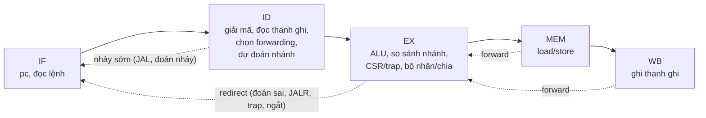

# rv32i-single-cycle

[](https://github.com/trandangduy777-cloud/rv32i-single-cycle/actions/workflows/verify.yml)

Ba lõi RISC-V tự viết bằng Verilog, dùng chung bộ kiểm chứng, đưa qua flow RTL-to-GDS (LibreLane, PDK mở IHP SG13G2 130 nm):

| Lõi | Tập lệnh | Chu kỳ tối thiểu (góc chậm) | CPI bench (RV32I / nặng M) | Số cell |
|---|---|---|---|---|
| `rv32i_core.v`: single-cycle | RV32IM + CSR + trap | ≈ 23,0 ns (ngoại suy) * | 1,00 / 7,95 | 28.775 * |
| `rv32i_pipeline.v`: 5 tầng | RV32I | ≈ 11,98 ns, ≈ 83 MHz | 1,29 / - | 36.466 |
| `rv32im_pipeline.v`: 5 tầng | RV32IM(C) + CSR + trap + ngắt + WFI | ≈ 14,40 ns, ≈ 69 MHz ** | 1,32 / 5,00 | 47.129 ** |

\* Số liệu flow của single-cycle đo trên bản RV32I thuần, trước khi thêm CSR, trap và M.
\*\* Đo trước khi thêm ngắt và WFI (thêm 8 flip-flop cùng logic chọn mcause và dừng WFI, chưa chạy lại flow), với `ENABLE_C = 0`.

- **Pipeline**: forwarding tính sẵn ở ID, dự đoán nhánh ở ID (bảng đếm 2 bit 64 mục, JAL nhảy ngay ở ID), `redirect` được đăng ký ở RV32IM để cắt đường tới hạn, bộ nhân/chia lặp 2 bit mỗi chu kỳ.
- **Cache và bộ nhớ có độ trễ**: pipeline RV32IM có bắt tay bộ nhớ (`imem_ready`, `dmem_ready`), cache lệnh và cache dữ liệu ánh xạ trực tiếp, bộ phân xử bus chung; chạy đúng từng lệnh so với Spike với bộ nhớ trễ ngẫu nhiên 1-8 chu kỳ mỗi từ.
- **Lệnh nén C** (tham số `ENABLE_C` của pipeline RV32IM): giải nén ở IF nên ID/EX/MEM/WB không đổi; mã của benchmark nhỏ đi khoảng 29 % mà số chu kỳ giữ nguyên. Bộ giải nén được so với GNU objdump trên toàn bộ 49.152 mã lệnh 16 bit.
- **Ngắt**: ngắt timer, ngắt phần mềm (khối `mtime`/`mtimecmp`/`msip` kiểu CLINT) và ngắt ngoài cho pipeline RV32IM, nhận chính xác ở tầng EX, cùng lệnh `WFI`; testbench riêng cho ngắt xen vào giữa vòng lặp nhân/chia/load/store hơn 300 lần, kèm 16 đột biến phần ngắt và WFI đều bị bắt.
- **Kiểm chứng**: so từng lệnh với ISS Python trên chương trình ngẫu nhiên, so từng lệnh với Spike (trình mô phỏng chuẩn của RISC-V) trên riscv-tests và benchmark, riscv-tests chính thức (rv32ui, rv32um), mutation test (42 / 28 / 66 lỗi chèn cố ý đều bị bắt), benchmark C so checksum giữa các lõi, mô phỏng gate-level trên netlist sau P&R. Kiểm chứng chạy tự động bằng GitHub Actions mỗi lần push.
- **Thiết kế vật lý**: mọi run flow trong bảng đều đạt DRC, LVS, antenna; mọi số liệu flow nằm trong `results/` và `metrics.json`.



Chi tiết từng phần nằm ở các mục bên dưới; giới hạn và các điểm chưa làm được ghi ở mục cuối.

## Cấu trúc thư mục
| File | Nội dung |
|---|---|
| `rv32i_core.v` | Lõi single-cycle RV32IM + CSR + trap (chứa module `rv32m` dùng chung), bộ nhớ lệnh và dữ liệu nằm ngoài lõi |
| `tb_rv32i_core.v` | Testbench: nạp `prog.hex`, báo PASS/FAIL qua địa chỉ `0x1000` |
| `rv32i_pipeline.v` | Pipeline 5 tầng, RV32I thuần (xem mục Pipeline) |
| `tb_rv32i_pipeline.v` | Testbench tự kiểm tra cho pipeline, nạp `prog_base.hex` |
| `rv32im_pipeline.v` | Pipeline đầy đủ: RV32IM + CSR + trap + ngắt + WFI (dùng module `rv32m` trong `rv32i_core.v`) |
| `rv32c_decompress.v` | Bộ giải nén lệnh RV32C (16 bit → 32 bit), dùng ở IF của pipeline RV32IM khi `ENABLE_C = 1` |
| `rv32_icache.v`, `rv32_dcache.v`, `rv32_bus_arbiter.v` | Cache lệnh, cache dữ liệu (ghi xuyên) và bộ phân xử bus cho pipeline RV32IM |
| `cache/` | Kiểm chứng cache: testbench ngẫu nhiên, mutation test, đo hiệu năng (xem mục Cache) |
| `rvc/` | Kiểm chứng lệnh nén: so bộ giải nén với objdump trên 49.152 mã lệnh, mutation test (xem mục Mở rộng C) |
| `rv32_mtimer.v` | Bộ đếm `mtime`/`mtimecmp` 64 bit và thanh ghi `msip`, ánh xạ bộ nhớ, sinh ngắt timer và ngắt phần mềm |
| `irq/` | Kiểm chứng ngắt và WFI: chương trình `irq_test.S`, testbench `tb_irq.v`, mutation test `mutate_irq.py` (xem mục Ngắt) |
| `config_pipeline.json` | Cấu hình LibreLane cho pipeline RV32I thuần (`CLOCK_PERIOD` = 14 ns, đã chạy đạt timing) |
| `config_pipeline_full.json` | Cấu hình LibreLane cho pipeline đầy đủ (`CLOCK_PERIOD` = 15 ns, đã chạy đạt timing) |
| `prog_base.hex` | Chương trình test chỉ gồm RV32I thuần (229 lệnh), dùng cho pipeline |
| `asm.py` | Assembler mini sinh `prog.hex` (823 lệnh tự kiểm tra, gồm CSR/trap và M) |
| `verify/` | Mô hình tham chiếu (ISS), bộ sinh chương trình ngẫu nhiên, so vết từng lệnh, mutation test (xem `verify/README.md`) |
| `prog.hex` | Chương trình test đã sinh sẵn |
| `config.json` | Cấu hình LibreLane (`CLOCK_PERIOD` = 24 ns) |
| `metrics.json` | Số liệu flow của single-cycle RV32I (24 ns) |
| `results/` | Số liệu flow của các lõi pipeline (`metrics_*.json`), mỗi file ứng với một dòng trong bảng so sánh |
| `bench/` | Benchmark C: `bench.c` (RV32I thuần) và `bench_m.c` (nặng nhân/chia), `run_bench.sh` in số chu kỳ và CPI |
| `riscv-tests/` | Môi trường tối giản và script chạy bộ test ISA chính thức riscv-tests trên cả 3 lõi |
| `cosim/` | So từng lệnh của 3 lõi với Spike: testbench `tb_cosim.v`, script `run_cosim.py` (xem mục So vết với Spike) |
| `gls/` | Mô phỏng gate-level netlist sau P&R (`run_gls.sh`, `make_func_lib.py`); netlist không được commit |
| `docs/` | Ảnh layout (KLayout) và đường tới hạn (OpenROAD) |

## Tập lệnh hỗ trợ
`LUI AUIPC JAL JALR`, `BEQ BNE BLT BGE BLTU BGEU`, `LB LH LW LBU LHU SB SH SW`, `ADDI SLTI SLTIU XORI ORI ANDI SLLI SRLI SRAI`, `ADD SUB SLL SLT SLTU XOR SRL SRA OR AND`.
Thêm: `FENCE`/`FENCE.I` (coi như NOP), `ECALL`, `EBREAK`, `MRET`, `CSRRW CSRRS CSRRC CSRRWI CSRRSI CSRRCI`.
Phần mở rộng M: `MUL MULH MULHSU MULHU DIV DIVU REM REMU`.
Phần mở rộng C (chỉ pipeline RV32IM, `ENABLE_C = 1`): mọi lệnh nén RV32C không dùng số thực.

## Phần mở rộng M
- Bộ nhân/chia lặp, mỗi chu kỳ xử lý 1 bit, một lệnh M mất 34 chu kỳ (1 nhận toán hạng, 32 lặp, 1 hoàn tất). Trong lúc đó lõi giữ nguyên PC (stall).
- Tham số `STEPS` (1, 2 hoặc 4) cho số bit xử lý mỗi chu kỳ: bước nhân/chia 1 bit được lặp `STEPS` lần nối tiếp trong một chu kỳ, nên chỉ cần 32/`STEPS` chu kỳ lặp. Single-cycle giữ `STEPS = 1` (34 chu kỳ). Bản RV32IM pipeline dùng `STEPS = 2` (19 chu kỳ mỗi lệnh M thay vì 35); flow 15 ns vẫn đạt (slack +0,60 ns). `STEPS = 4` cho 11 chu kỳ nhưng nối 4 bộ cộng/trừ 33 bit trong một chu kỳ, chưa thử flow.
- Bản pipeline dùng tham số `PREP = 1` của module `rv32m`: chu kỳ đầu chỉ chép toán hạng thô vào thanh ghi, chu kỳ sau mới đảo dấu từ chính các flop đó (thêm 1 chu kỳ mỗi lệnh M). Lý do: toán hạng của lệnh M đã đi qua mux forwarding, nếu đảo dấu (bộ cộng 32 bit) ngay trước khi ghi thì đường `idex_fb_wb` → đảo dấu → thanh ghi nhân/chia trở thành đường tới hạn của RV32IM. Bản single-cycle giữ `PREP = 0`.
- Chọn bộ lặp thay vì nhân/chia tổ hợp 32 bit để không kéo dài đường tới hạn của lõi.
- Chia cho 0: thương toàn bit 1, dư bằng số bị chia. `INT_MIN / -1`: thương `INT_MIN`, dư 0, không trap (đúng đặc tả).
- Tín hiệu `retire` báo lệnh đã hoàn tất, testbench in vết theo tín hiệu này.

## Pipeline 5 tầng
Có hai bản, cùng cổng với `rv32i_core`:
- `rv32i_pipeline.v`: RV32I thuần. Dùng làm mốc so sánh công bằng với bản single-cycle RV32I thuần đã chạy flow.
- `rv32im_pipeline.v`: RV32IM + CSR + trap. CSR, trap và MRET xử lý ở tầng EX theo đúng thứ tự chương trình và gửi redirect như nhánh. Ở bản này `redirect` được đăng ký và áp ở chu kỳ sau (huỷ 3 lệnh phía sau, mất 3 chu kỳ), và các CSR của trap (`mepc`, `mcause`, `mtval`, `mstatus`) cũng ghi trễ 1 chu kỳ; xem mục "Đăng ký redirect ở RV32IM". Lệnh M đứng ở EX, đóng băng IF/ID/EX đến khi bộ nhân/chia xong, tầng MEM/WB vẫn chạy tiếp.

Chung cho cả hai:
- Forwarding từ EX/MEM và MEM/WB vào tầng EX, ưu tiên lệnh mới hơn. Thanh ghi đọc ở ID được bypass từ WB.
- Các tín hiệu chọn forwarding được so sánh sẵn ở tầng ID và đăng ký vào ID/EX, nên tầng EX chỉ còn mux 3 đường (cắt phần so sánh số thanh ghi khỏi đường tới hạn).
- Các trường dữ liệu của ID/EX (giá trị rs1, rs2, imm, pc, lệnh...) nạp lại mỗi chu kỳ, không bị `redirect` hay `stall` điều khiển enable, vì bong bóng đã được đánh dấu bằng `idex_valid` và các cờ điều khiển. Việc này giảm tải (fanout) của tín hiệu `redirect`, vốn nằm trên đường tới hạn.
- Các trường dữ liệu của IF/ID (`ifid_pc`, `ifid_instr`) cũng không bị `redirect` điều khiển enable, chỉ bị giữ khi stall. Lệnh bị huỷ được đánh dấu bằng `ifid_valid = 0`. Việc này sinh ra từ phân tích đường tới hạn của RV32IM có dự đoán nhánh: đường `idex_fa_wb` → so sánh nhánh → `redirect` → enable của IF/ID trượt −1,64 ns ở 15 ns.
- Load-use: dừng 1 chu kỳ rồi forward từ WB.
- Dự đoán nhánh ở tầng ID (xem mục "Dự đoán nhánh và CPI" bên dưới): JAL nhảy ngay ở ID (mất 1 chu kỳ), nhánh có điều kiện dùng bảng đếm 2 bit 64 mục, đoán sai thì phát hiện ở EX và huỷ 2 lệnh. JALR vẫn quyết định ở EX (mất 2 chu kỳ).
- Bộ nhớ lệnh và dữ liệu vẫn đọc tổ hợp ở ngoài lõi như bản single-cycle.

| Chỉ số | Single-cycle | Pipeline |
|---|---|---|
| Chu kỳ chạy `prog_base.hex` (229 lệnh, có vòng lặp) | 261 | 294 |

Pipeline chỉ đáng giá khi tần số tối đa tăng nhiều hơn tỷ lệ CPI tăng so với single-cycle. Số CPI đo trên benchmark nằm ở mục dưới, Fmax nằm ở bảng so sánh flow.

```
python3 asm.py prog_base.hex --base
iverilog -g2012 -o sim_pipe.vvp rv32i_pipeline.v tb_rv32i_pipeline.v
vvp sim_pipe.vvp
```
Kết quả đúng: `[TB] PASS sau 294 chu ky`.
Bản đầy đủ:
```
iverilog -g2012 -DPIPE_FULL -o sim_pipem.vvp rv32im_pipeline.v rv32i_core.v tb_rv32i_pipeline.v
vvp sim_pipem.vvp +prog=prog.hex
```
Kết quả đúng: `[TB] PASS sau 2423 chu ky`.

## CSR và trap (chế độ Machine)
- CSR: `mstatus` (MIE, MPIE; MPP cố định 11), `misa` (chỉ đọc giá trị RV32I), `mtvec` (chế độ trực tiếp), `mscratch`, `mepc`, `mcause`, `mtval`, `mhartid`.
- Trap: lệnh bất hợp lệ (cause 2), `EBREAK` (3), `ECALL` (11), nhảy tới địa chỉ không chia hết cho 4 (0), load lệch địa chỉ (4), store lệch địa chỉ (6; `mtval` = địa chỉ vi phạm). Lệnh gây trap không ghi thanh ghi hay bộ nhớ.
- Truy cập CSR không tồn tại, hoặc ghi vào CSR chỉ đọc, là lệnh bất hợp lệ.
- Giải mã chặt: các trường `funct7`/`funct3`/`rd`/`rs1` sai giá trị quy định đều gây trap.
- Ngắt chỉ có ở `rv32im_pipeline.v` (xem mục Ngắt). `FENCE` giữ vai trò NOP (đúng với lõi in-order, bộ nhớ đồng bộ một cổng). Bản `rv32i_pipeline.v` là RV32I thuần, không có trap nên không kiểm tra căn chỉnh; chương trình test của nó chỉ truy cập đúng căn chỉnh.

## Cache và bộ nhớ có độ trễ (pipeline RV32IM)
Mặc định pipeline nối với bộ nhớ tổ hợp (`imem_ready = dmem_ready = 1`, giống hệt bản cũ). Để nối với bộ nhớ thật có độ trễ, lõi có giao tiếp bắt tay và repo có sẵn 3 khối:

- **Bắt tay ở lõi** (`rv32im_pipeline.v`):
  - `imem_ready = 0`: IF giữ pc và đưa bong bóng vào ID; redirect vẫn đổi pc được trong lúc chờ.
  - `dmem_ready = 0` khi lệnh ở MEM đang load (`dmem_re`) hoặc store (`dmem_we`): **toàn bộ pipeline đóng băng** (`frz`): pc, IF/ID, ID/EX, EX/MEM và MEM/WB giữ nguyên. Một tín hiệu đóng băng chung cho mọi tầng, thay vì chỉ dừng các tầng trước MEM, nên forwarding, bypass và các tín hiệu chọn tính sẵn ở ID không phải xử lý trường hợp mới.
  - Trong lúc đóng băng, mọi tác dụng của lệnh ở EX bị chặn: redirect, trap, ghi CSR, `MRET`, nhận ngắt, cập nhật bảng đếm nhánh. Redirect đã đăng ký mà IF chưa dùng tới cũng được giữ. Lệnh ở EX được xét lại khi pipeline chạy tiếp.
  - WB ghi lại cùng giá trị mỗi chu kỳ đóng băng (vô hại); `wb_commit` đánh dấu đúng 1 chu kỳ cho mỗi lệnh hoàn tất, testbench in vết theo tín hiệu này.
- **`rv32_icache.v`**: ánh xạ trực tiếp, `LINES` dòng × `WORDS` từ. Trả 32 bit tại địa chỉ chia hết cho 2 trong cùng chu kỳ khi trúng; với lệnh nén, cửa sổ 32 bit có thể nằm vắt qua 2 dòng nên cả 2 dòng phải có mặt. Có cổng `flush` (dòng đang nạp khi bị flush sẽ không được đánh dấu valid).
- **`rv32_dcache.v`**: ánh xạ trực tiếp, ghi xuyên (write-through), không cấp phát khi ghi. Load trúng: không tốn chu kỳ. Vùng không cacheable (`CMASK`/`CBASE`, vd. thiết bị ngoại vi, TOHOST) đọc/ghi thẳng qua bus. Store luôn đi qua bus và cập nhật dòng nếu đang có.
- **`rv32_bus_arbiter.v`**: 2 cache dùng chung 1 bus tới bộ nhớ; ưu tiên cache dữ liệu (lệnh ở MEM đang đóng băng cả pipeline), giữ quyền bus tới khi bộ nhớ trả lời.

Hiệu năng (`cache/perf_cache.py`, bản biên dịch có lệnh nén, cache lệnh và dữ liệu cùng kích thước, mỗi từ trên bus mất ngẫu nhiên 1..N chu kỳ):

| Cấu hình | `bench` CPI (N = 1 / 4 / 8) | `bench_m` CPI (N = 1 / 4 / 8) | Trượt I / D (`bench`) |
|---|---|---|---|
| Bộ nhớ lý tưởng, không cache | 1,32 | 5,00 | - |
| Cache 4 dòng × 4 từ (64 B mỗi cache) | 1,94 / 2,37 / 2,95 | 5,62 / 6,04 / 6,59 | 853 / 802 |
| Cache 16 × 4 (256 B) | 1,55 / 1,71 / 1,94 | 5,14 / 5,24 / 5,37 | 40 / 136 |
| Cache 64 × 4 (1 KB) | 1,54 / 1,70 / 1,91 | 5,06 / 5,10 / 5,15 | 34 / 106 |

- Từ 64 B lên 256 B mỗi cache, số lần trượt của `bench` giảm khoảng 10 lần; lên 1 KB gần như chỉ còn trượt bắt buộc (lần đầu chạm vào dòng).
- Phần còn lại so với bộ nhớ lý tưởng chủ yếu do ghi xuyên: mỗi store chờ bộ nhớ trả lời (chưa có bộ đệm ghi), và mỗi lần nạp dòng tốn `WORDS` lần truy cập bus.

Kiểm chứng (`cache/`, `cosim/`):
- **So vết với ISS trên chương trình ngẫu nhiên qua cache** (`verify/run_verify.py --pipem --cache`): bộ nhớ lệnh và dữ liệu đi qua cache 2 dòng × 2 từ với độ trễ 1-6, nên lệnh CSR, trap, `MRET`, lệnh M... của chương trình ngẫu nhiên rơi vào đúng lúc pipeline đang đóng băng. Đây là chỗ Spike cosim không phủ được: riscv-tests và benchmark gần như không có CSR hay trap ngay sau một load trượt cache. Bộ sinh chương trình đặt thêm 1 lệnh `lw` ngay trước mỗi `MRET` để có tình huống này.
- **So vết với Spike**: thêm 2 cấu hình lõi RV32IMC có cache: 16 × 4 với độ trễ 1-4, và cache rất nhỏ 2 dòng × 2 từ với độ trễ 1-8 (xung đột dòng liên tục, lệnh nén vắt qua dòng). Cả 101 chương trình khớp Spike từng lệnh ở cả hai cấu hình.
- **`cache/tb_cache_random.v`**: kiểm tra riêng 2 cache và bộ phân xử, không cần CPU. Load/store ngẫu nhiên (byte, half, word) vào vùng cacheable, vùng không cacheable và vùng thiết bị (giá trị tự tăng mỗi chu kỳ, load phải đi qua bus và trả đúng giá trị bus đọc về); ghi vào vùng mã rồi flush cache lệnh như `FENCE.I`; địa chỉ lệnh đổi ngẫu nhiên cả khi cache đang nạp. So với mô hình tham chiếu ở mỗi load, mỗi lần cache lệnh trả lệnh, và so toàn bộ bộ nhớ ở cuối. Chạy 3 kích thước cache × 3 seed trong GitHub Actions.
- **`cache/mutate_cache.py`**: 20 đột biến, đều bị bắt. 11 đột biến trong 2 cache và bộ phân xử (không so tag, cửa sổ lệnh nén sai, flush lúc đang nạp vẫn đánh dấu valid, store không cập nhật dòng hoặc bỏ qua `wstrb`, cache cả vùng thiết bị, bus ghi sai byte, không giữ quyền bus...) bị `tb_cache_random.v` bắt; 4 đột biến bắt tay ở lõi bị so vết Spike bắt; 5 đột biến cơ chế đóng băng (IF/ID hoặc ID/EX vẫn đổi, ghi CSR, trap, `MRET` lúc đóng băng) bị chương trình ngẫu nhiên qua cache bắt. Lúc đầu có 2 đột biến không bị bắt: một cái là đột biến tương đương (trường hợp không thể xảy ra) nên được thay; cái kia lộ ra là chương trình ngẫu nhiên chưa bao giờ có `MRET` lúc đóng băng, nên bộ sinh chương trình được sửa như trên.

```
python3 cosim/run_cosim.py <thư mục riscv-tests> --core=cache
iverilog -g2012 -DL=4 -DW=2 -o cr.vvp cache/tb_cache_random.v rv32_icache.v rv32_dcache.v rv32_bus_arbiter.v && vvp cr.vvp +seed=1
python3 cache/perf_cache.py
python3 cache/mutate_cache.py <thư mục riscv-tests>
```

## Mở rộng C: lệnh nén 16 bit (pipeline RV32IM)
Bật bằng tham số `ENABLE_C = 1` của `rv32im_pipeline`; mặc định 0 nên phần cứng và mọi số liệu flow cũ không đổi.

- **Giải nén ở IF**: `rv32c_decompress.v` (mạch tổ hợp) đổi lệnh 16 bit thành lệnh 32 bit tương đương trước thanh ghi IF/ID, nên bộ giải mã, forwarding, dự đoán nhánh, CSR, trap và ngắt ở các tầng sau dùng lại nguyên vẹn. Mỗi lệnh chỉ cần 1 bit `c` đi theo pipeline.
- **pc tăng 2 hoặc 4**. Địa chỉ liên kết của `JAL`/`JALR` và đích "chạy tiếp" khi đoán sai nhánh là pc + 2 với lệnh nén. Bảng đếm dự đoán nhánh lấy chỉ số từ bit 1 vì hai nhánh nén có thể nằm chung một từ.
- **Đích nhảy chỉ cần chia hết cho 2**: với C không còn trap lệch địa chỉ lệnh (imm luôn chẵn, `JALR` xoá bit 0).
- **Lệnh không hợp lệ**: mã dành riêng (vd. `c.addi4spn` với imm 0, `c.lwsp` với rd = 0, shamt[5] = 1, lệnh RV64, lệnh số thực `c.flw`...) được giải nén thành 0 và bộ giải mã 32 bit báo illegal; `mtval` là 16 bit gốc như Spike. `misa` có thêm bit C.
- **Bộ nhớ lệnh** phải trả về 32 bit bắt đầu từ một địa chỉ chia hết cho 2, vì lệnh 32 bit có thể nằm vắt qua ranh giới từ (vd. 2 bank 16 bit xen kẽ chẵn / lẻ). Testbench `cosim/tb_cosim.v` làm như vậy.

Lợi ích đo trên pipeline RV32IM (bộ nhớ lý tưởng, `cosim/tb_cosim.v`):

| Chương trình | Mã `.text` không C | Có C | Số lệnh | Chu kỳ không C / có C |
|---|---|---|---|---|
| `bench` | 756 B | 532 B (−29,6 %) | 33.119 | 43.738 / 43.738 |
| `bench_m` | 688 B | 492 B (−28,5 %) | 14.657 | 73.314 / 73.314 |

Số lệnh không đổi vì mỗi lệnh nén tương ứng đúng 1 lệnh 32 bit, và giải nén không thêm chu kỳ nào. Lợi ích là mã nhỏ hơn (bộ nhớ lệnh nhỏ hơn, ít băng thông nạp lệnh hơn). Cái giá là bộ giải nén nằm trên đường IF → IF/ID; chưa chạy flow với `ENABLE_C = 1`.

Kiểm chứng (`rvc/`, `cosim/`):
- `rvc/check_decompress.py`: duyệt **toàn bộ 49.152 mã lệnh 16 bit**. GNU objdump giải mã lệnh nén, rồi giải mã lệnh 32 bit mà RTL sinh ra đặt ở cùng địa chỉ (nên đích nhánh trùng nhau); hai chuỗi phải giống hệt. Khác biệt chỉ do alias (`mv` / `addi rd,rs,0`) được biên dịch lại bằng GNU as để so mã máy. Kết quả: 28.823 mã giải nén đúng, 20.329 mã illegal đúng, 0 lệch. Có 1.537 mã dành riêng theo đặc tả RV32C (shamt[5] = 1, `c.addi16sp` imm 0) mà objdump vẫn giải mã; RTL báo illegal, khớp Spike.
- So vết với Spike: mọi riscv-tests (rv32ui, rv32um) và 2 benchmark được biên dịch lần thứ hai với `-march=...c` (trình hợp dịch tự nén mọi lệnh nén được), cộng test `rv32uc/rvc`, chạy trên cấu hình `ENABLE_C = 1` (xem mục So vết với Spike).
- `rvc/mutate_rvc.py`: 17 đột biến, đều bị bắt. 6 đột biến trong pipeline (địa chỉ liên kết pc + 4, chạy tiếp ở pc + 4 khi đoán sai, IF luôn tăng 4, vẫn trap lệch địa chỉ, mất 16 bit gốc, nhận dạng lệnh nén sai) bị so vết với Spike bắt; 11 đột biến trong bộ giải nén (sai vị trí bit imm của `c.j`, `c.beqz`, `c.addi4spn`, `c.addi16sp`, `c.lwsp`; `c.srai` → `srli`; `c.sub` → `add`; `c.jalr` không ghi `ra`; bỏ kiểm tra illegal của `c.lui` imm 0, shamt[5] = 1, `c.fsw`) bị `check_decompress.py` bắt. Chạy trong GitHub Actions khi bấm Run workflow.

```
python3 rvc/check_decompress.py
python3 rvc/mutate_rvc.py <thư mục riscv-tests> [--spike <đường dẫn spike>]
```

## Ngắt và WFI (pipeline RV32IM)
- Ba chân ngắt mức cao: `irq_ext` (MEIP), `irq_soft` (MSIP), `irq_timer` (MTIP), đồng bộ qua 1 flip-flop. Thêm CSR `mie` (MEIE, MSIE, MTIE) và `mip` (chỉ đọc, phản ánh ba chân ngắt).
- Ngắt được nhận ở tầng EX khi `mstatus.MIE = 1`, bit tương ứng trong `mie` bật và EX đang có lệnh hợp lệ. Lệnh ở EX không thực thi (không ghi thanh ghi, không ghi bộ nhớ, không ghi CSR); `mepc` = pc của lệnh đó, nên ngắt chính xác: mọi lệnh cũ hơn đã ở MEM/WB và hoàn tất, lệnh bị ngắt chạy lại sau `MRET`.
- `mcause` = `0x8000000B` (ngoài), `0x80000003` (phần mềm) hoặc `0x80000007` (timer), ưu tiên theo đúng thứ tự này như đặc tả. Đi chung đường với trap: redirect tới `mtvec`, `mepc`/`mcause`/`mstatus` ghi trễ 1 chu kỳ.
- Điều kiện nhận ngắt chỉ dùng thanh ghi (`mstatus`, `mie`, `mip`, `idex_valid`), không dùng kết quả so sánh nhánh, nên không kéo dài đường tới hạn.
- Lệnh nhân/chia đang chạy không bị ngắt: ngắt chờ tới lệnh kế tiếp. Độ trễ ngắt ngoài đo được tối đa 36 chu kỳ, khi ngắt tới lúc lõi đang chạy lệnh M hoặc đang ở trong trình xử lý của ngắt khác (MIE = 0).
- `WFI` dừng ở EX (đóng băng IF/ID/EX giống lệnh M đang chạy) cho tới khi có ngắt đang chờ và được bật trong `mie`, bất kể `mstatus.MIE`. Ngắt không được nhận trên chính `WFI` mà trên lệnh sau nó, nên `mepc` = địa chỉ `WFI` + 4 và sau `MRET` chương trình không quay lại chờ tiếp. Nếu `mstatus.MIE = 0` thì lõi chỉ thức dậy và chạy tiếp.
- `rv32_mtimer.v`: `mtime` tăng mỗi `PRESCALE` chu kỳ, `irq = mtime >= mtimecmp`, `mtimecmp` khởi động bằng toàn bit 1; `msip` (bit 0) ghi 1 để phát ngắt phần mềm. Ánh xạ: `+0x0`/`+0x4` mtime, `+0x8`/`+0xC` mtimecmp, `+0x10` msip. Khối này nằm ngoài lõi (như CLINT), testbench đặt ở `0x0200_0000`.

Kiểm chứng (`irq/`, chạy trong GitHub Actions):
- `irq_test.S`: vòng lặp 300 lần tính checksum bằng `mul`/`remu`/load/store/nhánh, trong khi ngắt timer (khoảng cách thay đổi 40-103 chu kỳ), ngắt phần mềm (cứ 4 ngắt timer thì trình xử lý timer bật `msip` một lần) và 3 ngắt ngoài xen vào. Checksum phải bằng giá trị tính trước bằng Python (`checksum.py`): lệnh bị ngắt phải chạy lại đúng một lần. Trình xử lý kiểm tra `mcause`, `mstatus` (MIE = 0, MPIE = 1) và `mepc`.
- Sau vòng lặp: ngắt đang chờ nhưng bị che bởi `mstatus.MIE` hoặc `mie` thì không được nhận, `mip` phải báo đủ MTIP, MSIP, MEIP; bật cả ba cùng lúc thì thứ tự nhận phải là ngoài, phần mềm, timer.
- `WFI` với `MIE = 0`: lõi phải chờ tới khi `mtime` chạm `mtimecmp` (đọc lại `mtime` để kiểm), không thức dậy vì MSIP đang chờ nhưng bị che trong `mie`, và không vào trình xử lý. `WFI` với `MIE = 1`: `mepc` phải bằng địa chỉ `WFI` + 4.
- `tb_irq.v` tự đếm số lần lõi nhận từng loại ngắt và so với bộ đếm của phần mềm, đếm số lần ghi bộ nhớ của vòng lặp (phải đúng 300), số vị trí lệnh bị ngắt và số chu kỳ dừng ở `WFI`. Kết quả: 264 ngắt timer, 67 ngắt phần mềm, 4 ngắt ngoài, ngắt rơi vào 11 lệnh khác nhau, dừng ở `WFI` 493 chu kỳ, PASS sau 30.501 chu kỳ.
- `mutate_irq.py`: 16 đột biến (mepc lệch, lệnh bị ngắt vẫn ghi thanh ghi hoặc bộ nhớ, không xoá MIE, bỏ qua MIE/MTIE/MEIE/MSIE, mcause thiếu bit ngắt, đảo ưu tiên ngoài/phần mềm và phần mềm/timer, nhận ngắt khi EX trống, MRET không khôi phục MIE, WFI chạy như NOP, WFI thức dậy vì ngắt bị che, ngắt nhận trên chính WFI) đều bị bắt.
- Bộ so vết với ISS ngẫu nhiên cũng sinh lệnh đọc/ghi `mie`, `mip` cho pipeline RV32IM (chân ngắt nối 0).

```
iverilog -g2012 -o irq.vvp irq/tb_irq.v rv32im_pipeline.v rv32i_core.v rv32_mtimer.v && vvp irq.vvp
python3 irq/mutate_irq.py
sh irq/build.sh        # biên dịch lại irq_test.hex, cần riscv64-unknown-elf-gcc
```

## Mô phỏng
Cần `python3` và Icarus Verilog (`iverilog`, `vvp`).
```
python3 asm.py prog.hex
iverilog -g2012 -o sim.vvp rv32i_core.v tb_rv32i_core.v
vvp sim.vvp
```
Kết quả đúng: `[TB] PASS sau 2260 chu ky`, Fibonacci(10) = 55 được ghi vào địa chỉ `0x300`.
Xem sóng bằng `gtkwave rv32i_core.vcd`.

## Chương trình test gồm
- ALU thanh ghi và immediate
- LUI, AUIPC
- Load/store byte, halfword, word (có dấu và không dấu)
- 6 loại nhánh, mỗi loại thử cả taken và not-taken
- JAL, JALR
- Vòng lặp Fibonacci
- MUL/DIV với đáp án tính tay: dấu, làm tròn về 0, chia cho 0, tràn số, lệnh M liên tiếp
- Các thao tác CSR, ECALL/EBREAK, các loại lệnh bất hợp lệ, nhảy không căn chỉnh, MRET và trạng thái `mstatus` qua trap

## Chạy flow
Chạy LibreLane với `config.json` trong môi trường có sẵn PDK IHP SG13G2 (ví dụ image `isaiassh/unic-cass-tools`). Kết quả nằm trong thư mục `runs/` do LibreLane sinh ra.

## Dự đoán nhánh và CPI

Bản đầu của pipeline quyết định mọi lệnh nhảy ở EX nên mỗi lệnh nhảy thực hiện đều mất 2 chu kỳ. Bản hiện tại thêm bộ dự đoán ở tầng ID:
- JAL nhảy ngay ở ID, huỷ 1 lệnh ở IF (mất 1 chu kỳ thay vì 2).
- Nhánh có điều kiện: bảng đếm bão hoà 2 bit, 64 mục, chỉ số lấy từ `pc[7:2]`, khởi tạo "yếu, không nhảy". Đoán "nhảy" thì nhảy ngay ở ID (mất 1 chu kỳ), đoán "không nhảy" thì chạy tiếp (không mất chu kỳ nào).
- Đoán sai phát hiện ở EX (so kết quả nhánh với dự đoán đã mang theo qua ID/EX), huỷ 2 lệnh. Đích khi đoán sai chọn theo dự đoán chứ không theo kết quả so sánh, nên tín hiệu `redirect_pc` không nằm sau bộ so sánh.
- Đích nhảy sớm là `pc + imm` tính đúng ở ID, không dùng BTB hay tag. Vì vậy đoán sai chỉ làm chậm, không bao giờ làm sai kết quả, và không cần so sánh tag 30 bit.
- Bảng đếm cập nhật trễ 1 chu kỳ qua thanh ghi giữa EX và MEM, để kết quả so sánh nhánh không phải điều khiển enable của 128 flip-flop (cùng bài học với `redirect` trước đây).
- JALR chưa được dự đoán.

Đo bằng `bench/` (5 bài: sắp xếp nổi bọt 48 phần tử, sàng nguyên tố đến 600, CRC32 theo bit trên 128 byte, cộng ma trận 12x12, tìm nhị phân lặp lại; biên dịch bằng `riscv64-unknown-elf-gcc -O2`, RV32I thuần). Checksum 5 bài khớp giữa cả 3 lõi và khớp số nguyên tố đã biết (109 số dưới 600).

| | Single-cycle | Pipeline, đứng yên (cũ) | Pipeline RV32I, có dự đoán | Pipeline RV32IM, có dự đoán, redirect đăng ký |
|---|---|---|---|---|
| Chu kỳ | 33 118 | 46 917 | 42 744 | 43 737 |
| Lệnh hoàn tất | 33 118 | 33 117 | 33 117 | 33 117 |
| CPI | 1,000 | 1,416 | 1,290 | 1,320 |

Dự đoán giảm 8,9% số chu kỳ so với bản cũ. Pipeline vẫn chậm hơn single-cycle 1,29 lần về chu kỳ, nên chỉ có lợi khi Fmax tăng nhiều hơn 1,29 lần. Chạy lại: `sh bench/run_bench.sh`.

Bộ `bench/` ở trên không có lệnh M. `bench/bench_m.c` (biên dịch với `-march=rv32im`) gồm 5 bài nặng nhân/chia: nhân ma trận 8x8, lũy thừa mô-đun, tổng chữ số thập phân, UCLN bằng chia lấy dư, nhân/chia có dấu và MULH. Checksum khớp giữa các lõi và khớp giá trị tính độc lập bằng Python.

| `bench_m` (14.655 lệnh) | Chu kỳ | CPI |
|---|---|---|
| Single-cycle (`STEPS = 1`) | 116.527 | 7,95 |
| Pipeline RV32IM, `STEPS = 1` | 122.705 | 8,37 |
| Pipeline RV32IM, `STEPS = 2` (hiện tại) | 73.313 | 5,00 |
| Pipeline RV32IM, `STEPS = 4` (chưa dùng) | 48.617 | 3,32 |

Flow 15 ns của RV32IM với `STEPS = 2` (`results/metrics_rv32im_15ns_steps2.json`): slack góc chậm +0,601 ns (Tmin ≈ 14,40 ns), 47.129 instance, 538.550 µm² (+1 % so với `STEPS = 1`). Thời gian chạy `bench_m`: 73.313 × 14,40 ns ≈ 1.056 µs so với 122.705 × 14,21 ns ≈ 1.743 µs, nhanh hơn khoảng 1,65 lần. Bộ `bench/` không có lệnh M chậm đi khoảng 1,3 % (≈ 630 µs so với ≈ 621 µs) vì Tmin tăng 0,19 ns; mức chênh này nhỏ, có thể một phần do biến động của P&R chứ không chỉ do bộ nhân/chia.


Kiểm chứng phần dự đoán: sinh thêm đơn vị vòng lặp có giới hạn vào bộ chương trình ngẫu nhiên (nếu không, mỗi nhánh chỉ chạy một lần và bảng đếm không bao giờ học), thêm 8 mutation riêng cho dự đoán (đích đoán sai, thiếu một chiều đoán sai, nhảy sớm khi đang stall load-use, nhảy sớm đè lên redirect của EX, nhảy sớm khi lệnh M đóng băng EX, ...). Cả 8 đều bị bắt. Riêng mutation chỉ làm giảm hiệu năng (ví dụ không cập nhật bảng đếm) không thể bị bắt bằng so sánh kết quả, vì thiết kế đã bảo đảm đoán sai không đổi kết quả; hiệu năng được kiểm bằng CPI ở trên.

### Đăng ký redirect ở RV32IM

Ở RV32IM có dự đoán, flow 15 ns trượt setup vì `redirect` (sau bộ so sánh nhánh, khoảng 10 ns) phải đi qua khoảng 13 tầng buffer mới tới `pc` và các thanh ghi bị huỷ. Lần sửa lần lượt:
- Các cờ điều khiển ID/EX chỉ bị `stall` xoá, `redirect` chỉ xoá `idex_valid`: slack góc chậm từ -2,50 ns lên -2,15 ns.
- `redirect` và `redirect_pc` được lưu vào `redirect_q`/`redirect_pc_q` và áp ở chu kỳ sau; lệnh nằm ở EX trong chu kỳ đó bị vô hiệu qua `idex_valid = idex_valid_r & ~redirect_q`. Slack lên -0,26 ns, chỉ còn 1 endpoint trượt (`mtval_r`).
- Endpoint đó do `trap_ex` (phụ thuộc kết quả so sánh khi đích nhánh lệch) điều khiển enable của các CSR trap, nên các CSR này cũng ghi trễ 1 chu kỳ qua `trap_q`. Lệnh ở EX chu kỳ sau đã bị huỷ và lệnh đầu của trình xử lý trap tới EX sau ít nhất 3 chu kỳ, nên hành vi không đổi. Flow 15 ns sau thay đổi này đạt: slack góc chậm +0,79 ns.

Cái giá: phạt khi đoán sai, JALR, trap và MRET tăng từ 2 lên 3 chu kỳ, CPI bench từ 1,290 lên 1,320 (+2,3 %), thêm khoảng 67 flip-flop. Các thay đổi được kiểm bằng 200 chương trình ngẫu nhiên, riscv-tests (rv32ui, rv32um) và 4 mutation mới. RV32I không đổi.

### Kết quả flow của bản có dự đoán (RV32I, 14 ns)

| Hạng mục | Chưa có dự đoán | Có dự đoán |
|---|---|---|
| Setup slack, góc chậm | +0,216 ns | +2,02 ns |
| Chu kỳ tối thiểu | 13,78 ns | ≈ 11,98 ns (≈ 83,5 MHz) |
| Số instance | 33.372 | 36.466 (+9 %) |
| Diện tích instance | 375.352 µm² | 413.937 µm² (+10 %) |
| Công suất ước tính | 11,11 mW | 13,08 mW |

Số liệu có dự đoán là của bản đã tách dữ liệu IF/ID khỏi `redirect` (xem mục cải tiến bên dưới), nên Fmax tăng đến từ cả hai thay đổi chứ không riêng bộ dự đoán.

### Kết quả flow của bản có dự đoán (RV32IM, 15 ns)

| Hạng mục | Chưa có dự đoán | Có dự đoán, redirect đăng ký |
|---|---|---|
| Setup slack, góc chậm | +0,441 ns | +0,792 ns |
| Chu kỳ tối thiểu | 14,56 ns | ≈ 14,21 ns (≈ 70,4 MHz) |
| Số instance | 42.064 | 46.464 (+10 %) |
| Diện tích instance | 474.858 µm² | 532.973 µm² (+12 %) |
| Công suất ước tính | 21,51 mW | 14,17 mW |
| Vi phạm Max Slew | 7 | 0 |

Thời gian chạy bộ benchmark: 43.737 chu kỳ × 14,21 ns ≈ 621 µs so với 46.917 chu kỳ × 14,56 ns ≈ 683 µs, tức nhanh hơn khoảng 1,10 lần, đổi lại diện tích tăng 12 %. Công suất ước tính giảm nhưng dùng hoạt động chuyển mạch mặc định của công cụ, nên mức giảm này chưa giải thích được và không nên dùng để kết luận. Số liệu: `results/metrics_rv32im_15ns_bp.json`.

## Kết quả flow (clock 24 ns)
Số liệu dưới đây đo trên bản RV32I thuần, trước khi thêm CSR, trap và M. Chưa chạy lại flow cho bản hiện tại (diện tích sẽ tăng, nhất là do bộ nhân/chia).

| Hạng mục | Giá trị |
|---|---|
| Setup slack, góc chậm (1,08 V, 125 °C) | +0,587 ns |
| Setup slack, góc điển hình (1,20 V, 25 °C) | +5,606 ns |
| Setup slack, góc nhanh (1,32 V, -40 °C) | +8,624 ns |
| Hold slack tồi nhất | +0,134 ns |
| Lỗi DRC (route / Magic / KLayout) | 0 / 0 / 0 |
| Lỗi LVS | 0 |
| Lỗi antenna (net / pin) | 0 / 0 |
| Số instance | 28.775 |
| Công suất tổng (ước tính) | 4,21 mW |

Ở clock 20 ns thiết kế không đạt setup ở góc chậm (slack -1,813 ns), nên chu kỳ được nới lên 24 ns.

## So sánh single-cycle và pipeline (cùng PDK, cùng flow, SDC mặc định)

| Hạng mục | Single-cycle RV32I | Pipeline RV32I | Pipeline RV32IM | Pipeline RV32IM, có dự đoán | RV32IM, có dự đoán, `STEPS = 2` (hiện tại) |
|---|---|---|---|---|---|
| Clock chạy flow | 24 ns | 14 ns | 15 ns | 15 ns | 15 ns |
| Setup slack, góc chậm | +0,587 ns | +0,216 ns | +0,441 ns | +0,792 ns | +0,601 ns |
| Hold slack tồi nhất | +0,134 ns | +0,099 ns | +0,121 ns | +0,106 ns | +0,108 ns |
| Chu kỳ tối thiểu | 23,0 ns (ngoại suy), ≈ 43 MHz | 13,78 ns, ≈ 72,6 MHz | 14,56 ns, ≈ 68,7 MHz | 14,21 ns, ≈ 70,4 MHz | 14,40 ns, ≈ 69,5 MHz |
| Số instance | 28.775 | 33.372 (+16 %) | 42.064 (+46 %) | 46.464 (+61 %) | 47.129 (+64 %) |
| Diện tích instance | không ghi lại | 375.352 µm² | 474.858 µm² | 532.973 µm² | 538.550 µm² |
| Công suất ước tính | 4,21 mW (24 ns) | 11,11 mW (14 ns) | 21,51 mW (15 ns) | 14,17 mW (15 ns) | 14,56 mW (15 ns) |
| DRC (route / Magic / KLayout), LVS, antenna | 0 / 0 / 0 | 0 / 0 / 0 | 0 / 0 / 0 | đạt cả ba | đạt cả ba |

Cách đọc:
- Pipeline RV32I có tần số tối đa cao hơn single-cycle khoảng 1,67 lần (23,0 / 13,78). CPI của pipeline cao hơn khoảng 1,21 lần (1,22 so với 1,01 trên chương trình ngẫu nhiên dày phụ thuộc dữ liệu), nên thời gian chạy thực tế nhanh hơn khoảng 1,4 lần, đổi lại diện tích tăng 16 %.
- Thời gian chạy bộ benchmark trong `bench/`: pipeline RV32I có dự đoán 42.744 chu kỳ × 11,98 ns ≈ 512 µs, single-cycle 33.118 chu kỳ × 23,0 ns ≈ 762 µs, tức nhanh hơn khoảng 1,49 lần. Vế single-cycle dùng Tmin ngoại suy nên con số này chỉ mang tính ước lượng.
- Chu kỳ tối thiểu của pipeline được tính bằng chu kỳ chạy trừ slack góc chậm. Với RV32IM, run 20 ns (slack +5,441 ns) và run 15 ns (slack +0,441 ns) cho cùng một kết quả 14,56 ns, nên phép tính này đáng tin với pipeline. Với single-cycle, đường vào ra chiếm ưu thế (độ dốc khoảng 0,6) nên 23,0 ns chỉ là ngoại suy từ hai lần chạy (20 ns: -1,813 ns; 24 ns: +0,587 ns).
- Không có số liệu flow của single-cycle RV32IM, nên cột RV32IM chỉ so được với pipeline RV32I.
- Công suất ở các chu kỳ khác nhau không so sánh trực tiếp được.
- SDC là SDC mặc định của flow (độ trễ vào ra 20 % chu kỳ). Mô phỏng gate-level mới ở mức chức năng (xem mục bên dưới).
- Run RV32IM và RV32I chưa có dự đoán còn cảnh báo Max Slew ở góc chậm (nom_slow_1p08V_125C). Đây là vi phạm ràng buộc điện, không làm flow dừng nhưng chưa được xử lý. Hai run có dự đoán (RV32I 14 ns, RV32IM 15 ns) không còn vi phạm Max Slew.

### Cải tiến đã giúp giảm chu kỳ
- Tính sẵn các tín hiệu chọn forwarding ở tầng ID rồi đăng ký vào ID/EX (RV32I: từ ≈ 17,6 ns xuống 15,49 ns).
- Các trường dữ liệu của ID/EX không còn bị `redirect` và `stall` điều khiển enable. Tín hiệu `redirect` trước đó phải đi tới khoảng 250 flip-flop. RV32IM giảm từ ≈ 21,4 ns xuống 14,56 ns, RV32I từ 15,49 ns xuống 13,78 ns.
- Các trường dữ liệu của IF/ID (`ifid_pc`, `ifid_instr`) cũng không còn bị `redirect` điều khiển enable, chỉ bị giữ khi stall; lệnh bị huỷ được đánh dấu bằng `ifid_valid`. RV32I có dự đoán đạt ≈ 11,98 ns nhờ thay đổi này. Với RV32IM thì đường tới hạn dời sang chỗ khác và chưa giải quyết xong.

## Hình ảnh kết quả

Layout cuối (KLayout), pipeline RV32I, 14 ns:


Layout cuối (KLayout), pipeline RV32IM, 15 ns:


Đường tới hạn (OpenROAD GUI), pipeline RV32I. Báo cáo trong ảnh dùng góc điển hình (nom_typ_1p20V_25C), nên slack trong ảnh (+5,348 ns) lớn hơn slack góc chậm trong bảng (+0,216 ns). Điểm đáng chú ý: điểm xuất phát có fanout 105, tức là cây buffer cho tín hiệu điều khiển chiếm phần lớn độ trễ.


## Kiểm chứng bằng bộ test ISA chính thức (riscv-tests)

Ngoài ISS Python tự viết, 3 core được chạy trên bộ `riscv-tests` chính thức của RISC-V International (rv32ui và rv32um), để không chỉ tự kiểm bằng mô hình do cùng một người viết.

| Core | PASS | FAIL | Bỏ qua |
|---|---|---|---|
| Single-cycle (RV32IM) chạy rv32ui | 40 | 0 | 10 |
| Pipeline RV32I | 40 | 0 | 10 |
| Pipeline RV32IM (rv32ui + rv32um) | 48 | 0 | 2 |

- Số "bỏ qua" của single-cycle và pipeline RV32I gồm 8 test rv32um (hai core này được chạy với rv32ui) và 2 test dưới đây.
- Bỏ qua `fence_i` (cần Zifencei, core không hỗ trợ) và `ma_data` (kiểm tra truy cập lệch được phần cứng xử lý, còn core này chủ động bẫy cause 4/6).
- Môi trường test là bản tối giản tự viết (`riscv-tests/riscv_test.h`, `link.ld`): không khởi tạo PMP/satp, kết quả ghi vào địa chỉ `0x00100000`. Không dùng được env gốc vì core chỉ có tập CSR M-mode nhỏ.
- Đã kiểm tra harness bắt được lỗi: cố tình đổi SLT thành so sánh không dấu thì `slt`/`slti` fail, phá forwarding thì 34/40 test fail.

Chạy lại:

```
git clone --recursive https://github.com/riscv-software-src/riscv-tests
python3 riscv-tests/run_riscv_tests.py riscv-tests
```

Cần `gcc-riscv64-unknown-elf` và `iverilog`.

## So vết từng lệnh với Spike

riscv-tests chỉ tự báo PASS/FAIL ở cuối, và ISS Python do chính mình viết nên có thể sai giống RTL. `cosim/run_cosim.py` so **mọi lệnh hoàn tất** của RTL với [Spike](https://github.com/riscv-software-src/riscv-isa-sim), trình mô phỏng ISA chuẩn của RISC-V:

- Chương trình: 48 test riscv-tests (rv32ui, rv32um) và 2 benchmark C (`bench`, `bench_m`); với cấu hình có lệnh C, các chương trình này được biên dịch thêm một lần với `-march=...c`, cộng test `rv32uc/rvc`, biên dịch đặt ở `0x8000_0000` theo bản đồ bộ nhớ mặc định của Spike. Lõi khởi động ở đó nhờ tham số `RESET_PC`; bộ nhớ lệnh và dữ liệu dùng chung như Spike.
- Spike chạy với `--log-commits`. Với từng lệnh, so pc, mã lệnh, thanh ghi đích và giá trị ghi, địa chỉ / độ rộng / giá trị của lệnh store. Dừng ở lệnh lệch đầu tiên và in 3 lệnh trước đó.
- Thanh ghi x1-x31 được đặt 0 trước khi chạy như Spike (register file không có reset, hàm C lưu thanh ghi chưa dùng lên stack).

| Lõi | Chương trình | Số lệnh khớp Spike |
|---|---|---|
| Single-cycle (RV32IM) | 50 (rv32ui, rv32um, bench, bench_m) | 61.576 |
| Pipeline RV32I | 41 (rv32ui, bench) | 44.986 |
| Pipeline RV32IM | 50 | 61.576 |
| Pipeline RV32IM, `ENABLE_C = 1` | 101 (50 không C, 51 có C) | 123.340 |
| Như trên + cache 16 × 4, bộ nhớ trễ 1-4 | 101 | 123.340 |
| Như trên + cache 2 × 2, bộ nhớ trễ 1-8 | 101 | 123.340 |

- Đã kiểm tra bộ so bắt được lỗi: bỏ bypass WB → ID của rs2 trong pipeline RV32IM thì cả `bench` và `bench_m` lệch ngay, và báo đúng lệnh store đầu tiên ghi sai giá trị.
- Spike được build từ mã nguồn, ghim phiên bản (`7d1ee24`), và lưu cache trong GitHub Actions (job `cosim`).

```
python3 cosim/run_cosim.py <thư mục riscv-tests> [--spike <đường dẫn spike>] [--only=<tên test>] [--core=<tên lõi>]
```

Cần `spike`, `gcc-riscv64-unknown-elf`, `iverilog`.

## Mô phỏng gate-level (netlist pipeline sau P&R)

Netlist cuối của hai lõi pipeline có dự đoán (RV32IM 15 ns với `STEPS = 2`: 47.129 cell; RV32I 14 ns: 36.466 cell, cùng run cho số liệu flow ở trên) được mô phỏng bằng iverilog với mô hình cell IHP SG13G2, dùng nguyên các testbench của RTL:

| Bài | RTL | Netlist sau P&R |
|---|---|---|
| RV32IM: `prog.hex` (RV32IM + CSR + trap) | PASS, 1.871 chu kỳ | PASS, 1.871 chu kỳ |
| RV32IM: bộ benchmark `bench/` | 43.737 chu kỳ | 43.737 chu kỳ, cùng 5 checksum |
| RV32IM: `bench_m` (nặng nhân/chia) | 73.313 chu kỳ | 73.313 chu kỳ, cùng 5 checksum |
| RV32IM: riscv-tests (rv32ui, rv32um) | 48 PASS | 48 PASS |
| RV32I: `prog_base.hex` | PASS, 294 chu kỳ | PASS, 294 chu kỳ |
| RV32I: bộ benchmark `bench/` | 42.744 chu kỳ | 42.744 chu kỳ, cùng 5 checksum |
| RV32I: riscv-tests (rv32ui) | 40 PASS | 40 PASS |

Hai điểm cần biết khi chạy:
- Mô hình flip-flop của IHP lấy D/CLK/RESET_B qua các dây `delayed_*` chỉ được nối trong khối `specify`, iverilog không nối nên mọi flip-flop ra X. `gls/make_func_lib.py` tạo bản sao thư viện có `assign delayed_X = X;` (file PDK gốc không bị sửa).
- Testbench cũ nhả reset ngay tại cạnh lên của clock nên RTL và netlist lệch nhau 1 chu kỳ do chạy đua. Nay reset được nhả ở cạnh xuống, RTL và netlist khớp từng chu kỳ; số chu kỳ RTL không đổi.

Đây là mô phỏng chức năng, chưa có độ trễ thật (chưa nạp SDF), nên nó kiểm việc tổng hợp và P&R không làm sai logic chứ không kiểm timing; timing do STA của flow đảm nhận. Chạy lại (trong container có PDK):
```
cp runs/RUN_.../final/nl/rv32im_pipeline.nl.v gls/      # hoặc rv32i_pipeline.nl.v, script tự nhận diện
sh gls/run_gls.sh gls/rv32im_pipeline.nl.v
GLS_FILES="gls/rv32im_pipeline.nl.v gls/build/sg13g2_stdcell_func.v $PDK_ROOT/ihp-sg13g2/libs.ref/sg13g2_stdcell/verilog/sg13g2_udp.v" python3 riscv-tests/run_riscv_tests.py <thu_muc_riscv-tests>
```

## Giới hạn
- Ngắt và `WFI` chỉ có ở pipeline RV32IM; chưa có `mtvec` chế độ vectored, chế độ User
- Flow của RV32IM pipeline chưa chạy lại sau khi thêm ngắt và WFI
- JALR chưa được dự đoán; bảng đếm đơn giản, chưa có BTB hay bộ dự đoán lịch sử toàn cục
- Bộ nhân/chia vẫn lặp (34 chu kỳ ở single-cycle, 19 ở RV32IM pipeline với `STEPS = 2`); chưa có bộ nhân song song
- Mô hình tham chiếu Python và RTL do cùng một người viết; bù lại bằng riscv-tests và so từng lệnh với Spike, nhưng chương trình ngẫu nhiên chưa chạy trên Spike và chưa so với Spike khi có ngắt
- Cache chưa có bộ đệm ghi, chưa set-associative, chưa chạy flow; khi đóng băng, lệnh M đang chạy ở EX có thể phải tính lại (đúng nhưng chậm)
- Lệnh nén C chỉ có ở pipeline RV32IM và chưa chạy flow; bộ nhớ lệnh phải đọc được 32 bit ở địa chỉ chia hết cho 2
- Công suất dùng hoạt động chuyển mạch mặc định của công cụ, chỉ mang tính ước tính
- Hai lõi pipeline khác nhau ở cách xử lý redirect: RV32IM đăng ký redirect (phạt 3 chu kỳ) mới đạt timing, RV32I vẫn áp redirect ngay (phạt 2 chu kỳ)
- Chu kỳ tối thiểu của single-cycle là ngoại suy từ hai lần chạy, và công suất ở các chu kỳ khác nhau không so sánh trực tiếp được
- Mô phỏng gate-level chỉ ở mức chức năng (không SDF), làm cho hai lõi pipeline, chưa làm cho single-cycle; flow dùng SDC mặc định
