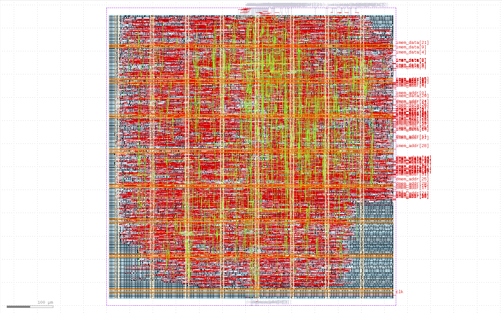
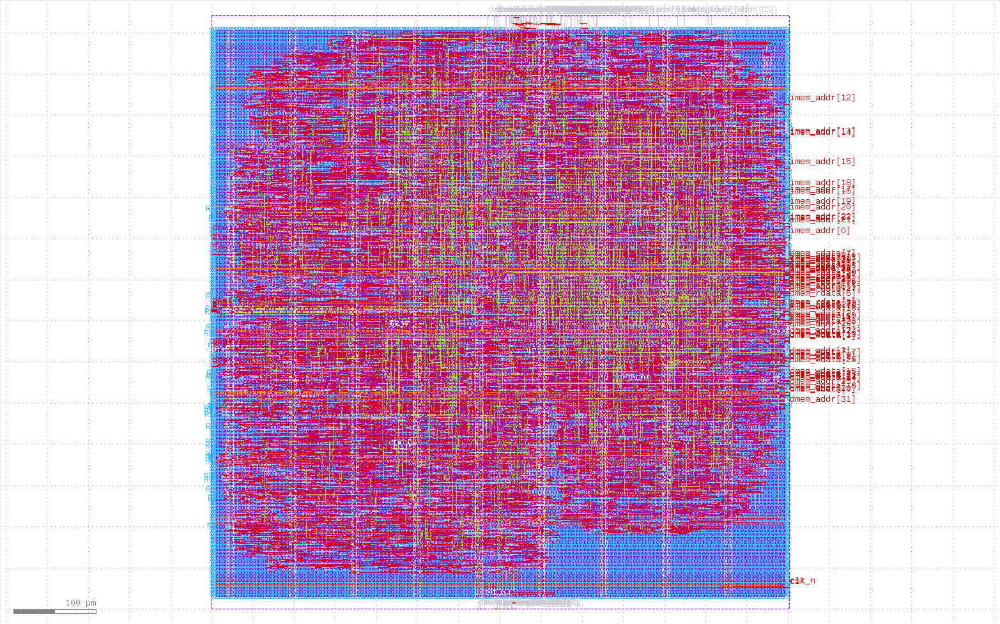
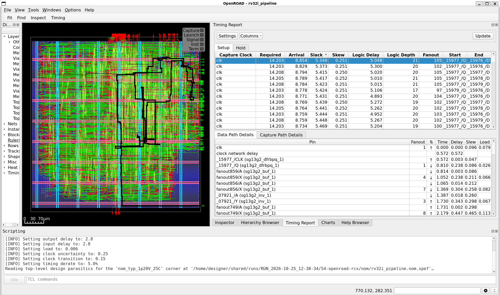

# rv32i-single-cycle

Lõi vi xử lý RV32IM single-cycle viết bằng Verilog, có CSR cơ bản và trap (chế độ Machine), kèm testbench tự kiểm tra và bộ kiểm chứng so từng lệnh với mô hình tham chiếu Python. Bản RV32I thuần đã đi qua flow RTL-to-GDS (LibreLane, PDK IHP SG13G2) đến layout GDS đạt DRC và LVS.

## Cấu trúc thư mục
| File | Nội dung |
|---|---|
| `rv32i_core.v` | Lõi RV32I single-cycle, bộ nhớ lệnh và dữ liệu nằm ngoài lõi |
| `tb_rv32i_core.v` | Testbench: nạp `prog.hex`, báo PASS/FAIL qua địa chỉ `0x1000` |
| `rv32i_pipeline.v` | Pipeline 5 tầng, RV32I thuần (xem mục Pipeline) |
| `tb_rv32i_pipeline.v` | Testbench tự kiểm tra cho pipeline, nạp `prog_base.hex` |
| `rv32im_pipeline.v` | Pipeline đầy đủ: RV32IM + CSR + trap (dùng module `rv32m` trong `rv32i_core.v`) |
| `config_pipeline.json` | Cấu hình LibreLane cho pipeline RV32I thuần (`CLOCK_PERIOD` = 14 ns, đã chạy đạt timing) |
| `config_pipeline_full.json` | Cấu hình LibreLane cho pipeline đầy đủ (`CLOCK_PERIOD` = 15 ns, đã chạy đạt timing) |
| `prog_base.hex` | Chương trình test chỉ gồm RV32I thuần (229 lệnh), dùng cho pipeline |
| `asm.py` | Assembler mini sinh `prog.hex` (823 lệnh tự kiểm tra, gồm CSR/trap và M) |
| `verify/` | Mô hình tham chiếu (ISS), bộ sinh chương trình ngẫu nhiên, so vết từng lệnh, mutation test (xem `verify/README.md`) |
| `prog.hex` | Chương trình test đã sinh sẵn |
| `config.json` | Cấu hình LibreLane (`CLOCK_PERIOD` = 24 ns) |
| `metrics.json` | Số liệu cuối của flow |

## Tập lệnh hỗ trợ
`LUI AUIPC JAL JALR`, `BEQ BNE BLT BGE BLTU BGEU`, `LB LH LW LBU LHU SB SH SW`, `ADDI SLTI SLTIU XORI ORI ANDI SLLI SRLI SRAI`, `ADD SUB SLL SLT SLTU XOR SRL SRA OR AND`.
Thêm: `FENCE`/`FENCE.I` (coi như NOP), `ECALL`, `EBREAK`, `MRET`, `CSRRW CSRRS CSRRC CSRRWI CSRRSI CSRRCI`.
Phần mở rộng M: `MUL MULH MULHSU MULHU DIV DIVU REM REMU`.

## Phần mở rộng M
- Bộ nhân/chia lặp, mỗi chu kỳ xử lý 1 bit, một lệnh M mất 34 chu kỳ (1 nhận toán hạng, 32 lặp, 1 hoàn tất). Trong lúc đó lõi giữ nguyên PC (stall).
- Bản pipeline dùng tham số `PREP = 1` của module `rv32m`: chu kỳ đầu chỉ chép toán hạng thô vào thanh ghi, chu kỳ sau mới đảo dấu từ chính các flop đó (mỗi lệnh M mất 35 chu kỳ). Lý do: toán hạng của lệnh M đã đi qua mux forwarding, nếu đảo dấu (bộ cộng 32 bit) ngay trước khi ghi thì đường `idex_fb_wb` → đảo dấu → thanh ghi nhân/chia trở thành đường tới hạn của RV32IM. Bản single-cycle giữ `PREP = 0`.
- Chọn bộ lặp thay vì nhân/chia tổ hợp 32 bit để không kéo dài đường tới hạn của lõi.
- Chia cho 0: thương toàn bit 1, dư bằng số bị chia. `INT_MIN / -1`: thương `INT_MIN`, dư 0, không trap (đúng đặc tả).
- Tín hiệu `retire` báo lệnh đã hoàn tất, testbench in vết theo tín hiệu này.

## Pipeline 5 tầng
Có hai bản, cùng cổng với `rv32i_core`:
- `rv32i_pipeline.v`: RV32I thuần. Dùng làm mốc so sánh công bằng với bản single-cycle RV32I thuần đã chạy flow.
- `rv32im_pipeline.v`: RV32IM + CSR + trap. CSR, trap và MRET xử lý ở tầng EX theo đúng thứ tự chương trình và gửi redirect như nhánh. Ở bản này `redirect` được đăng ký và áp ở chu kỳ sau (huỷ 3 lệnh phía sau, mất 3 chu kỳ), và các CSR của trap (`mepc`, `mcause`, `mtval`, `mstatus`) cũng ghi trễ 1 chu kỳ; xem mục "Đăng ký redirect ở RV32IM". Lệnh M đứng ở EX, đóng băng IF/ID/EX đến khi bộ nhân/chia xong, tầng MEM/WB vẫn chạy tiếp.

Chung cho cả hai:
- Forwarding từ EX/MEM và MEM/WB vào tầng EX, ưu tiên lệnh mới hơn. Thanh ghi đọc ở ID được bypass từ WB.
- Các tín hiệu chọn forwarding được so sánh sẵn ở tầng ID và đăng ký vào ID/EX, nên tầng EX chỉ còn mux 3 đường (cắt phần so sánh số thanh ghi khỏi đường tới hạn).
- Các trường dữ liệu của ID/EX (giá trị rs1, rs2, imm, pc, lệnh...) nạp lại mỗi chu kỳ, không bị `redirect` hay `stall` điều khiển enable, vì bong bóng đã được đánh dấu bằng `idex_valid` và các cờ điều khiển. Việc này giảm tải (fanout) của tín hiệu `redirect`, vốn nằm trên đường tới hạn.
- Các trường dữ liệu của IF/ID (`ifid_pc`, `ifid_instr`) cũng không bị `redirect` điều khiển enable, chỉ bị giữ khi stall. Lệnh bị huỷ được đánh dấu bằng `ifid_valid = 0`. Việc này sinh ra từ phân tích đường tới hạn của RV32IM có dự đoán nhánh: đường `idex_fa_wb` → so sánh nhánh → `redirect` → enable của IF/ID trượt −1,64 ns ở 15 ns.
- Load-use: dừng 1 chu kỳ rồi forward từ WB.
- Dự đoán nhánh ở tầng ID (xem mục "Dự đoán nhánh và CPI" bên dưới): JAL nhảy ngay ở ID (mất 1 chu kỳ), nhánh có điều kiện dùng bảng đếm 2 bit 64 mục, đoán sai thì phát hiện ở EX và huỷ 2 lệnh. JALR vẫn quyết định ở EX (mất 2 chu kỳ).
- Bộ nhớ lệnh và dữ liệu vẫn đọc tổ hợp ở ngoài lõi như bản single-cycle.

| Chỉ số | Single-cycle | Pipeline |
|---|---|---|
| Chu kỳ chạy `prog_base.hex` (229 lệnh, có vòng lặp) | 261 | 294 |

Pipeline chỉ đáng giá khi tần số tối đa tăng nhiều hơn tỷ lệ CPI tăng so với single-cycle. Số CPI đo trên benchmark nằm ở mục dưới, Fmax nằm ở bảng so sánh flow.

```
python3 asm.py prog_base.hex --base
iverilog -g2012 -o sim_pipe.vvp rv32i_pipeline.v tb_rv32i_pipeline.v
vvp sim_pipe.vvp
```
Kết quả đúng: `[TB] PASS sau 294 chu ky`.
Bản đầy đủ:
```
iverilog -g2012 -DPIPE_FULL -o sim_pipem.vvp rv32im_pipeline.v rv32i_core.v tb_rv32i_pipeline.v
vvp sim_pipem.vvp +prog=prog.hex
```
Kết quả đúng: `[TB] PASS sau 2423 chu ky`.

## CSR và trap (chế độ Machine)
- CSR: `mstatus` (MIE, MPIE; MPP cố định 11), `misa` (chỉ đọc giá trị RV32I), `mtvec` (chế độ trực tiếp), `mscratch`, `mepc`, `mcause`, `mtval`, `mhartid`.
- Trap: lệnh bất hợp lệ (cause 2), `EBREAK` (3), `ECALL` (11), nhảy tới địa chỉ không chia hết cho 4 (0), load lệch địa chỉ (4), store lệch địa chỉ (6; `mtval` = địa chỉ vi phạm). Lệnh gây trap không ghi thanh ghi hay bộ nhớ.
- Truy cập CSR không tồn tại, hoặc ghi vào CSR chỉ đọc, là lệnh bất hợp lệ.
- Giải mã chặt: các trường `funct7`/`funct3`/`rd`/`rs1` sai giá trị quy định đều gây trap.
- Chưa có ngắt. `FENCE` giữ vai trò NOP (đúng với lõi in-order, bộ nhớ đồng bộ một cổng). Bản `rv32i_pipeline.v` là RV32I thuần, không có trap nên không kiểm tra căn chỉnh; chương trình test của nó chỉ truy cập đúng căn chỉnh.

## Mô phỏng
Cần `python3` và Icarus Verilog (`iverilog`, `vvp`).
```
python3 asm.py prog.hex
iverilog -g2012 -o sim.vvp rv32i_core.v tb_rv32i_core.v
vvp sim.vvp
```
Kết quả đúng: `[TB] PASS sau 2260 chu ky`, Fibonacci(10) = 55 được ghi vào địa chỉ `0x300`.
Xem sóng bằng `gtkwave rv32i_core.vcd`.

## Chương trình test gồm
- ALU thanh ghi và immediate
- LUI, AUIPC
- Load/store byte, halfword, word (có dấu và không dấu)
- 6 loại nhánh, mỗi loại thử cả taken và not-taken
- JAL, JALR
- Vòng lặp Fibonacci
- MUL/DIV với đáp án tính tay: dấu, làm tròn về 0, chia cho 0, tràn số, lệnh M liên tiếp
- Các thao tác CSR, ECALL/EBREAK, các loại lệnh bất hợp lệ, nhảy không căn chỉnh, MRET và trạng thái `mstatus` qua trap

## Chạy flow
Chạy LibreLane với `config.json` trong môi trường có sẵn PDK IHP SG13G2 (ví dụ image `isaiassh/unic-cass-tools`). Kết quả nằm trong thư mục `runs/` do LibreLane sinh ra.

## Dự đoán nhánh và CPI

Bản đầu của pipeline quyết định mọi lệnh nhảy ở EX nên mỗi lệnh nhảy thực hiện đều mất 2 chu kỳ. Bản hiện tại thêm bộ dự đoán ở tầng ID:
- JAL nhảy ngay ở ID, huỷ 1 lệnh ở IF (mất 1 chu kỳ thay vì 2).
- Nhánh có điều kiện: bảng đếm bão hoà 2 bit, 64 mục, chỉ số lấy từ `pc[7:2]`, khởi tạo "yếu, không nhảy". Đoán "nhảy" thì nhảy ngay ở ID (mất 1 chu kỳ), đoán "không nhảy" thì chạy tiếp (không mất chu kỳ nào).
- Đoán sai phát hiện ở EX (so kết quả nhánh với dự đoán đã mang theo qua ID/EX), huỷ 2 lệnh. Đích khi đoán sai chọn theo dự đoán chứ không theo kết quả so sánh, nên tín hiệu `redirect_pc` không nằm sau bộ so sánh.
- Đích nhảy sớm là `pc + imm` tính đúng ở ID, không dùng BTB hay tag. Vì vậy đoán sai chỉ làm chậm, không bao giờ làm sai kết quả, và không cần so sánh tag 30 bit.
- Bảng đếm cập nhật trễ 1 chu kỳ qua thanh ghi giữa EX và MEM, để kết quả so sánh nhánh không phải điều khiển enable của 128 flip-flop (cùng bài học với `redirect` trước đây).
- JALR chưa được dự đoán.

Đo bằng `bench/` (5 bài: sắp xếp nổi bọt 48 phần tử, sàng nguyên tố đến 600, CRC32 theo bit trên 128 byte, cộng ma trận 12x12, tìm nhị phân lặp lại; biên dịch bằng `riscv64-unknown-elf-gcc -O2`, RV32I thuần). Checksum 5 bài khớp giữa cả 3 lõi và khớp số nguyên tố đã biết (109 số dưới 600).

| | Single-cycle | Pipeline, đứng yên (cũ) | Pipeline RV32I, có dự đoán | Pipeline RV32IM, có dự đoán, redirect đăng ký |
|---|---|---|---|---|
| Chu kỳ | 33 118 | 46 917 | 42 744 | 43 737 |
| Lệnh hoàn tất | 33 118 | 33 117 | 33 117 | 33 117 |
| CPI | 1,000 | 1,416 | 1,290 | 1,320 |

Dự đoán giảm 8,9% số chu kỳ so với bản cũ. Pipeline vẫn chậm hơn single-cycle 1,29 lần về chu kỳ, nên chỉ có lợi khi Fmax tăng nhiều hơn 1,29 lần. Chạy lại: `sh bench/run_bench.sh`.

Kiểm chứng phần dự đoán: sinh thêm đơn vị vòng lặp có giới hạn vào bộ chương trình ngẫu nhiên (nếu không, mỗi nhánh chỉ chạy một lần và bảng đếm không bao giờ học), thêm 8 mutation riêng cho dự đoán (đích đoán sai, thiếu một chiều đoán sai, nhảy sớm khi đang stall load-use, nhảy sớm đè lên redirect của EX, nhảy sớm khi lệnh M đóng băng EX, ...). Cả 8 đều bị bắt. Riêng mutation chỉ làm giảm hiệu năng (ví dụ không cập nhật bảng đếm) không thể bị bắt bằng so sánh kết quả, vì thiết kế đã bảo đảm đoán sai không đổi kết quả; hiệu năng được kiểm bằng CPI ở trên.

### Đăng ký redirect ở RV32IM

Ở RV32IM có dự đoán, flow 15 ns trượt setup vì `redirect` (sau bộ so sánh nhánh, khoảng 10 ns) phải đi qua khoảng 13 tầng buffer mới tới `pc` và các thanh ghi bị huỷ. Lần sửa lần lượt:
- Các cờ điều khiển ID/EX chỉ bị `stall` xoá, `redirect` chỉ xoá `idex_valid`: slack góc chậm từ -2,50 ns lên -2,15 ns.
- `redirect` và `redirect_pc` được lưu vào `redirect_q`/`redirect_pc_q` và áp ở chu kỳ sau; lệnh nằm ở EX trong chu kỳ đó bị vô hiệu qua `idex_valid = idex_valid_r & ~redirect_q`. Slack lên -0,26 ns, chỉ còn 1 endpoint trượt (`mtval_r`).
- Endpoint đó do `trap_ex` (phụ thuộc kết quả so sánh khi đích nhánh lệch) điều khiển enable của các CSR trap, nên các CSR này cũng ghi trễ 1 chu kỳ qua `trap_q`. Lệnh ở EX chu kỳ sau đã bị huỷ và lệnh đầu của trình xử lý trap tới EX sau ít nhất 3 chu kỳ, nên hành vi không đổi. Flow 15 ns sau thay đổi này đạt: slack góc chậm +0,79 ns.

Cái giá: phạt khi đoán sai, JALR, trap và MRET tăng từ 2 lên 3 chu kỳ, CPI bench từ 1,290 lên 1,320 (+2,3 %), thêm khoảng 67 flip-flop. Các thay đổi được kiểm bằng 200 chương trình ngẫu nhiên, riscv-tests (rv32ui, rv32um) và 4 mutation mới. RV32I không đổi.

### Kết quả flow của bản có dự đoán (RV32I, 14 ns)

| Hạng mục | Chưa có dự đoán | Có dự đoán |
|---|---|---|
| Setup slack, góc chậm | +0,216 ns | +2,02 ns |
| Chu kỳ tối thiểu | 13,78 ns | ≈ 11,98 ns (≈ 83,5 MHz) |
| Số instance | 33.372 | 36.466 (+9 %) |
| Diện tích instance | 375.352 µm² | 413.937 µm² (+10 %) |
| Công suất ước tính | 11,11 mW | 13,08 mW |

Số liệu có dự đoán là của bản đã tách dữ liệu IF/ID khỏi `redirect` (xem mục cải tiến bên dưới), nên Fmax tăng đến từ cả hai thay đổi chứ không riêng bộ dự đoán.

### Kết quả flow của bản có dự đoán (RV32IM, 15 ns)

| Hạng mục | Chưa có dự đoán | Có dự đoán, redirect đăng ký |
|---|---|---|
| Setup slack, góc chậm | +0,441 ns | +0,792 ns |
| Chu kỳ tối thiểu | 14,56 ns | ≈ 14,21 ns (≈ 70,4 MHz) |
| Số instance | 42.064 | 46.464 (+10 %) |
| Diện tích instance | 474.858 µm² | 532.973 µm² (+12 %) |
| Công suất ước tính | 21,51 mW | 14,17 mW |
| Vi phạm Max Slew | 7 | 0 |

Thời gian chạy bộ benchmark: 43.737 chu kỳ × 14,21 ns ≈ 621 µs so với 46.917 chu kỳ × 14,56 ns ≈ 683 µs, tức nhanh hơn khoảng 1,10 lần, đổi lại diện tích tăng 12 %. Công suất ước tính giảm nhưng dùng hoạt động chuyển mạch mặc định của công cụ, nên mức giảm này chưa giải thích được và không nên dùng để kết luận. Số liệu: `results/metrics_rv32im_15ns_bp.json`.

## Kết quả flow (clock 24 ns)
Số liệu dưới đây đo trên bản RV32I thuần, trước khi thêm CSR, trap và M. Chưa chạy lại flow cho bản hiện tại (diện tích sẽ tăng, nhất là do bộ nhân/chia).

| Hạng mục | Giá trị |
|---|---|
| Setup slack, góc chậm (1,08 V, 125 °C) | +0,587 ns |
| Setup slack, góc điển hình (1,20 V, 25 °C) | +5,606 ns |
| Setup slack, góc nhanh (1,32 V, -40 °C) | +8,624 ns |
| Hold slack tồi nhất | +0,134 ns |
| Lỗi DRC (route / Magic / KLayout) | 0 / 0 / 0 |
| Lỗi LVS | 0 |
| Lỗi antenna (net / pin) | 0 / 0 |
| Số instance | 28.775 |
| Công suất tổng (ước tính) | 4,21 mW |

Ở clock 20 ns thiết kế không đạt setup ở góc chậm (slack -1,813 ns), nên chu kỳ được nới lên 24 ns.

## So sánh single-cycle và pipeline (cùng PDK, cùng flow, SDC mặc định)

| Hạng mục | Single-cycle RV32I | Pipeline RV32I | Pipeline RV32IM | Pipeline RV32IM, có dự đoán |
|---|---|---|---|---|
| Clock chạy flow | 24 ns | 14 ns | 15 ns | 15 ns |
| Setup slack, góc chậm | +0,587 ns | +0,216 ns | +0,441 ns | +0,792 ns |
| Hold slack tồi nhất | +0,134 ns | +0,099 ns | +0,121 ns | +0,106 ns |
| Chu kỳ tối thiểu | 23,0 ns (ngoại suy), ≈ 43 MHz | 13,78 ns, ≈ 72,6 MHz | 14,56 ns, ≈ 68,7 MHz | 14,21 ns, ≈ 70,4 MHz |
| Số instance | 28.775 | 33.372 (+16 %) | 42.064 (+46 %) | 46.464 (+61 %) |
| Diện tích instance | không ghi lại | 375.352 µm² | 474.858 µm² | 532.973 µm² |
| Công suất ước tính | 4,21 mW (24 ns) | 11,11 mW (14 ns) | 21,51 mW (15 ns) | 14,17 mW (15 ns) |
| DRC (route / Magic / KLayout), LVS, antenna | 0 / 0 / 0 | 0 / 0 / 0 | 0 / 0 / 0 | đạt cả ba |

Cách đọc:
- Pipeline RV32I có tần số tối đa cao hơn single-cycle khoảng 1,67 lần (23,0 / 13,78). CPI của pipeline cao hơn khoảng 1,21 lần (1,22 so với 1,01 trên chương trình ngẫu nhiên dày phụ thuộc dữ liệu), nên thời gian chạy thực tế nhanh hơn khoảng 1,4 lần, đổi lại diện tích tăng 16 %.
- Thời gian chạy bộ benchmark trong `bench/`: pipeline RV32I có dự đoán 42.744 chu kỳ × 11,98 ns ≈ 512 µs, single-cycle 33.118 chu kỳ × 23,0 ns ≈ 762 µs, tức nhanh hơn khoảng 1,49 lần. Vế single-cycle dùng Tmin ngoại suy nên con số này chỉ mang tính ước lượng.
- Chu kỳ tối thiểu của pipeline được tính bằng chu kỳ chạy trừ slack góc chậm. Với RV32IM, run 20 ns (slack +5,441 ns) và run 15 ns (slack +0,441 ns) cho cùng một kết quả 14,56 ns, nên phép tính này đáng tin với pipeline. Với single-cycle, đường vào ra chiếm ưu thế (độ dốc khoảng 0,6) nên 23,0 ns chỉ là ngoại suy từ hai lần chạy (20 ns: -1,813 ns; 24 ns: +0,587 ns).
- Không có số liệu flow của single-cycle RV32IM, nên cột RV32IM chỉ so được với pipeline RV32I.
- Công suất ở các chu kỳ khác nhau không so sánh trực tiếp được.
- SDC là SDC mặc định của flow (độ trễ vào ra 20 % chu kỳ). Mô phỏng gate-level mới ở mức chức năng (xem mục bên dưới).
- Run RV32IM và RV32I chưa có dự đoán còn cảnh báo Max Slew ở góc chậm (nom_slow_1p08V_125C). Đây là vi phạm ràng buộc điện, không làm flow dừng nhưng chưa được xử lý. Hai run có dự đoán (RV32I 14 ns, RV32IM 15 ns) không còn vi phạm Max Slew.

### Cải tiến đã giúp giảm chu kỳ
- Tính sẵn các tín hiệu chọn forwarding ở tầng ID rồi đăng ký vào ID/EX (RV32I: từ ≈ 17,6 ns xuống 15,49 ns).
- Các trường dữ liệu của ID/EX không còn bị `redirect` và `stall` điều khiển enable. Tín hiệu `redirect` trước đó phải đi tới khoảng 250 flip-flop. RV32IM giảm từ ≈ 21,4 ns xuống 14,56 ns, RV32I từ 15,49 ns xuống 13,78 ns.
- Các trường dữ liệu của IF/ID (`ifid_pc`, `ifid_instr`) cũng không còn bị `redirect` điều khiển enable, chỉ bị giữ khi stall; lệnh bị huỷ được đánh dấu bằng `ifid_valid`. RV32I có dự đoán đạt ≈ 11,98 ns nhờ thay đổi này. Với RV32IM thì đường tới hạn dời sang chỗ khác và chưa giải quyết xong.

## Hình ảnh kết quả

Layout cuối (KLayout), pipeline RV32I, 14 ns:



Layout cuối (KLayout), pipeline RV32IM, 15 ns:



Đường tới hạn (OpenROAD GUI), pipeline RV32I. Báo cáo trong ảnh dùng góc điển hình (nom_typ_1p20V_25C), nên slack trong ảnh (+5,348 ns) lớn hơn slack góc chậm trong bảng (+0,216 ns). Điểm đáng chú ý: điểm xuất phát có fanout 105, tức là cây buffer cho tín hiệu điều khiển chiếm phần lớn độ trễ.



## Kiểm chứng bằng bộ test ISA chính thức (riscv-tests)

Ngoài ISS Python tự viết, 3 core được chạy trên bộ `riscv-tests` chính thức của RISC-V International (rv32ui và rv32um), để không chỉ tự kiểm bằng mô hình do cùng một người viết.

| Core | PASS | FAIL | Bỏ qua |
|---|---|---|---|
| Single-cycle (RV32IM) chạy rv32ui | 40 | 0 | 10 |
| Pipeline RV32I | 40 | 0 | 10 |
| Pipeline RV32IM (rv32ui + rv32um) | 48 | 0 | 2 |

- Số "bỏ qua" của single-cycle và pipeline RV32I gồm 8 test rv32um (hai core này được chạy với rv32ui) và 2 test dưới đây.
- Bỏ qua `fence_i` (cần Zifencei, core không hỗ trợ) và `ma_data` (kiểm tra truy cập lệch được phần cứng xử lý, còn core này chủ động bẫy cause 4/6).
- Môi trường test là bản tối giản tự viết (`riscv-tests/riscv_test.h`, `link.ld`): không khởi tạo PMP/satp, kết quả ghi vào địa chỉ `0x00100000`. Không dùng được env gốc vì core chỉ có tập CSR M-mode nhỏ.
- Đã kiểm tra harness bắt được lỗi: cố tình đổi SLT thành so sánh không dấu thì `slt`/`slti` fail, phá forwarding thì 34/40 test fail.

Chạy lại:

```
git clone --recursive https://github.com/riscv-software-src/riscv-tests
python3 riscv-tests/run_riscv_tests.py riscv-tests
```

Cần `gcc-riscv64-unknown-elf` và `iverilog`.

## Mô phỏng gate-level (netlist pipeline sau P&R)

Netlist cuối của hai lõi pipeline có dự đoán (RV32IM 15 ns: 46.464 cell; RV32I 14 ns: 36.466 cell, cùng run cho số liệu flow ở trên) được mô phỏng bằng iverilog với mô hình cell IHP SG13G2, dùng nguyên các testbench của RTL:

| Bài | RTL | Netlist sau P&R |
|---|---|---|
| RV32IM: `prog.hex` (RV32IM + CSR + trap) | PASS, 2.479 chu kỳ | PASS, 2.479 chu kỳ |
| RV32IM: bộ benchmark `bench/` | 43.737 chu kỳ | 43.737 chu kỳ, cùng 5 checksum |
| RV32IM: riscv-tests (rv32ui, rv32um) | 48 PASS | 48 PASS |
| RV32I: `prog_base.hex` | PASS, 294 chu kỳ | PASS, 294 chu kỳ |
| RV32I: bộ benchmark `bench/` | 42.744 chu kỳ | 42.744 chu kỳ, cùng 5 checksum |
| RV32I: riscv-tests (rv32ui) | 40 PASS | 40 PASS |

Hai điểm cần biết khi chạy:
- Mô hình flip-flop của IHP lấy D/CLK/RESET_B qua các dây `delayed_*` chỉ được nối trong khối `specify`, iverilog không nối nên mọi flip-flop ra X. `gls/make_func_lib.py` tạo bản sao thư viện có `assign delayed_X = X;` (file PDK gốc không bị sửa).
- Testbench cũ nhả reset ngay tại cạnh lên của clock nên RTL và netlist lệch nhau 1 chu kỳ do chạy đua. Nay reset được nhả ở cạnh xuống, RTL và netlist khớp từng chu kỳ; số chu kỳ RTL không đổi.

Đây là mô phỏng chức năng, chưa có độ trễ thật (chưa nạp SDF), nên nó kiểm việc tổng hợp và P&R không làm sai logic chứ không kiểm timing; timing do STA của flow đảm nhận. Chạy lại (trong container có PDK):
```
cp runs/RUN_.../final/nl/rv32im_pipeline.nl.v gls/      # hoặc rv32i_pipeline.nl.v, script tự nhận diện
sh gls/run_gls.sh gls/rv32im_pipeline.nl.v
GLS_FILES="gls/rv32im_pipeline.nl.v gls/build/sg13g2_stdcell_func.v $PDK_ROOT/ihp-sg13g2/libs.ref/sg13g2_stdcell/verilog/sg13g2_udp.v" python3 riscv-tests/run_riscv_tests.py <thu_muc_riscv-tests>
```

## Giới hạn
- Chưa có ngắt, chưa có chế độ User
- JALR chưa được dự đoán; bảng đếm đơn giản, chưa có BTB hay bộ dự đoán lịch sử toàn cục
- Bộ nhân/chia lặp nên lệnh M chậm (34 chu kỳ ở single-cycle, 35 ở pipeline); chưa có bộ nhân nhanh
- Mô hình tham chiếu và RTL do cùng một người viết; đã bổ sung riscv-tests (rv32ui, rv32um) nhưng chưa đối chiếu lock-step với Spike
- Công suất dùng hoạt động chuyển mạch mặc định của công cụ, chỉ mang tính ước tính
- Hai lõi pipeline khác nhau ở cách xử lý redirect: RV32IM đăng ký redirect (phạt 3 chu kỳ) mới đạt timing, RV32I vẫn áp redirect ngay (phạt 2 chu kỳ)
- Chu kỳ tối thiểu của single-cycle là ngoại suy từ hai lần chạy, và công suất ở các chu kỳ khác nhau không so sánh trực tiếp được
- Mô phỏng gate-level chỉ ở mức chức năng (không SDF), làm cho hai lõi pipeline, chưa làm cho single-cycle; flow dùng SDC mặc định
